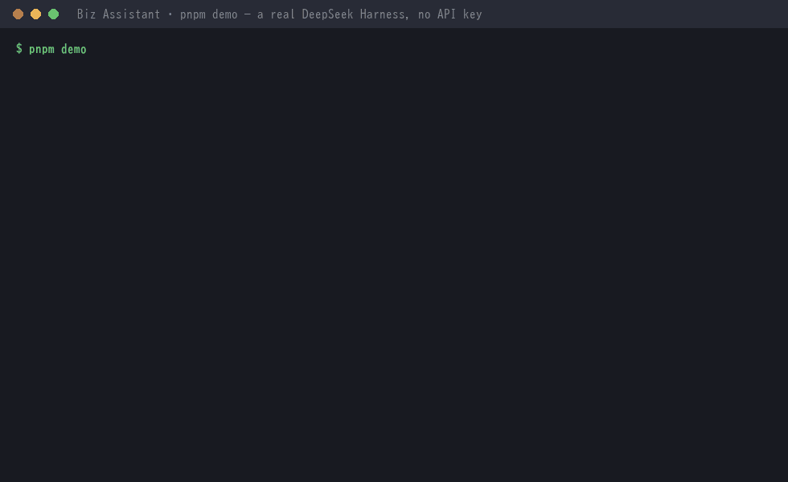

# Biz Assistant Framework

**公式サイト：[biz-ai.myaiportal.net](https://biz-ai.myaiportal.net/)**

[](https://biz-ai.myaiportal.net/)
[](LICENSE)
[](https://github.com/deepseek-ai/deepseek-harness)
[](packages/protocol)
[](package.json)
[](https://www.npmjs.com/org/dsh-bridge)

[English](README.md) · **日本語** · [简体中文](README.zh-CN.md)

**あらゆる IT システムを、考えて動く AI 社員の職場に。**<br>
Every IT system, a workplace of AI employees that think and act. · 让每一个 IT 系统，都成为会思考、会行动的 AI 员工的职场。

[導入 skill](#導入-skill-で業務システムに組み込む) ·
[クイックスタート](#クイックスタート) ·
[開発ガイドライン](docs/GUIDELINE.md) ·
[技術解説](docs/slides/manual/biz-assistant-framework-technical-guide.md) ·
[Discussions](https://github.com/ITC-cloud-soft/biz-ai/discussions) ·
[Issues](https://github.com/ITC-cloud-soft/biz-ai/issues)

Bizアシスタント（Biz Assistant、パッケージ `@dsh-bridge/*`）は、登録・照会・更新を「待つ」だけだった業務システムに、小さな **ブリッジ** を足す。
すると **AI 社員** が生まれ、職員一人ひとりのチャット（Slack、LINE、Teams、WeCom、Feishu、…）で
**知らせ、頼み、下書きし、覚える**。業務ロジックの書き換えは不要。決めるのは、いつも人。

**52** 適合性テストの項目（Bridge v1） · **9** AI 面のプラグイン · **12** 個人ボットで使えるチャット ·
**0** AI が確定・承認・支払う操作

**モデルは選べます。** DeepSeek は既定値にすぎません。会話のモデルは DSH の Models 画面で、OpenAI・Azure OpenAI・Anthropic・DeepSeek・OpenAI 互換のゲートウェイ・自社で動かすサーバー（vLLM など）から選べます（DSH に同梱の `dsh-llm-pi-ai` アダプター）。Bridge v1 そのものは、どのモデルにも依存しません。下のデモは台本どおりに答えるモデルを使うので、API キーは要りません。

## 3 分で動かしてみる

API キーもチャットのアカウントも要りません。例の業務システム（設備点検、架空のデータ）と framework のプラグインが、
**本物の DeepSeek Harness** の上で、台本どおりに答えるモデルとモックの LINE を相手に動きます。必要なのは Node 22.19 以上・pnpm・Docker です。
DSH CLI は初回に、固定した版（0.2.2-rc.1）をチェックアウト内の `.dsh-cli/` に入れます（2 分ほど）。グローバルに入れた DSH には触りません。

```sh
git clone https://github.com/ITC-cloud-soft/biz-ai.git && cd biz-ai
pnpm install
pnpm demo        # Docker で使い捨ての PostgreSQL。会話の記録とシナリオごとの PASS / FAIL を表示
```

**手元の準備なしで：** [GitHub Codespaces で開いて](https://codespaces.new/ITC-cloud-soft/biz-ai) `pnpm demo` を実行します（dev container に Node 24・pnpm・PostgreSQL が入っています）。**Docker なしで：** 手元の PostgreSQL を指定します。`FW_TEST_DATABASE_URL=postgres://<user>:<password>@127.0.0.1:5432/postgres pnpm demo`（一時的なデータベースを作り、終わったら消します）。



表示される会話の一部です。職員が尋ね、システムが気づき、AI 社員が決める人に頼み、人が決めます。

```text
manager（設備責任者） ▶ 期限切れの点検は？
  AI 社員 ▶ manager（設備責任者）
    │ 期限切れの点検は 1 件です（FE-002）。

業務システム ▶ (業務システム：点検の期限切れを検出（inspection.overdue）)
  AI 社員 ▶ inspector1（点検員）  ［自分から］
    │ 【対応のお願い】点検期限の超過
    │ お疲れさまです。点検期限を 3 日過ぎた設備があります（期限 2026-11-11）。…
    │ [ 業務 Web を開いて対応 ]

inspector1（点検員） ▶ (アプリで修理依頼を登録（見積 12000 円）)
  AI 社員 ▶ manager（設備責任者）  ［自分から］
    │ 【承認のお願い】修理依頼の承認  設備コード FE-002 · 見積額 12000円
    │ 文字で返信する場合：「承認 321904」／「差戻 321904 理由」
    │ [ 承認 ] [ 差戻 ] [ 業務Webで詳細を見る ]

manager（設備責任者） ▶ (カードの［承認］を押す)
  AI 社員 ▶ manager（設備責任者）
    │ 承認しました。ありがとうございます。結果はカードにも反映します。
```

**DeepSeek Harness を使っている方へ：** AI 面は `@dsh-bridge/dsh-core` の上の普通の dsh プラグイン（`plugins/*`、`@dsh-bridge/plugin-*`）です。
本人確認、manifest から作るツール、イベント、通知、承認、アシスタント、記憶、人物設定、書類の読み取り。
多くの dsh プラグインはコードを書くためのものですが、これは dsh のエージェントが**業務システムの中で、職員本人の権限で**働くためのものです。npm では [`@dsh-bridge/*`](https://www.npmjs.com/org/dsh-bridge)。DSH home へは、製品の設定ごと profile の雛形
（`node profile/scripts/install.mjs`、クイックスタート参照）で入れます。

## 記録する道具から、一緒に働く同僚へ

| 時代 | システム | 人 |
|---|---|---|
| 記録 | 台帳と入力 | 人がデータを入れ、人が探す |
| 画面 | CRUD と業務ロジック — 人が画面を開くまで待っている | 画面を開いて確かめ、承認のために担当者を追いかけ、報告書のためにデータを集める |
| **知能** | **AI 社員が変化に先に気づき、関係する人にだけ知らせ、適任者に頼み、進まなければ催促し、朝と夕方にまとめる** | **チャットで決める — 承認はワンタップ** |

AI 社員は、**職員一人ひとりの権限の範囲で** 働く AI アシスタント：

- **考える** — 本人の権限の範囲で業務データを読み、いま大事なことを見分け、計画書や修正の案を提案として下書きする。
- **覚える** — 一人ひとりの好みと用件、組織の手順や決めごと、前の会話。個人情報は覚えない。
- **自分から動く** — 変化を見張り、関係する人にだけ知らせ、適任者に頼み、進まなければ催促し、定時にまとめる。

**AI は読む・提案する。確定・承認・金額の決定は、いつも人** — プロンプトではなく、コードと
設定で守る。

## 仕組み

業務システムは、そのまま **正本**。AI 社員は、ブリッジの向こうで働く。業務面と AI 面を、
**Bridge v1**（版の付いた小さな HTTP プロトコル、OpenAPI 3.1）と **manifest**（機械が読めるシステムの
自己紹介：役割、event、メッセージの雛形、tools、playbooks、報告）でつなぐ。

1. 業務の変化とその event を、業務と **同じトランザクション** で記録する（outbox）。
2. 誰に届けるかを **業務システムが** 決める — Web 画面と同じ判定で。
3. AI 社員が **本人の権限で** 読み、案を出す。
4. 人がチャットで決め、結果は **業務システムに** 記録される。

**旧いシステムにも、新しいシステムにも** 使える。ただし、何も変えずにつながるわけではない。最初の診断で、
業務システムが足すもの（13 項目、後述）を一覧にする。

## 導入 skill で業務システムに組み込む

いちばん早い導入方法は、このリポジトリに同梱の skill を使って AI コーディングエージェントに組み込みを任せること：
[`docs/skill/biz-assistant-integration`](docs/skill/biz-assistant-integration/SKILL.md)。skill はエージェントを
**診断 → 計画 → 実装 → 検証** の順に導き、このリポジトリの文書を正本として使い、あなたが決めるべきことがあれば
その都度止まって尋ねる。

### 1. skill を入れる

必要なものは、AI コーディングエージェント（[Claude Code](https://claude.com/claude-code) または Markdown の手順書を読めるほかのエージェント）、
Node 22.19+ と pnpm 10、つなぎたい業務システムのリポジトリ（新規システムなら空のリポジトリ）。

```sh
git clone https://github.com/ITC-cloud-soft/biz-ai.git

# 自分用に、すべてのプロジェクトで
cp -r biz-ai/docs/skill/biz-assistant-integration ~/.claude/skills/

# またはチーム用に、業務システムのリポジトリの中へ（システムと一緒に commit する）
cp -r biz-ai/docs/skill/biz-assistant-integration <your-system>/.claude/skills/
```

Windows（PowerShell）では：`Copy-Item -Recurse biz-ai\docs\skill\biz-assistant-integration "$HOME\.claude\skills\"`。
ほかのエージェントでは、まず `SKILL.md` を読ませ、必要になったときに `references/` の下のファイルを読ませる。

### 2. 頼む

業務システムのリポジトリでエージェントを開き、自分の言葉で頼む — 次のような依頼で skill が使われる：

```text
Integrate Biz Assistant Framework into this system.
この業務システムに Bizアシスタントを導入して。最初は請求の承認から。
把 biz assistant framework 导入这个既有系统，先从巡检超期提醒开始。
```

現場からのヒント：**ひとつの業務から始める**（請求の承認、期限の超過、…）。既存の画面と並べて動かし、それから広げる。

### 3. エージェントがすること

| 手順 | 何をするか | 確かめ方 |
|---|---|---|
| 1 診断と計画 | ログイン、職員と役割、API、トランザクション、バッチ処理を読み、13 項目のチェックリストを埋め（ある / 足す / 別名）、進め方を選び、雛形から `integration-plan.md` を書く | あなたが確認する計画 |
| 2 Manifest | 役割と委託の上限、event と payload の許可リスト、メッセージ、tools、playbooks、報告 | `bridge-validate manifest --strict` が 0 で終わる |
| 3 業務側 | hooks `employees` · `authenticate` · `isSessionLive` · `recipientsFor` · `approvals` · `proposalKinds` · `reports` · `piiScan`。AI の書込みは提案だけ | あなたのテスト |
| 4 Event | 業務の行と `emitEvent` を同じトランザクションで | あなたのテスト |
| 5 適合性テスト | TEST 環境に対して 52 項目 | `52 passed, 0 known gaps, 0 skipped` |
| 6 AI 面 | 雛形からの DSH product profile、registry、ボット、送信の設定は閉じたまま | profile の検査 |
| 7 Web と BFF | SNS 連携、通知の設定、承認、AI の提案、AI 社員のプロフィール画面。gateway | 型検査、画面 |
| 8 自動タスク | 委託の分類と playbooks を有効にする | profile の検査 |
| 9 任意の機能 | マニュアルからの使い方の回答、長期記憶、添付ファイル、外部連携、スキャンした文書 | 機能ごと |
| 10 完了の確認 | 上の検査をすべてコマンドで再実行し、結果を報告する。確かめていないことは「未確認」と報告する | 最終チェックリスト |

エージェントはまず、次の進め方からひとつを選ぶ（明らかでないときは診断結果を見せる）：

| あなたの状況 | 進め方 |
|---|---|
| 新規システム | `server-kit` の上で作る — 書くのは業務コード、hooks、manifest、画面 |
| 既存、Node.js、コードを変えてよい | `createBridgeApp` をサーバーにマウントし、hooks を既存のテーブルと関数につなぐ |
| 既存、同等の API がすでにある | `/bridge/v1` を既存ルートの別名として提供し、足りないものだけを足す |
| 既存、別の言語 | `packages/protocol/openapi/bridge-v1.yaml` を実装し、conformance suite（適合性テスト）で確かめる |
| 既存、コードを一切変えない | 外付けモード（試行）：別のブリッジサービス。IdP、本人として呼べる API、変化の知らせ、承認 / 書込みの API が必要 |

### 4. あなたが決めること

skill は次のことを推測で決めない。選択肢と推奨を計画に書き、あなたの判断を待つ：最初の業務と
AI が読んでよいもの（tools と役割、役割ごとに `none | read | propose`）、どの event を誰に知らせるか、どの提案があり誰が
採用できるか、自動タスクの委託、開ける送信の設定（理由つき）、チャットと AI モデル、どの
任意の機能を使うか。

また、作業中もフレームワークの規則を守る：フレームワーク自体（`packages/*`、`plugins/*`、`vendor/*`、
`profile/template`）は決して編集しない。AI は読むと提案だけ。受信者は業務システムが決める。event やメッセージに個人情報を載せない。
SNS 連携は本人だけが、業務システム自身のログインを通して行う。秘密情報をリポジトリ・設定・ログ・チャットに置かない。テストは架空の
データと TEST 環境だけで行う。そして「何も変えずにつながる」とは決して言わない。

skill（英語、`SKILL.md` + 10 の references + 計画の雛形）は [`docs/GUIDELINE.md`](docs/GUIDELINE.md) の上の道案内で、
詳細は常にリポジトリから取る。内容：[`docs/skill/README.md`](docs/skill/README.md)。
手で進めたい場合は [`docs/GUIDELINE.md`](docs/GUIDELINE.md) を読む — まずは
[「既存の業務システムをつなぐ：チェックリスト」](docs/GUIDELINE.md#既存の業務システムをつなぐチェックリスト) から — そして
[見本の業務システム](examples/equipment-inspection/README.md)（52 / 52）も。

## 中身

業務システムは記録の正本のまま。業務システムが足すのはブリッジ：Bridge v1、manifest、業務システム自身の
ログインでの SNS 連携、業務システム自身が決める受信者の規則。残りはフレームワークが用意する — DSH ランタイムとその IM チャネル、
プラグイン（職員の IM アカウントを連携する（各職員は自分のアカウントだけを、組織のボットか自分の個人ボットで連携する）、
職員本人に委託された権限で業務 tools を呼ぶ（読むと提案だけ — 決めるのは人）、通知と承認カードを
**業務システムが指名した人にだけ** 届ける、業務 event で自動タスクを動かす（分類ごと・本人ごとの委託）、
定時報告を本人のチャットに送る、業務 Web のアシスタントパネルからの質問に答える）、AI から IM へのすべての
経路のガード、テストと conformance suite（適合性テスト）。

AI 社員には **会社が決めた名前と人柄** があり（呼び名、口調、会社紹介 — 署名は常に
AI 秘書として、規則を変えることはできない）、**長期記憶** を持ち（職員ごとの好みと用件、組織の
手順、前の会話の想起。個人情報は残さない）、**システム自身のマニュアルから使い方の質問に答え**、
該当する画面へのリンクを添える（後述の各節）。

フレームワークは、最初の利用者である介護請求システム（ケアビリング）から切り出した（`examples/care-billing/`：manifest と対応表だけで、
業務コードは含まない）。

## ディレクトリ構成

| パス | パッケージ | 内容 |
|---|---|---|
| `packages/protocol` | `@dsh-bridge/protocol` | Bridge v1：OpenAPI、manifest / event の JSON Schema、検証器、conformance suite（適合性テスト）、`bridge-validate` CLI |
| `packages/dsh-core` | `@dsh-bridge/dsh-core` | DSH 側のコア：アプリケーション registry（`bridge-apps` プラグイン）、業務 API クライアント、委託のキャッシュ、セッションキー、tools-sdk、app-switch、AI 秘書としての枠付け、配信の分類 |
| `packages/gateway` | `@dsh-bridge/gateway` | BFF → DSH の認証 gateway（`/dsh/*`、launch token、公開 webhook パス、RPC の許可リスト、supervise） |
| `packages/server-kit` | `@dsh-bridge/server-kit` | 業務システムで Bridge v1 を実装するための Node の部品。`bridge-effect-report`：AI がどれだけ使われ、提案がどれだけ採択されたかを `bridge_*` の表から出す（`docs/EFFECT_REPORT.md`） |
| `packages/help` | `@dsh-bridge/help` | SNS での使い方の質問に業務システム自身のマニュアルから答える：マニュアルの解析、索引、画面と突き合わせる CI 検査、役割に応じたリンク付きの検索 |
| `packages/web-kit` | `@dsh-bridge/web-kit` | 業務 Web の部品（SNS 連携、職員自身のボット、組織の IM ボット、通知の設定、プラットフォームの表示名、AI 社員のプロフィール画面 `AiProfilePage`） |
| `packages/testing` | `@dsh-bridge/testing` | LLM / LINE / iLink / WeCom のモック、隔離した DSH home とプロセスの補助 |
| `plugins/identity` | `@dsh-bridge/plugin-identity` | DSH プラグイン `bridge-identity`：連携コード、アクセス判定（連携済みの職員だけ、グループ会話には固定の案内）、ボットごとの照合、共有ボットでのアプリ切替、AI の回答のリンクガード、まだ連携していない送信者向けの公開ヘルプの節 |
| `plugins/tools` | `@dsh-bridge/plugin-tools` | `bridge-tools`：委託ゲート、委託の分類と event ごとの委託、tool モジュール（手書きの読む / 提案する tools） |
| `plugins/events` | `@dsh-bridge/plugin-events` | `bridge-events`：アプリケーションごとの event カーソル、プラグインと自動タスクへの振り分け、manifest の playbook の配置 |
| `plugins/notify` | `@dsh-bridge/plugin-notify` | `bridge-notify`：業務システムが指名した受信者への決定的な通知、まとめ（digest）、静かな時間帯、AI 秘書の文面、定時報告とそのガード |
| `plugins/approvals` | `@dsh-bridge/plugin-approvals` | `bridge-approvals`：承認カード、ボタンと返信コード、一度の決定で決まる |
| `plugins/assistant` | `@dsh-bridge/plugin-assistant` | `bridge-assistant`：業務 Web のアシスタントパネル（チケットを通じて職員本人の権限で動く。パネルの表題 = AI 社員の呼び名） |
| `plugins/memory` | `@dsh-bridge/plugin-memory` | `bridge-memory`：長期記憶 — 個人の記憶（本人だけ）、組織の記憶、会話の想起。保存前に個人情報を検査（ローカル + 業務システムの `/pii-scan`、fail closed）、グループ会話では使わない |
| `plugins/persona` | `@dsh-bridge/plugin-persona` | `bridge-persona`：業務システムから取る AI 社員のプロフィール（`GET /bridge/v1/ai-profile`：呼び名、口調、会社紹介、人柄、経歴）を、固定の規則の後に system prompt の節として入れる |
| `plugins/reader` | `@dsh-bridge/plugin-reader` | `bridge-reader`：業務システムが読めなかったスキャン文書（画像、テキスト層のない PDF）— `GET /bridge/v1/document-reads` からページ画像を受け取り、画像を読むモデルで 1 リクエストに 1 ページずつ書き起こし（会話なし）、テキストを `POST .../result` に返す（`docs/DOCUMENT_READS.md`） |
| `profile/` | `@dsh-bridge/profile` | DSH product profile の雛形、`install.mjs`、自動タスクの雛形の形式 |
| `vendor/` | `@care/dsh-im`, `@care/dsh-auto-tasks`, `@care/dsh-proactive` | DSH の IM / auto-tasks / proactive プラグインの fork（独自の npm 構成、各 `FORK.md` を参照） |
| `examples/` | | `leave-requests`（いちばん小さなシステム：1 ファイル、データベースなし）、`equipment-inspection`（server-kit の上の見本の業務システム）、`care-billing`（最初の利用者の manifest） |
| `docs/` | | `GUIDELINE.md`、`ARCHITECTURE.md`、スライド |

## クイックスタート

Node 22.19+（24 で検証済み）、pnpm 10。

```sh
pnpm install
pnpm test                    # ワークスペースのすべてのパッケージ（vendor/ は除く）
pnpm test:protocol           # または：test:core, test:gateway, test:testing, test:plugins, test:profile, test:examples
pnpm validate                # OpenAPI の lint と、同梱の manifest の検証

pnpm demo                    # 下のエンドツーエンドを Docker の使い捨て PostgreSQL で。結果を会話として表示

# 実際の DSH でのエンドツーエンド（dsh CLI をグローバルにインストール、ローカルの PostgreSQL。モデルと LINE はモック）
FW_TEST_DATABASE_URL=postgres://<user>:<password>@127.0.0.1:5432/postgres pnpm run e2e

# 自分の manifest
node packages/protocol/bin/bridge-validate.mjs manifest my-app.manifest.yaml

# profile の雛形で作る DSH home（個人の ~/.dsh は決して使わない）
node profile/scripts/install.mjs --home .dsh-home-trial --skip-install
```

fork は自身の `package-lock.json` を持つ：`cd vendor/dsh-im && npm ci && npm test`（`dsh-auto-tasks`、`dsh-proactive` も同様）。

次に読むもの：`docs/GUIDELINE.md`（業務システムのつなぎ方）、`docs/ARCHITECTURE.md`（層、event の流れ、個人ボット、
受信者の保証、会話の分離、安全上の約束）、`packages/protocol/README.md`（プロトコルと conformance suite）。

送信の設定は `profile/template` で既定で閉じている（`docs/GUIDELINE.md` d.8）。プラグインと fork の既定値には
上流の挙動のままのものがあるため、雛形が製品の値を書き、システムが設定を開くのはその行を明示的に変えたときだけ
とする。`install.mjs` は固定の配信先（`--auto-task-session / --auto-task-bot / --auto-task-target`）を拒否し、
server-kit は照合時に個人ボットの所有者の規則を適用し、event ごとの委託は `hooks.eventDelegations` を通してだけ発行する。

## SNS で使い方の質問に答える（マニュアル）

職員は AI 秘書にシステムの使い方も尋ねる（「モニタリングはどこで入力するの？」）。フレームワークは **業務
システム自身のマニュアルから** 答え — モデルの推測では決して答えない — **質問者の役割に合った画面の URL** を添える：

- マニュアル（Markdown、画面ごとに 1 節）は CI で画面と突き合わせて検査し（パスがルートであること、すべての画面に節があること、
  書かれた役割がガードと一致すること、リンクが解決できること）、索引にする（`@dsh-bridge/help`）。
- 業務システムが役割ごとに検索する（`server-kit` の `help` オプション → `GET /bridge/v1/help/*`、Bridge v1 では任意）。
  質問者が開けない画面には URL を付けず、誰に頼めばよいかだけを示す。
- DSH は manifest の `help.tool` からマニュアル検索の tool を生成する（`@dsh-bridge/dsh-core` help-tool）。AI は
  【ご案内】 の枠で答え、渡された URL だけを写す。bridge-identity は、回答が出る前に manifest の `web.routes` にないリンクを
  取り除き、まだ連携していない送信者には公開の節（サインイン、SNS 連携）から AI を使わずに答える。

組み込み方：[`packages/help/README.md`](packages/help/README.md)、`docs/GUIDELINE.md`（チェックリスト #9、b.8）。見本のシステムには
小さなマニュアルがある（`examples/equipment-inspection/manual`）。ケアビリングのマニュアルは 164 節。

## AI 社員のプロフィールと長期記憶

- **プロフィール**（`plugins/persona`、`docs/AI_EMPLOYEE_PROFILE.md`）：管理者が業務 Web（web-kit `AiProfilePage`）で、AI 社員の呼び名（例：さくら）、
  一人称と口調、会社紹介、人柄、経歴、話し方の例、AI 社員ごとの上書きを設定する。正本は業務システム（server-kit：etag 付きの
  `GET /bridge/v1/ai-profile`、管理者用の `GET / PUT /bridge/v1/admin/ai-profile` と復元、版と監査は版番号だけ。プロトコルの
  `validateAiProfile` で検査：規則を上書きする文言と個人情報は拒否する）。DSH は起動時と 60 秒ごとにこれを読む（dsh-core の
  holder）。bridge-persona は固定の規則を先に置き、次に規則を上書きできない設定として人柄を、その次に参考として会社を置き、
  会話ごとに固定する。署名はすぐに 「— <呼び名>（<アプリ名> AI 秘書）」 になる。
  外部連携（P2・P3）：管理者が登録した
  自社とサードパーティの API を、業務システムが実行する（許可した https ホスト、封印した秘密情報、許可リストにある
  応答フィールド）。AI は職員本人として読み、書込みは提案する。人が承認し、規則が event / cron に反応する。
- **長期記憶**（`plugins/memory`）：個人の記憶（本人だけ）、組織の記憶、会話の想起（90 日）。
  会話の始めにその一部を参考として（指示ではなく）渡す。保存前に個人情報を検査する
  （ローカルの検査 + 業務システムの `POST /bridge/v1/pii-scan`、fail closed）。グループ会話では使わない。業務データは決して保存しない
  （常に tools で読む）。profile の雛形では既定で有効。アプリケーションは `createMemoryPlugin` で tools と保存先の名前を変えられる。

## ドキュメント

日本語で書かれている（それぞれ冒頭に短い英語の要約がある）。日本語の原文は下の表に載せている。開発ガイドラインと技術解説には
英語と中国語の翻訳もある：[`docs/GUIDELINE.en.md`](docs/GUIDELINE.en.md) · [`docs/GUIDELINE.zh-CN.md`](docs/GUIDELINE.zh-CN.md) ·
[`technical-guide.en.md`](docs/slides/manual/biz-assistant-framework-technical-guide.en.md) · [`technical-guide.zh-CN.md`](docs/slides/manual/biz-assistant-framework-technical-guide.zh-CN.md)
（正本は日本語の原文）。公式サイト（https://biz-ai.myaiportal.net）では、これらを 3 言語のページとして読める。

| 文書 | 対象 | 内容 |
|---|---|---|
| [`docs/ARCHITECTURE.md`](docs/ARCHITECTURE.md) | 全員 | フレームワークとは何か（業務面 = SoR、AI 面 = DSH）、システムが足すもの、L1–L5 の層、event の流れ、本人確認、個人ボットと委託（分類、event ごと）、複数アプリケーションの DSH とアプリケーションごとのセッション、受信者の保証（誰が決めるか、すべての送信経路のガード、fail closed の設定）、安全とプライバシーの約束、fork |
| [`docs/GUIDELINE.md`](docs/GUIDELINE.md) | 開発者 | 導入チェックリスト、クイックスタート、業務システムを順につなぐ手順、拡張点、MUST / SHOULD の規則（AI 秘書の文面、プラットフォームごとの注意、受信者、グループ会話、無人の委託、送信前の検査、設定の切替、個人ボット）、テスト、版管理、FAQ、参照実装としてのケアビリング |
| [`docs/slides/biz-assistant-framework.pptx`](docs/slides/biz-assistant-framework.pptx) ([PDF](docs/slides/biz-assistant-framework.pdf)) | 技術者 | フレームワークを 31 枚のスライドで（発表者ノート付き、[`docs/slides/src`](docs/slides/src/README.md) から生成） |
| [`docs/slides/marketing/biz-assistant-for-executives.pptx`](docs/slides/marketing/biz-assistant-for-executives.pptx) ([PDF](docs/slides/marketing/biz-assistant-for-executives.pdf)) | 経営層 | Bizアシスタント：あらゆる IT システムを AI エージェント / AI アシスタントに。会社の名前と人柄を持つ AI 社員が、みんなのチャットに。23 枚（[`docs/slides/marketing/src`](docs/slides/marketing/src/README.md) から生成） |
| [`docs/slides/manual/biz-assistant-framework-technical-guide.md`](docs/slides/manual/biz-assistant-framework-technical-guide.md) ([PPTX](docs/slides/manual/biz-assistant-framework-technical-guide.pptx) / [PDF](docs/slides/manual/biz-assistant-framework-technical-guide.pdf)) | 顧客のエンジニア | 技術解説（日本語、50 枚のスライド + 詳しい Markdown 版、社内の名前は含まない）：アーキテクチャ、Bridge v1 と manifest、主な流れ、安全上の約束、システムのつなぎ方 / 作り方、品質と現状 — 公式 Web サイトの原稿も兼ねる |
| [`docs/skill/biz-assistant-integration`](docs/skill/README.md) | AI コーディングエージェント | 新規または既存の業務システムにフレームワークを組み込む作業へエージェントを導く skill（Claude Code の `SKILL.md` + references）：診断、計画、manifest、hooks、event、適合性テスト 52 / 52、DSH profile、Web と BFF、自動タスク、完了の確認 |
| [`docs/AI_EMPLOYEE_PROFILE.md`](docs/AI_EMPLOYEE_PROFILE.md) | 開発者 | AI 社員のプロフィール（P1）と外部連携 / 規則（P2・P3）、実装済み |
| [`docs/ASSISTANT_ATTACHMENTS.md`](docs/ASSISTANT_ATTACHMENTS.md) | 開発者 | アシスタントパネルでのファイル添付と Markdown の回答（提案、実装中） |
| [`packages/protocol/README.md`](packages/protocol/README.md) | システムインテグレーター | Bridge v1、manifest、conformance suite とその 52 項目 |
| [`examples/leave-requests`](examples/leave-requests/README.md) · [`examples/equipment-inspection`](examples/equipment-inspection/README.md) · [`examples/care-billing`](examples/care-billing/README.md) | 開発者 | いちばん小さなシステム：1 ファイル、データベースなし（52 / 52、英語） · server-kit と PostgreSQL の見本のシステム（52 / 52） · 最初の利用者の manifest、registry の登録内容、対応表 |

## ライセンス

[Apache License 2.0](LICENSE) — [`NOTICE`](NOTICE) も参照。`vendor/` の fork は上流のライセンス（MIT）のまま。

公開リポジトリ：https://github.com/ITC-cloud-soft/biz-ai — 質問は GitHub Discussions へ、バグは GitHub Issues へ。

自社の業務システムに AI をつなぐ支援もしています。30 分の無料「既存システム AI 化診断」：https://biz-ai.myaiportal.net/diagnosis.html?utm_source=github&utm_medium=referral&utm_campaign=readme&utm_content=biz-ai
