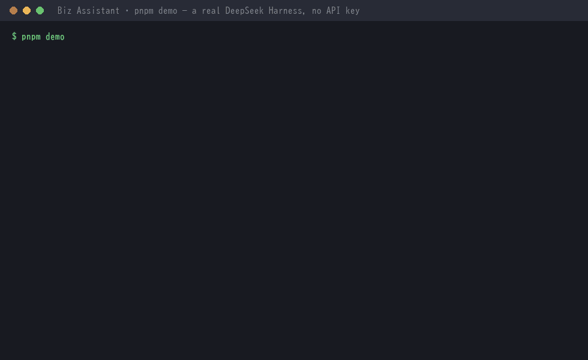

# Biz Assistant Framework

[](LICENSE)
[](https://github.com/deepseek-ai/deepseek-harness)
[](packages/protocol)
[](package.json)
[](https://www.npmjs.com/org/dsh-bridge)

**English** · [日本語](README.ja.md) · [简体中文](README.zh-CN.md)

**Every IT system, a workplace of AI employees that think and act.**

[Integration skill](#bring-it-into-your-system-with-the-integration-skill) ·
[Quick start](#quick-start) ·
[Development guideline](docs/GUIDELINE.en.md) ·
[Technical guide](docs/slides/manual/biz-assistant-framework-technical-guide.en.md) ·
[Discussions](https://github.com/ITC-cloud-soft/biz-ai/discussions) ·
[Issues](https://github.com/ITC-cloud-soft/biz-ai/issues)

Biz Assistant (packages `@dsh-bridge/*`) adds a small **bridge** to business systems that used to just wait for
create, read and update. **AI employees** come alive and, in each employee's own chat (Slack, LINE, Teams, WeCom, Feishu, …),
**notify, ask, draft and remember**. No rewrite of business logic. People always decide.

**52** conformance checks (Bridge v1) · **9** AI-plane plugins · **12** chat platforms for personal bots ·
**0** actions the AI can confirm, approve or pay

## See it in 3 minutes

No API key, no chat account: the example business system (equipment inspection, fictional data) and the framework plugins run on
a **real DeepSeek Harness** with a scripted model and a mock LINE. Needs Node 22.19+, pnpm and Docker. The first run installs
the pinned DSH CLI (0.2.2-rc.1) into `.dsh-cli/` inside the checkout (about 2 minutes); a DSH you installed globally is not touched.

```sh
git clone https://github.com/ITC-cloud-soft/biz-ai.git && cd biz-ai
pnpm install
pnpm demo        # a throwaway PostgreSQL in Docker; prints the conversation and PASS / FAIL per scenario
```

What it prints (the example system serves a Japanese facility, so its messages are Japanese):



1. The manager asks *"Which inspections are overdue?"* — the AI employee calls a tool generated from the manifest, with the manager's
   own rights, and answers *"1 (FE-002)"*. The inspector asks the same and is refused by the business system (403): not their role.
2. The business system detects an overdue inspection — the AI employee tells only the people the system names, on its own, with
   what to do and a link to the business web app.
3. An inspector files a repair request (12,000 yen) — an approval card reaches the approver (never the requester) with
   [Approve] [Reject] buttons and a reply code.
4. The manager presses Approve — the decision is recorded **in the business system**, and the card is updated to "approved".

**For DeepSeek Harness users:** the AI plane is a set of ordinary dsh plugins (`plugins/*`, `@dsh-bridge/plugin-*`) on
`@dsh-bridge/dsh-core` — identity, tools generated from the manifest, events, notifications, approvals, the assistant, memory,
persona and document reading. Most dsh plugins help you write code; these let a dsh agent work **inside a business system**,
with the employee's own rights. On npm as [`@dsh-bridge/*`](https://www.npmjs.com/org/dsh-bridge); a DSH home gets them,
with the product settings, from the profile template (`node profile/scripts/install.mjs`, see Quick start).

## From a tool that records to a colleague who works with you

| era | the system | people |
|---|---|---|
| Records | ledgers and input | type data in, search for it |
| Screens | CRUD and business logic — it waits until someone opens a screen | check screens, chase each other for approvals, collect data for reports |
| **Intelligence** | **AI employees notice changes first, tell only the people concerned, ask the right person, follow up, sum up every morning and evening** | **decide in chat — one tap to approve** |

An AI employee is an AI assistant that works **within each employee's own rights**:

- **Think** — reads business data with the user's rights, spots what matters now, drafts plans and corrections as proposals.
- **Remember** — each person's preferences and open items, the organisation's procedures, earlier conversations. Never personal data.
- **Act on its own** — watches for changes, tells only those concerned, asks the right person, follows up, reports on schedule.

**The AI reads and proposes. Confirming, approving and deciding amounts is always up to people** — enforced by code and
configuration, not prompts.

## How it works

Your business system stays the **source of truth**; AI employees work across the bridge. The business plane and the AI plane are
joined by **Bridge v1** (a small, versioned HTTP protocol, OpenAPI 3.1) and the **manifest** (the system's machine-readable
self-description: roles, events, message templates, tools, playbooks, reports).

1. A business change and its event are recorded in the **same transaction** (outbox).
2. **Your system** decides who is told — the same check as its web screens.
3. The AI employee reads **with the user's rights** and drafts proposals.
4. People decide in chat; the result is recorded **in your system**.

It works for **legacy systems and new ones alike** — but it does not connect with zero changes: the first assessment lists what
your system adds (13 items, below).

## Bring it into your system with the integration skill

The fastest way in is to let an AI coding agent do the integration with the skill shipped in this repository:
[`docs/skill/biz-assistant-integration`](docs/skill/biz-assistant-integration/SKILL.md). It guides the agent through
**assess → plan → implement → verify**, using this repository's documents as the source of truth, and stops to ask you whenever a
decision is yours.

### 1. Install the skill

You need an AI coding agent ([Claude Code](https://claude.com/claude-code) or another agent that reads Markdown runbooks),
Node 22.19+ and pnpm 10, and the repository of the business system you want to connect (or an empty one for a new system).

```sh
git clone https://github.com/ITC-cloud-soft/biz-ai.git

# for yourself, in every project
cp -r biz-ai/docs/skill/biz-assistant-integration ~/.claude/skills/

# or for your team, inside the business system's repository (commit it with the system)
cp -r biz-ai/docs/skill/biz-assistant-integration <your-system>/.claude/skills/
```

On Windows (PowerShell): `Copy-Item -Recurse biz-ai\docs\skill\biz-assistant-integration "$HOME\.claude\skills\"`.
With another agent, have it read `SKILL.md` first and the files under `references/` when it needs them.

### 2. Ask for it

Open the agent in the business system's repository and ask in your own words — the skill is picked up from requests such as:

```text
Integrate Biz Assistant Framework into this system.
Add AI employees to our billing system; start with invoice approvals.
Connect this existing app to Biz Assistant, beginning with overdue-inspection reminders.
```

Requests in other languages work the same way; the skill itself is written in English.

Tip from the field: **start with one process** (billing approvals, overdue deadlines, …), run it next to the existing screens, then widen.

### 3. What the agent does

| step | what happens | proof |
|---|---|---|
| 1 Assess and plan | reads your login, staff and roles, APIs, transactions and batch jobs; fills the 13-item checklist (have / add / alias); picks the path; writes `integration-plan.md` from the template | a plan you review |
| 2 Manifest | roles and delegation limits, event and payload allow-lists, messages, tools, playbooks, reports | `bridge-validate manifest --strict` exits 0 |
| 3 Business side | hooks `employees` · `authenticate` · `isSessionLive` · `recipientsFor` · `approvals` · `proposalKinds` · `reports` · `piiScan`; AI writes only as proposals | your tests |
| 4 Events | the business row and `emitEvent` in the same transaction | your tests |
| 5 Conformance | the 52 checks against a TEST environment | `52 passed, 0 known gaps, 0 skipped` |
| 6 AI plane | DSH product profile from the template, registry, bots, outbound settings kept closed | profile checks |
| 7 Web and BFF | chat linking, notification settings, approvals, AI proposals, the AI employee's profile page; the gateway | type checks, screens |
| 8 Automatic tasks | delegation classes and playbooks switched on | profile checks |
| 9 Optional features | how-to answers from your manual, long-term memory, attachments, external connectors, scanned documents | per feature |
| 10 Done checks | every check above re-run as commands, results reported; anything not verified is reported as "not verified" | the final checklist |

The agent first chooses one of these paths (and shows you the assessment when it is not obvious):

| your situation | path |
|---|---|
| a new system | build it on `server-kit` — you write the business code, hooks, manifest and screens |
| existing, Node.js, code may change | mount `createBridgeApp` on your server and wire the hooks to your tables and functions |
| existing, equivalent APIs already exist | serve `/bridge/v1` as aliases of your routes, add only what is missing |
| existing, another language | implement `packages/protocol/openapi/bridge-v1.yaml` and prove it with the conformance suite |
| existing, no code changes at all | external mode (trial): a separate bridge service; needs an IdP, per-user APIs, change notifications and approval / write APIs |

### 4. What stays with you

The skill never guesses these; it writes the options and a recommendation into the plan and waits for you: the first process and
what the AI may read (tools and roles, `none | read | propose` per role); which events notify whom; which proposals exist and who
may accept them; automatic-task delegation; any outbound setting to open (with the reason); the chats and the AI model; which
optional features to use.

And it keeps the framework's rules while it works: it never edits the framework itself (`packages/*`, `plugins/*`, `vendor/*`,
`profile/template`); the AI only reads and proposes; your system names the recipients; no personal data in events or messages;
chat linking only by the person, through your own login; no secrets in the repository, config, logs or chat; tests only on fictional
data and a TEST environment; and it never claims "connects with zero changes".

The skill (English, `SKILL.md` + 10 references + a plan template) is a route map over [`docs/GUIDELINE.en.md`](docs/GUIDELINE.en.md);
details always come from the repository. Contents: [`docs/skill/README.md`](docs/skill/README.md).
Prefer to do it by hand? Read [`docs/GUIDELINE.en.md`](docs/GUIDELINE.en.md) — start with
["Connecting an existing business system: checklist"](docs/GUIDELINE.en.md#connecting-an-existing-business-system-checklist) — and the
[sample system](examples/equipment-inspection/README.md) (52 / 52), or the smallest one, [leave-requests](examples/leave-requests/README.md) (one file, no database, 52 / 52).

## What's inside

The business system stays the single source of record. It adds the bridge: Bridge v1, the manifest, chat linking on its own
login, and recipient rules it decides itself. The framework provides the rest — the DSH runtime and its IM channels, plugins that
link employees' IM accounts (each employee links only their own, through the organisation's bots or their own personal bots), call
business tools with the employee's own delegated rights (read and propose only — people decide), deliver notifications and approval
cards **only to the people the business system names**, run automatic tasks on business events (per-class or per-person delegation),
send scheduled reports to the employee's own chat, and answer questions from the business web's assistant panel; the guards on every
path from the AI to IM; tests and a conformance suite.

The AI employee also has **the name and personality the company sets** (nickname, tone, company introduction — always signed as an
AI secretary, never able to change the rules), **long-term memory** (each employee's preferences and open matters, the organization's
procedures, recall of earlier conversations; personal data is never kept) and **answers how-to questions from the system's own
manual** with a link to the right screen (sections below).

The framework was extracted from its first user, a care-billing system (`examples/care-billing/`: manifest and mapping only, no
business code).

## Layout

| path | package | what |
|---|---|---|
| `packages/protocol` | `@dsh-bridge/protocol` | Bridge v1: OpenAPI, manifest / event JSON Schemas, validators, conformance suite, `bridge-validate` CLI |
| `packages/dsh-core` | `@dsh-bridge/dsh-core` | DSH side core: application registry (`bridge-apps` plugin), business API client, delegation cache, session keys, tools-sdk, app-switch, AI secretary framing, delivery classification |
| `packages/gateway` | `@dsh-bridge/gateway` | BFF → DSH authenticating gateway (`/dsh/*`, launch token, public webhook paths, RPC allow-list, supervise) |
| `packages/server-kit` | `@dsh-bridge/server-kit` | Node parts for implementing Bridge v1 in a business system |
| `packages/help` | `@dsh-bridge/help` | answering how-to questions on SNS from the business system's own manual: manual parsing, the index, CI checks against the screens, role-aware search with links |
| `packages/web-kit` | `@dsh-bridge/web-kit` | business web parts (SNS linking, the employee's own bots, organisation IM bots, notification preferences, platform labels, the AI employee's profile page `AiProfilePage`) |
| `packages/testing` | `@dsh-bridge/testing` | mock LLM / LINE / iLink / WeCom, isolated DSH home and process helpers |
| `plugins/identity` | `@dsh-bridge/plugin-identity` | DSH plugin `bridge-identity`: link codes, access check (linked employees only, group chats get a fixed guide), lookup per bot, shared-bot app switching, link guard on AI answers, public help sections for senders not linked yet |
| `plugins/tools` | `@dsh-bridge/plugin-tools` | `bridge-tools`: delegation gate, delegation classes and per-event delegations, tool modules (hand-written read / propose tools) |
| `plugins/events` | `@dsh-bridge/plugin-events` | `bridge-events`: event cursors per application, dispatch to the plugins and auto-tasks, manifest playbook deployment |
| `plugins/notify` | `@dsh-bridge/plugin-notify` | `bridge-notify`: deterministic notifications to the recipients the business system names, digests, quiet hours, AI secretary wording, scheduled reports and their guards |
| `plugins/approvals` | `@dsh-bridge/plugin-approvals` | `bridge-approvals`: approval cards, buttons and reply codes, one decision decides |
| `plugins/assistant` | `@dsh-bridge/plugin-assistant` | `bridge-assistant`: the business web's assistant panel (the employee's own rights through a ticket; panel title = the AI employee's nickname) |
| `plugins/memory` | `@dsh-bridge/plugin-memory` | `bridge-memory`: long-term memory — personal memory (the owner only), organization memory, conversation recall; personal data checked before saving (local + the business system's `/pii-scan`, fail closed), never in group chats |
| `plugins/persona` | `@dsh-bridge/plugin-persona` | `bridge-persona`: the AI employee's profile from the business system (`GET /bridge/v1/ai-profile`: nickname, tone, company introduction, personality, background) as a system prompt section after the fixed rules |
| `plugins/reader` | `@dsh-bridge/plugin-reader` | `bridge-reader`: scanned documents the business system could not read (images, PDFs without a text layer) — page images from `GET /bridge/v1/document-reads`, transcribed by the image-reading model one page per request (no conversation), the text back to `POST .../result` (`docs/DOCUMENT_READS.md`) |
| `profile/` | `@dsh-bridge/profile` | DSH product profile template, `install.mjs`, automatic task template format |
| `vendor/` | `@care/dsh-im`, `@care/dsh-auto-tasks`, `@care/dsh-proactive` | forks of the DSH IM / auto-tasks / proactive plugins (own npm setup, see each `FORK.md`) |
| `examples/` | | `leave-requests` (the smallest system: one file, no database), `equipment-inspection` (a sample business system on server-kit), `care-billing` (the first user's manifest) |
| `docs/` | | `GUIDELINE.md`, `ARCHITECTURE.md`, slides |

## Quick start

Node 22.19+ (24 tested), pnpm 10.

```sh
pnpm install
pnpm test                    # every workspace package (vendor/ excluded)
pnpm test:protocol           # or: test:core, test:gateway, test:testing, test:plugins, test:profile, test:examples
pnpm validate                # lint the OpenAPI and validate the bundled manifests

pnpm demo                    # the end-to-end run below, with a throwaway PostgreSQL in Docker, printed as a conversation

# end to end on a real DSH (dsh CLI installed globally, local PostgreSQL; mocks for the model and LINE)
FW_TEST_DATABASE_URL=postgres://<user>:<password>@127.0.0.1:5432/postgres pnpm run e2e

# a manifest of your own
node packages/protocol/bin/bridge-validate.mjs manifest my-app.manifest.yaml

# a DSH home with the profile template (never the personal ~/.dsh)
node profile/scripts/install.mjs --home .dsh-home-trial --skip-install
```

The forks keep their own `package-lock.json`: `cd vendor/dsh-im && npm ci && npm test` (likewise `dsh-auto-tasks`, `dsh-proactive`).

Next: `docs/GUIDELINE.md` (how to connect a business system), `docs/ARCHITECTURE.md` (layers, event flow, personal bots,
recipient guarantees, conversation isolation, safety promises), `packages/protocol/README.md` (the protocol and the conformance suite).

The outbound switches are closed by default in `profile/template` (`docs/GUIDELINE.md` d.8): the plugin and fork defaults keep the
upstream behaviour for some of them, so the template writes the product values and a system opts in to an open setting only by changing
that line explicitly. `install.mjs` refuses fixed delivery targets (`--auto-task-session / --auto-task-bot / --auto-task-target`), and
server-kit applies the personal-bot owner rule at lookup and issues per-event delegations only through `hooks.eventDelegations`.

## Answering how-to questions on SNS (the manual)

Employees also ask the AI secretary how to use the system ("where do I enter the monitoring?"). The framework answers **from the business
system's own manual** — never from the model's guesses — with **the URL of the right screen for the asker's role**:

- the manual (Markdown, one section per screen) is checked against the screens in CI (paths are routes, every screen has a section, the
  roles written match the guards, links resolve) and built into an index (`@dsh-bridge/help`);
- the business system searches it per role (`server-kit` `help` option → `GET /bridge/v1/help/*`, optional in Bridge v1): a screen the
  asker cannot open has no URL, only whom to ask;
- the DSH generates the manual search tool from the manifest's `help.tool` (`@dsh-bridge/dsh-core` help-tool); the AI answers in the
  "guidance" (【ご案内】) frame and copies only the URLs it was given; bridge-identity drops any link that is not one of the manifest's `web.routes`
  before the answer leaves, and answers a sender that is not linked yet from the public sections (sign-in, SNS linking) without the AI.

How to add it: [`packages/help/README.md`](packages/help/README.md), `docs/GUIDELINE.md` (checklist #9, b.8). The sample system has a
small manual (`examples/equipment-inspection/manual`); Care Billing's (the reference system) has 164 sections.

## The AI employee's profile and long-term memory

- **Profile** (`plugins/persona`, `docs/AI_EMPLOYEE_PROFILE.md`): the administrator sets the AI employee's nickname (e.g. "Sakura"),
  first person and tone, company introduction, personality, background, speaking examples and per-AI-employee overrides on the business
  web (web-kit `AiProfilePage`). The business system is the source of record (server-kit: `GET /bridge/v1/ai-profile` with an etag,
  admin `GET / PUT /bridge/v1/admin/ai-profile` and restore, versions and audit with the version number only; checked by the protocol's
  `validateAiProfile`: rule-override wording and personal data are refused). The DSH reads it at start-up and every 60 s (dsh-core
  holder); bridge-persona puts the fixed rules first, then the persona as settings that cannot override them, then the company as
  reference, fixed per conversation. Signatures become "— <nickname> (<app name> AI secretary)" at once. External connectors (P2, P3): the
  company's own and third-party APIs registered by an administrator, run by the business system (allowed https hosts, sealed
  secrets, allow-listed response fields); the AI reads as the employee and proposes writes, a person approves, rules react to events / cron.
- **Long-term memory** (`plugins/memory`): personal memory (only the owner), organization memory, conversation recall (90 days);
  a little of it is given at the start of a conversation as reference (not instructions); personal data is checked before saving
  (local screen + the business system's `POST /bridge/v1/pii-scan`, fail closed); never in group chats; business data is never kept
  (always read with the tools). In the profile template by default; an application renames tools and storage with `createMemoryPlugin`.

## Docs

Written in Japanese (each starts with a short English summary). The development guideline and the technical guide are also translated into
English and Chinese: [`docs/GUIDELINE.en.md`](docs/GUIDELINE.en.md) · [`docs/GUIDELINE.zh-CN.md`](docs/GUIDELINE.zh-CN.md) ·
[`technical-guide.en.md`](docs/slides/manual/biz-assistant-framework-technical-guide.en.md) · [`technical-guide.zh-CN.md`](docs/slides/manual/biz-assistant-framework-technical-guide.zh-CN.md)
(the Japanese originals are authoritative). The official website (https://biz-ai.myaiportal.net) shows them as pages in all three languages.

| document | for | what |
|---|---|---|
| [`docs/ARCHITECTURE.md`](docs/ARCHITECTURE.md) | everyone | what the framework is (business plane = SoR, AI plane = DSH), what a system adds, layers L1–L5, the event flow, identity, personal bots and delegation (classes, per event), multi-application DSH and per-application sessions, the recipient guarantees (who decides, the guards on every outbound path, fail-closed settings), safety and privacy promises, the forks |
| [`docs/GUIDELINE.md`](docs/GUIDELINE.md) | developers | the integration checklist, quick start, connecting a business system step by step, extension points, MUST / SHOULD rules (AI secretary wording, per-platform notes, recipients, group chats, unattended delegation, outbound screening, config switches, personal bots), testing, versioning, FAQ, Care Billing as the reference |
| [`docs/slides/biz-assistant-framework.pptx`](docs/slides/biz-assistant-framework.pptx) ([PDF](docs/slides/biz-assistant-framework.pdf)) | technical audience | the framework in 31 slides with speaker notes (generated from [`docs/slides/src`](docs/slides/src/README.md)) |
| [`docs/slides/marketing/biz-assistant-for-executives.pptx`](docs/slides/marketing/biz-assistant-for-executives.pptx) ([PDF](docs/slides/marketing/biz-assistant-for-executives.pdf)) | executives | Biz Assistant: any IT system as an AI agent / AI assistant, AI employees with the company's name and personality in everyone's chat, 23 slides (generated from [`docs/slides/marketing/src`](docs/slides/marketing/src/README.md)) |
| [`docs/slides/manual/biz-assistant-framework-technical-guide.md`](docs/slides/manual/biz-assistant-framework-technical-guide.md) ([PPTX](docs/slides/manual/biz-assistant-framework-technical-guide.pptx) / [PDF](docs/slides/manual/biz-assistant-framework-technical-guide.pdf)) | customer engineers | the technical guide (Japanese, 50 slides + a detailed Markdown version, no internal names): architecture, Bridge v1 and the manifest, the main flows, the safety promises, connecting / building a system, quality and status — also the draft for the official web site |
| [`docs/skill/biz-assistant-integration`](docs/skill/README.md) | AI coding agents | a skill in English (Claude Code `SKILL.md` + references) that walks an agent through bringing the framework into a new or an existing business system: assessment, plan, manifest, hooks, events, conformance 52 / 52, DSH profile, web and BFF, automatic tasks, completion checks |
| [`docs/AI_EMPLOYEE_PROFILE.md`](docs/AI_EMPLOYEE_PROFILE.md) | developers | the AI employee's profile (P1) and the external connectors / rules (P2・P3), implemented |
| [`docs/ASSISTANT_ATTACHMENTS.md`](docs/ASSISTANT_ATTACHMENTS.md) | developers | file attachments and Markdown answers in the assistant panel (proposal, being implemented) |
| [`packages/protocol/README.md`](packages/protocol/README.md) | system integrators | Bridge v1, the manifest, the conformance suite and its 52 checks |
| [`examples/leave-requests`](examples/leave-requests/README.md) · [`examples/equipment-inspection`](examples/equipment-inspection/README.md) · [`examples/care-billing`](examples/care-billing/README.md) | developers | the smallest system: one file, no database (52 / 52) · a sample system on server-kit with PostgreSQL (52 / 52) · the first user's manifest, registry entry and mapping table |

## License

[Apache License 2.0](LICENSE) — see also [`NOTICE`](NOTICE). The forks in `vendor/` keep their upstream licenses (MIT).

Public repository: https://github.com/ITC-cloud-soft/biz-ai — questions in GitHub Discussions, bugs in GitHub Issues.
