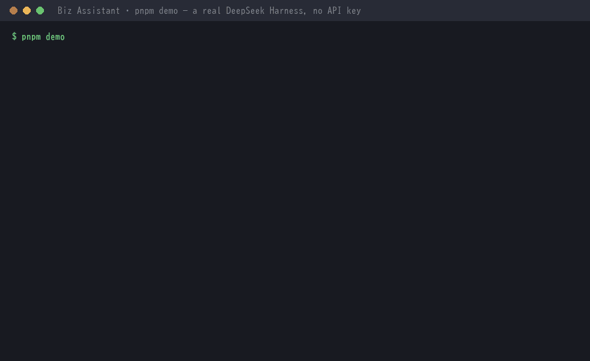

# Biz Assistant Framework

**官方网站：[biz-ai.myaiportal.net](https://biz-ai.myaiportal.net/)**

[](https://biz-ai.myaiportal.net/)
[](LICENSE)
[](https://github.com/deepseek-ai/deepseek-harness)
[](packages/protocol)
[](package.json)
[](https://www.npmjs.com/org/dsh-bridge)

[English](README.md) · [日本語](README.ja.md) · **简体中文**

**让每一个 IT 系统，都成为会思考、会行动的 AI 员工的职场。**<br>
Every IT system, a workplace of AI employees that think and act. · あらゆる IT システムを、考えて動く AI 社員の職場に。

[集成 skill](#用集成-skill-导入你的系统) ·
[快速开始](#快速开始) ·
[开发指南](docs/GUIDELINE.zh-CN.md) ·
[技术解说](docs/slides/manual/biz-assistant-framework-technical-guide.zh-CN.md) ·
[Discussions](https://github.com/ITC-cloud-soft/biz-ai/discussions) ·
[Issues](https://github.com/ITC-cloud-soft/biz-ai/issues)

Biz Assistant（Bizアシスタント，包名 `@dsh-bridge/*`）为过去只是被动等待增、查、改的业务系统加上一座小小的**桥（bridge）**。
**AI 员工**由此活起来，在每位员工自己的聊天工具（Slack、LINE、Teams、WeCom、Feishu……）中
**通知、询问、起草、记忆**。无需重写业务逻辑。始终由人来决定。

**52** 项一致性检查（Bridge v1）· **9** 个 AI 平面插件 · **12** 个支持个人机器人的聊天平台 ·
**0** 项可由 AI 确认、审批或支付的操作

**模型可以自己选。** DeepSeek 只是默认值。对话模型在 DSH 的 Models 页面设置，可选 OpenAI、Azure OpenAI、Anthropic、DeepSeek、OpenAI 兼容网关或自建服务器（vLLM 等），由 DSH 自带的 `dsh-llm-pi-ai` 适配器连接。Bridge v1 本身不依赖任何模型。下面的 demo 使用脚本化的模型，不需要 API key。

## 3 分钟跑起来看看

不需要 API key，也不需要聊天账号：示例业务系统（设备点检，数据全部虚构）和 framework 的插件运行在**真实的 DeepSeek Harness** 上，
对面是按脚本回答的模型和模拟的 LINE。需要 Node 22.19+、pnpm 和 Docker。
第一次运行时会把固定版本的 DSH CLI（0.2.2-rc.1）装进仓库里的 `.dsh-cli/`（约 2 分钟），不会动你全局安装的 DSH。

```sh
git clone https://github.com/ITC-cloud-soft/biz-ai.git && cd biz-ai
pnpm install
pnpm demo        # 用 Docker 起一个临时 PostgreSQL；打印对话记录和每个场景的 PASS / FAIL
```

**不想在本机准备环境：** [在 GitHub Codespaces 里打开](https://codespaces.new/ITC-cloud-soft/biz-ai)，运行 `pnpm demo`（dev container 自带 Node 24、pnpm 和 PostgreSQL）。**没有 Docker：** 指定你已有的 PostgreSQL：`FW_TEST_DATABASE_URL=postgres://<user>:<password>@127.0.0.1:5432/postgres pnpm demo`（会建一个临时数据库，结束后删除）。



输出的对话节选（示例系统是日语）：员工提问，系统发现问题，AI 员工去找该做决定的人，由人来决定。

```text
manager（設備責任者） ▶ 期限切れの点検は？
  AI 社員 ▶ manager（設備責任者）
    │ 期限切れの点検は 1 件です（FE-002）。

業務システム ▶ (業務システム：点検の期限切れを検出（inspection.overdue）)
  AI 社員 ▶ inspector1（点検員）  ［自分から］
    │ 【対応のお願い】点検期限の超過
    │ お疲れさまです。点検期限を 3 日過ぎた設備があります（期限 2026-11-11）。…
    │ [ 業務 Web を開いて対応 ]

inspector1（点検員） ▶ (アプリで修理依頼を登録（見積 12000 円）)
  AI 社員 ▶ manager（設備責任者）  ［自分から］
    │ 【承認のお願い】修理依頼の承認  設備コード FE-002 · 見積額 12000円
    │ 文字で返信する場合：「承認 321904」／「差戻 321904 理由」
    │ [ 承認 ] [ 差戻 ] [ 業務Webで詳細を見る ]

manager（設備責任者） ▶ (カードの［承認］を押す)
  AI 社員 ▶ manager（設備責任者）
    │ 承認しました。ありがとうございます。結果はカードにも反映します。
```

**给 DeepSeek Harness 用户：** AI 平面就是一组普通的 dsh 插件（`plugins/*`、`@dsh-bridge/plugin-*`），基于 `@dsh-bridge/dsh-core`：
身份、由 manifest 生成的工具、事件、通知、审批、助手、记忆、人设和文档读取。
大多数 dsh 插件帮你写代码；这组插件让 dsh agent **在业务系统里、以员工本人的权限**工作。npm 上为 [`@dsh-bridge/*`](https://www.npmjs.com/org/dsh-bridge)；装进 DSH home 时连同产品设置一起，用 profile 模板
（`node profile/scripts/install.mjs`，见快速开始）。

## 从记录工具到协同工作的同事

| 时代 | 系统 | 人 |
|---|---|---|
| 记录 | 台账与录入 | 录入数据、查找数据 |
| 画面 | CRUD 与业务逻辑——一直等到有人打开画面 | 查看画面、互相催促审批、为报告收集数据 |
| **智能** | **AI 员工率先察觉变化，只告知相关人员，询问合适的人，持续跟进，每天早晚汇总** | **在聊天中决定——一键审批** |

AI 员工是**在每位员工自身权限范围内**工作的 AI 助手：

- **思考**——以用户的权限读取业务数据，发现当下要紧的事项，以提案形式起草计划和修正。
- **记忆**——每个人的偏好和未完成事项、组织的流程、以往的对话。绝不记忆个人信息。
- **自主行动**——监视变化，只告知相关人员，询问合适的人，持续跟进，按时报告。

**AI 只负责读取和提案。确认、审批和决定金额始终由人来完成**——由代码和配置强制保证，而不是靠提示词。

## 工作原理

你的业务系统始终是**权威来源（正本）**；AI 员工跨过这座桥工作。业务平面与 AI 平面通过
**Bridge v1**（一个小型、带版本的 HTTP 协议，OpenAPI 3.1）和 **manifest**（系统的机器可读自描述：角色、事件、消息模板、
工具、playbook、报告）连接起来。

1. 业务变更及其事件在**同一个事务**中记录（outbox）。
2. 由**你的系统**决定通知谁——与其 Web 画面采用相同的检查。
3. AI 员工**以用户的权限**读取并起草提案。
4. 人在聊天中做出决定；结果记录**在你的系统中**。

它**同样适用于遗留系统和新系统**——但并非零改动即可连接：首次评估会列出你的系统需要补充的内容（13 项，见下文）。

## 用集成 skill 导入你的系统

最快的方式是让 AI 编码 agent 使用本仓库附带的 skill 完成集成：
[`docs/skill/biz-assistant-integration`](docs/skill/biz-assistant-integration/SKILL.md)。它引导 agent 按
**评估 → 计划 → 实现 → 验证**的步骤推进，以本仓库的文档为权威来源，凡是需要你决定的事项都会停下来询问你。

### 1. 安装 skill

你需要一个 AI 编码 agent（[Claude Code](https://claude.com/claude-code) 或其他能读取 Markdown runbook 的 agent）、
Node 22.19+ 和 pnpm 10，以及要连接的业务系统的仓库（新系统则准备一个空仓库）。

```sh
git clone https://github.com/ITC-cloud-soft/biz-ai.git

# 个人使用，适用于所有项目
cp -r biz-ai/docs/skill/biz-assistant-integration ~/.claude/skills/

# 或供团队使用，放在业务系统的仓库中（与系统一同提交）
cp -r biz-ai/docs/skill/biz-assistant-integration <your-system>/.claude/skills/
```

Windows（PowerShell）：`Copy-Item -Recurse biz-ai\docs\skill\biz-assistant-integration "$HOME\.claude\skills\"`。
使用其他 agent 时，让它先读取 `SKILL.md`，需要时再读取 `references/` 下的文件。

### 2. 提出请求

在业务系统的仓库中打开 agent，用你自己的话提出请求即可——skill 会被以下这类请求触发：

```text
Integrate Biz Assistant Framework into this system.
この業務システムに Bizアシスタントを導入して。最初は請求の承認から。
把 biz assistant framework 导入这个既有系统，先从巡检超期提醒开始。
```

来自实践的建议：**从一个业务流程开始**（账单审批、期限逾期……），与现有画面并行运行，然后再逐步扩大。

### 3. agent 的工作内容

| 步骤 | 做什么 | 证明 |
|---|---|---|
| 1 评估与计划 | 读取你的登录、员工与角色、API、事务和批处理；填写 13 项检查清单（已有 / 补充 / 别名）；选择路径；按模板编写 `integration-plan.md` | 一份供你审阅的计划 |
| 2 Manifest | 角色与委托上限、事件与 payload 的允许列表、消息、工具、playbook、报告 | `bridge-validate manifest --strict` 以 0 退出 |
| 3 业务侧 | hook `employees` · `authenticate` · `isSessionLive` · `recipientsFor` · `approvals` · `proposalKinds` · `reports` · `piiScan`；AI 只能以提案形式写入 | 你的测试 |
| 4 事件 | 业务数据行与 `emitEvent` 在同一个事务中 | 你的测试 |
| 5 一致性 | 在 TEST 环境中执行 52 项检查 | `52 passed, 0 known gaps, 0 skipped` |
| 6 AI 平面 | 按模板生成 DSH 产品 profile、registry、机器人，发送设置保持关闭 | profile 检查 |
| 7 Web 与 BFF | SNS 绑定、通知设置、审批、AI 提案、AI 员工的资料页；gateway | 类型检查、画面 |
| 8 自动任务 | 启用委托类别和 playbook | profile 检查 |
| 9 可选功能 | 基于你的操作手册回答使用方法的提问、长期记忆、附件、外部连接、扫描文档 | 按功能 |
| 10 完成检查 | 以命令重新执行上述所有检查并报告结果；未验证的项目如实报告为“未验证” | 最终检查清单 |

agent 首先从以下路径中选择一条（不明显时会向你展示评估结果）：

| 你的情况 | 路径 |
|---|---|
| 新系统 | 基于 `server-kit` 构建——由你编写业务代码、hook、manifest 和画面 |
| 既有系统，Node.js，代码可以修改 | 在你的服务器上挂载 `createBridgeApp`，并将 hook 接到你的表和函数 |
| 既有系统，已有等价的 API | 将 `/bridge/v1` 作为你现有路由的别名提供，只补充缺少的部分 |
| 既有系统，其他语言 | 实现 `packages/protocol/openapi/bridge-v1.yaml`，并用一致性测试（conformance suite）证明 |
| 既有系统，完全不改代码 | 外挂模式（试行）：独立的 bridge 服务；需要 IdP、按用户的 API、变更通知以及审批 / 写入 API |

### 4. 由你决定的事项

skill 从不擅自猜测以下事项；它会把选项和推荐写入计划并等待你决定：第一个业务流程以及
AI 可以读取什么（工具和角色，每个角色 `none | read | propose`）；哪些事件通知谁；有哪些提案以及谁可以采纳；
自动任务的委托；要开放哪项发送设置（附理由）；聊天工具和 AI 模型；要使用哪些可选功能。

并且它在工作中始终遵守框架的规则：绝不修改框架本身（`packages/*`、`plugins/*`、`vendor/*`、
`profile/template`）；AI 只读取和提案；由你的系统指定接收人；事件和消息中不含个人信息；
SNS 绑定只能由本人通过你自己的登录完成；仓库、配置、日志和聊天中不含密钥；测试只使用虚构数据和 TEST 环境；
并且绝不声称“零改动即可连接”。

该 skill（英文，`SKILL.md` + 10 份参考资料 + 一份计划模板）是 [`docs/GUIDELINE.md`](docs/GUIDELINE.md) 的路线图；
细节始终以仓库为准。目录：[`docs/skill/README.md`](docs/skill/README.md)。
想手动完成？请阅读 [`docs/GUIDELINE.md`](docs/GUIDELINE.md)——从
[「既存の業務システムをつなぐ：チェックリスト」（连接既有业务系统：检查清单）](docs/GUIDELINE.md#既存の業務システムをつなぐチェックリスト) 开始——以及
[示例系统](examples/equipment-inspection/README.md)（52 / 52）。

## 包含哪些内容

业务系统始终是唯一的记录来源。它需要补充的是这座桥：Bridge v1、manifest、基于自身登录的 SNS 绑定，
以及由它自己决定的接收人规则。其余部分由框架提供——DSH 运行时及其 IM 渠道；以及以下插件：
绑定员工的 IM 账号（每位员工只绑定自己的账号，通过组织机器人或自己的个人机器人）、
以员工本人被委托的权限调用业务工具（只读取和提案——由人决定）、**只向业务系统指定的人**投递通知和审批卡片、
在业务事件上运行自动任务（按类别或按人委托）、向员工自己的聊天发送定时报告、回答业务 Web 助手面板中的提问；
AI 到 IM 每条路径上的防护；测试和一致性测试（conformance suite）。

AI 员工还拥有**公司设定的名字和性格**（昵称、语气、公司介绍——始终以 AI 秘书身份署名，绝不能更改规则）、
**长期记忆**（每位员工的偏好和未完成事项、组织的流程、对以往对话的回忆；绝不保存个人信息），并能**基于系统自身的操作手册回答使用方法的提问**，
附上指向相应画面的链接（详见下文各节）。

本框架提炼自其首个用户——一个护理计费系统（`examples/care-billing/`：只有 manifest 和映射，不含业务代码）。

## 目录结构

| 路径 | 包 | 内容 |
|---|---|---|
| `packages/protocol` | `@dsh-bridge/protocol` | Bridge v1：OpenAPI、manifest / 事件 JSON Schema、校验器、一致性测试（conformance suite）、`bridge-validate` CLI |
| `packages/dsh-core` | `@dsh-bridge/dsh-core` | DSH 侧核心：应用 registry（`bridge-apps` 插件）、业务 API 客户端、委托缓存、会话密钥、tools-sdk、app-switch、AI 秘书话术框架、投递分类 |
| `packages/gateway` | `@dsh-bridge/gateway` | BFF → DSH 的认证 gateway（`/dsh/*`、launch token、公开 webhook 路径、RPC 允许列表、supervise） |
| `packages/server-kit` | `@dsh-bridge/server-kit` | 在业务系统中实现 Bridge v1 的 Node 组件。`bridge-effect-report`：从 `bridge_*` 表统计 AI 的使用情况和提案的采纳率（`docs/EFFECT_REPORT.md`） |
| `packages/help` | `@dsh-bridge/help` | 基于业务系统自身的操作手册在 SNS 上回答使用方法的提问：手册解析、索引、对照画面的 CI 检查、按角色检索并附链接 |
| `packages/web-kit` | `@dsh-bridge/web-kit` | 业务 Web 组件（SNS 绑定、员工自己的机器人、组织 IM 机器人、通知偏好、平台标签、AI 员工的资料页 `AiProfilePage`） |
| `packages/testing` | `@dsh-bridge/testing` | mock LLM / LINE / iLink / WeCom、隔离的 DSH home 及进程辅助工具 |
| `plugins/identity` | `@dsh-bridge/plugin-identity` | DSH 插件 `bridge-identity`：绑定码、访问检查（仅限已绑定员工，群聊返回固定的引导）、按机器人查找、共享机器人的应用切换、AI 回答中的链接防护、向尚未绑定的发送者提供公开的帮助章节 |
| `plugins/tools` | `@dsh-bridge/plugin-tools` | `bridge-tools`：委托闸门、委托类别和按事件的委托、工具模块（手写的读取 / 提案工具） |
| `plugins/events` | `@dsh-bridge/plugin-events` | `bridge-events`：按应用的事件游标、分发到各插件和自动任务、部署 manifest 中的 playbook |
| `plugins/notify` | `@dsh-bridge/plugin-notify` | `bridge-notify`：向业务系统指定的接收人进行确定性通知、汇总（digest）、免打扰时段、AI 秘书文案、定时报告及其防护 |
| `plugins/approvals` | `@dsh-bridge/plugin-approvals` | `bridge-approvals`：审批卡片、按钮和回复码，一次决定即生效 |
| `plugins/assistant` | `@dsh-bridge/plugin-assistant` | `bridge-assistant`：业务 Web 的助手面板（通过 ticket 使用员工本人的权限；面板标题 = AI 员工的昵称） |
| `plugins/memory` | `@dsh-bridge/plugin-memory` | `bridge-memory`：长期记忆——个人记忆（仅限本人）、组织记忆、对话回忆；保存前检查个人信息（本地 + 业务系统的 `/pii-scan`，fail closed），群聊中绝不使用 |
| `plugins/persona` | `@dsh-bridge/plugin-persona` | `bridge-persona`：来自业务系统的 AI 员工资料（`GET /bridge/v1/ai-profile`：昵称、语气、公司介绍、性格、背景），作为固定规则之后的系统提示词章节 |
| `plugins/reader` | `@dsh-bridge/plugin-reader` | `bridge-reader`：业务系统无法读取的扫描文档（图片、无文本层的 PDF）——从 `GET /bridge/v1/document-reads` 获取页面图片，由图像读取模型每次请求转写一页（无对话上下文），文本回传到 `POST .../result`（`docs/DOCUMENT_READS.md`） |
| `profile/` | `@dsh-bridge/profile` | DSH 产品 profile 模板、`install.mjs`、自动任务模板格式 |
| `vendor/` | `@care/dsh-im`、`@care/dsh-auto-tasks`、`@care/dsh-proactive` | DSH IM / auto-tasks / proactive 插件的 fork（各自独立的 npm 配置，见各自的 `FORK.md`） |
| `examples/` | | `leave-requests`（最小的系统：一个文件、无需数据库）、`equipment-inspection`（基于 server-kit 的示例业务系统）、`care-billing`（首个用户的 manifest） |
| `docs/` | | `GUIDELINE.md`、`ARCHITECTURE.md`、幻灯片 |

## 快速开始

Node 22.19+（已在 24 上测试），pnpm 10。

```sh
pnpm install
pnpm test                    # 所有 workspace 包（不含 vendor/）
pnpm test:protocol           # 或：test:core, test:gateway, test:testing, test:plugins, test:profile, test:examples
pnpm validate                # 检查 OpenAPI 并校验内置的 manifest

pnpm demo                    # 即下面的端到端测试，用 Docker 临时 PostgreSQL，以对话形式输出

# 在真实 DSH 上端到端测试（全局安装 dsh CLI、本地 PostgreSQL；模型和 LINE 使用 mock）
FW_TEST_DATABASE_URL=postgres://<user>:<password>@127.0.0.1:5432/postgres pnpm run e2e

# 校验你自己的 manifest
node packages/protocol/bin/bridge-validate.mjs manifest my-app.manifest.yaml

# 用 profile 模板创建 DSH home（绝不使用个人的 ~/.dsh）
node profile/scripts/install.mjs --home .dsh-home-trial --skip-install
```

各 fork 保留自己的 `package-lock.json`：`cd vendor/dsh-im && npm ci && npm test`（`dsh-auto-tasks`、`dsh-proactive` 同理）。

下一步：`docs/GUIDELINE.md`（如何连接业务系统）、`docs/ARCHITECTURE.md`（分层、事件流、个人机器人、
接收人保证、对话隔离、安全承诺）、`packages/protocol/README.md`（协议与一致性测试）。

在 `profile/template` 中，发送开关默认关闭（`docs/GUIDELINE.md` d.8）：插件和 fork 的默认值对其中一部分保留了
上游的行为，因此模板写入产品值，系统只有显式修改对应的那一行才能选择开放某项设置。`install.mjs` 拒绝固定的投递目标（`--auto-task-session / --auto-task-bot / --auto-task-target`），
server-kit 在查找时应用个人机器人的所有者规则，并且只通过 `hooks.eventDelegations` 签发按事件的委托。

## 在 SNS 上回答使用方法的提问（操作手册）

员工也会向 AI 秘书询问系统的用法（“监测记录在哪里录入？”）。框架**基于业务系统自身的操作手册**回答——
绝不依赖模型的猜测——并附上**适合提问者角色的相应画面的 URL**：

- 操作手册（Markdown，每个画面一个章节）在 CI 中对照画面进行检查（路径即路由、每个画面都有章节、
  所写的角色与防护一致、链接可解析），并构建为索引（`@dsh-bridge/help`）；
- 业务系统按角色检索手册（`server-kit` 的 `help` 选项 → `GET /bridge/v1/help/*`，在 Bridge v1 中为可选）：提问者
  无法打开的画面不提供 URL，只告知应该询问谁；
- DSH 根据 manifest 的 `help.tool` 生成手册检索工具（`@dsh-bridge/dsh-core` help-tool）；AI 以
  【ご案内】（指引）框架回答，并且只复制提供给它的 URL；bridge-identity 在回答发出前删除所有不属于 manifest `web.routes` 的链接，
  并对尚未绑定的发送者不经 AI、直接用公开章节（登录、SNS 绑定）回答。

添加方法：[`packages/help/README.md`](packages/help/README.md)、`docs/GUIDELINE.md`（检查清单 #9、b.8）。示例系统附有
一份小型操作手册（`examples/equipment-inspection/manual`）；CareBilling 的手册有 164 个章节。

## AI 员工的资料与长期记忆

- **资料（profile）**（`plugins/persona`、`docs/AI_EMPLOYEE_PROFILE.md`）：管理员在业务 Web（web-kit `AiProfilePage`）上设置 AI 员工的昵称（例如 さくら）、
  第一人称和语气、公司介绍、性格、背景、说话示例，以及针对单个 AI 员工的覆盖设置。业务系统是记录来源（server-kit：带 etag 的 `GET /bridge/v1/ai-profile`、
  管理员用的 `GET / PUT /bridge/v1/admin/ai-profile` 及恢复、版本管理和仅记录版本号的审计；由协议的
  `validateAiProfile` 检查：拒绝试图覆盖规则的措辞和个人信息）。DSH 在启动时及每 60 秒读取一次（dsh-core
  holder）；bridge-persona 先放固定规则，再放作为设置的人设（不能覆盖规则），最后放作为参考的公司信息，每个对话内固定不变。署名立即变为
  「— <呼び名>（<アプリ名> AI 秘書）」（即“— <昵称>（<应用名> AI 秘书）”）。外部连接（P2・P3）：由管理员登记的
  公司自有 API 和第三方 API，由业务系统执行（允许的 https 主机、加密保存的密钥、
  允许列表中的响应字段）；AI 以员工身份读取并提出写入提案，由人审批，规则响应事件 / cron。
- **长期记忆**（`plugins/memory`）：个人记忆（仅限本人）、组织记忆、对话回忆（90 天）；
  对话开始时提供其中一小部分作为参考（而非指令）；保存前检查个人信息
  （本地筛查 + 业务系统的 `POST /bridge/v1/pii-scan`，fail closed）；群聊中绝不使用；绝不保存业务数据
  （始终通过工具读取）。在 profile 模板中默认启用；应用可通过 `createMemoryPlugin` 重命名工具和存储。

## 文档

以日语编写（每份文档开头都有简短的英文摘要）。开发指南与技术解说另有英文版和中文版：[`docs/GUIDELINE.zh-CN.md`](docs/GUIDELINE.zh-CN.md) ·
[`docs/GUIDELINE.en.md`](docs/GUIDELINE.en.md) · [`technical-guide.zh-CN.md`](docs/slides/manual/biz-assistant-framework-technical-guide.zh-CN.md) ·
[`technical-guide.en.md`](docs/slides/manual/biz-assistant-framework-technical-guide.en.md)（以日文原文为准）。官网（https://biz-ai.myaiportal.net）上可以阅读这三种语言的网页版。

| 文档 | 面向 | 内容 |
|---|---|---|
| [`docs/ARCHITECTURE.md`](docs/ARCHITECTURE.md) | 所有人 | 框架是什么（业务平面 = SoR，AI 平面 = DSH）、系统需要补充什么、L1–L5 分层、事件流、身份、个人机器人与委托（类别、按事件）、多应用 DSH 与按应用的会话、接收人保证（谁来决定、每条发送路径上的防护、fail-closed 设置）、安全与隐私承诺、各 fork |
| [`docs/GUIDELINE.md`](docs/GUIDELINE.md) | 开发者 | 集成检查清单、快速开始、逐步连接业务系统、扩展点、MUST / SHOULD 规则（AI 秘书文案、各平台注意事项、接收人、群聊、无人值守的委托、发送筛查、配置开关、个人机器人）、测试、版本管理、FAQ、以 CareBilling 为参考 |
| [`docs/slides/biz-assistant-framework.pptx`](docs/slides/biz-assistant-framework.pptx)（[PDF](docs/slides/biz-assistant-framework.pdf)） | 技术受众 | 用 31 张带演讲者备注的幻灯片介绍框架（由 [`docs/slides/src`](docs/slides/src/README.md) 生成） |
| [`docs/slides/marketing/biz-assistant-for-executives.pptx`](docs/slides/marketing/biz-assistant-for-executives.pptx)（[PDF](docs/slides/marketing/biz-assistant-for-executives.pdf)） | 管理层 | Bizアシスタント：让任何 IT 系统成为 AI agent / AI 助手，拥有公司名字和性格的 AI 员工出现在每个人的聊天中，23 张幻灯片（由 [`docs/slides/marketing/src`](docs/slides/marketing/src/README.md) 生成） |
| [`docs/slides/manual/biz-assistant-framework-technical-guide.md`](docs/slides/manual/biz-assistant-framework-technical-guide.md)（[PPTX](docs/slides/manual/biz-assistant-framework-technical-guide.pptx) / [PDF](docs/slides/manual/biz-assistant-framework-technical-guide.pdf)） | 客户工程师 | 技术指南（日语，50 张幻灯片 + 详细的 Markdown 版，不含内部名称）：架构、Bridge v1 与 manifest、主要流程、安全承诺、连接 / 构建系统、质量与现状——同时也是官方网站的草稿 |
| [`docs/skill/biz-assistant-integration`](docs/skill/README.md) | AI 编码 agent | 一个 skill（Claude Code `SKILL.md` + 参考资料），引导 agent 将框架导入新的或既有的业务系统：评估、计划、manifest、hook、事件、一致性 52 / 52、DSH profile、Web 与 BFF、自动任务、完成检查 |
| [`docs/AI_EMPLOYEE_PROFILE.md`](docs/AI_EMPLOYEE_PROFILE.md) | 开发者 | AI 员工的资料（P1）以及外部连接 / 规则（P2・P3），已实现 |
| [`docs/ASSISTANT_ATTACHMENTS.md`](docs/ASSISTANT_ATTACHMENTS.md) | 开发者 | 助手面板中的文件附件和 Markdown 回答（提案，实现中） |
| [`packages/protocol/README.md`](packages/protocol/README.md) | 系统集成商 | Bridge v1、manifest、一致性测试及其 52 项检查 |
| [`examples/leave-requests`](examples/leave-requests/README.md) · [`examples/equipment-inspection`](examples/equipment-inspection/README.md) · [`examples/care-billing`](examples/care-billing/README.md) | 开发者 | 最小的系统：一个文件、无需数据库（52 / 52，英文）· 基于 server-kit 和 PostgreSQL 的示例系统（52 / 52）· 首个用户的 manifest、registry 条目和映射表 |

## 许可证

[Apache License 2.0](LICENSE)——另见 [`NOTICE`](NOTICE)。`vendor/` 中的各 fork 保留其上游许可证（MIT）。

公开仓库：https://github.com/ITC-cloud-soft/biz-ai ——问题请在 GitHub Discussions 中提出，缺陷请提交到 GitHub Issues。

想把你们自己的业务系统接上 AI？我们提供 30 分钟的免费 AI 化诊断：https://biz-ai.myaiportal.net/zh/diagnosis.html?utm_source=github&utm_medium=referral&utm_campaign=readme&utm_content=biz-ai
