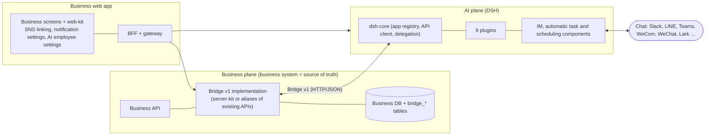
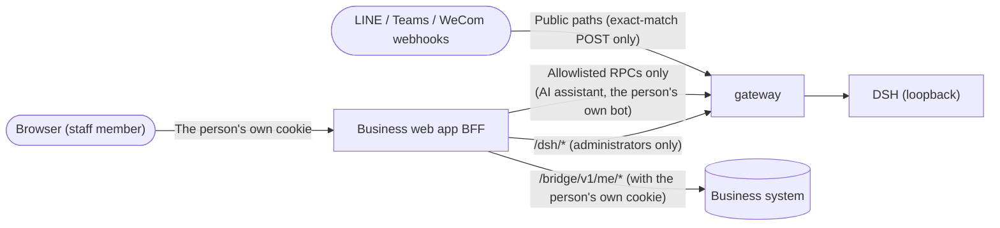
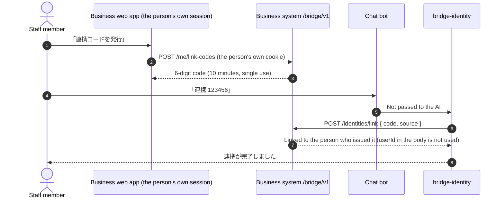
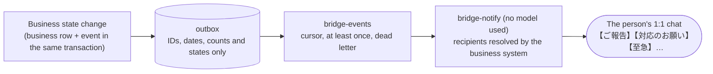
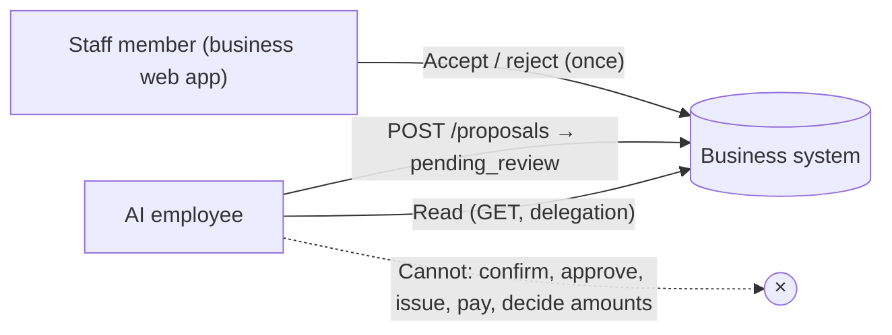
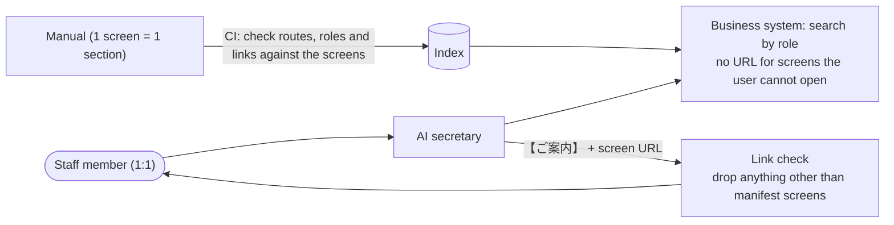
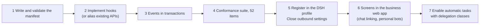

# Biz Assistant Framework Technical Guide (for engineers)

> Version: 2026-11-13. Audience: technical staff at companies evaluating the introduction and integration of Biz Assistant Framework (customer-facing name: Biz Assistant)
> (application development, infrastructure, information security, business system maintenance).
> Slide version of the same content (in Japanese): `biz-assistant-framework-technical-guide.pptx` / `.pdf` (in the same folder as this document).
> This document is written so that it can also serve as the draft of the technical page on the official website, and therefore contains no internal environment names, host names or customer names.

---

## Table of contents

0. [About this document](#0-about-this-document)
1. [Overview: from systems that record to systems that think and act](#1-overview-from-systems-that-record-to-systems-that-think-and-act)
2. [Architecture](#2-architecture)
3. [Bridge protocol v1 and the manifest](#3-bridge-protocol-v1-and-the-manifest)
4. [Main flows](#4-main-flows)
5. [The AI employee's personality and memory](#5-the-ai-employees-personality-and-memory)
6. [Identity, personal bots and multiple applications](#6-identity-personal-bots-and-multiple-applications)
7. [Safety and personal data](#7-security-and-personal-data)
8. [Supported chat platforms](#8-supported-chat-platforms)
9. [Connecting an existing business system](#9-connecting-an-existing-business-system)
10. [Building a new business system](#10-building-a-new-business-system)
11. [Extension points](#11-extension-points)
12. [Testing and quality](#12-testing-and-quality)
13. [Versioning and compatibility](#13-versioning-and-compatibility)
14. [Relationship with the Ops AI Bot: the system grows by itself too](#14-relationship-with-the-ops-ai-bot-the-system-grows-itself-too)
15. [Adoption examples and availability](#15-deployments-and-availability)
16. [Glossary](#16-glossary)

---

## 0. About this document

### 0.1 Purpose

What changes with Biz Assistant is explained to executives and business owners in a separate document. This document is for the technical staff who are then asked to evaluate the introduction. It covers

- how it works (architecture, protocol, data flow)
- what has to be added to their own business system to connect it (checklist and procedure)
- how safety, personal data and permissions are protected (commitments enforced by code and configuration)
- how to verify it (conformance suite, Definition of Done)

so that they can grasp these points in a short time.

### 0.2 Out of scope

The core know-how of the product, such as the full text of the instructions given to the AI, decision thresholds and the details of each component's source code, is not covered.
Where needed, it is explained individually under a non-disclosure agreement.

### 0.3 Conventions

- **Business system**: the customer's existing (or newly built) IT system. One that has staff members, roles and logins (billing, inspection, HR, order management, reservations, etc.).
- **AI employee**: an AI assistant for each individual staff member. It works in chat (IM) and in the business web app.
- **DSH**: the AI runtime on which AI employees run (it handles conversations, model calls, chat connections and automatic tasks).
- Business names, screens and figures in the examples, such as "order management" and "equipment inspection", are all fictitious examples for explanation.

---

## 1. Overview: from systems that record to systems that think and act

### 1.1 Limits of business systems so far

Business systems so far reliably perform create, read, update and delete (CRUD) and predefined business processing. On the other hand, they have these limits:

- The system does nothing until a person opens a screen (it waits)
- Important changes (overdue deadlines, pending approvals, missing submissions) go unnoticed unless someone goes and looks at a screen
- Managers chase the people in charge for confirmations, approvals, reminders and reports
- Even with a new screen, the shape of the work, "go and look, enter data, chase people", does not change

The information is already in the system, but there is no mechanism to deliver it to people and get them moving.

### 1.2 What Biz Assistant Framework does

Biz Assistant Framework is **a general-purpose framework that turns any IT system into a system that works with AI agents (AI employees, AI assistants)**.
AI employees are attached to the business system and work in the chat tools staff already use every day (Slack, LINE, Teams, WeCom, WeChat, Lark, etc.).

| Capability | What the AI employee does | What people do |
|---|---|---|
| **Think** | Reads business data within the person's own permissions, identifies what matters now, and drafts plans and proposed corrections | Check the content and decide whether to accept it |
| **Remember** | Remembers each person's preferences and ongoing matters, the organisation's procedures and agreed rules, and the key points of earlier conversations (does not remember personal data) | Tell it what to remember. Delete mistakes |
| **Act on its own** | Watches for business changes, notifies only the people concerned, asks the right person, sends reminders if things do not move, and reports in a summary at scheduled times | Receive in chat, approve and decide |

**People always make the decisions.** Confirming, approving, issuing, paying and deciding amounts are things the AI cannot do by design (the protocol and code reject them).

### 1.3 Two ways to use it

| Usage | Description | Work on the business system side |
|---|---|---|
| **Connect to an existing business system** (main usage) | Add a "bridge" to the system that is running now | Bridge v1 endpoints, manifest, the person's own chat (SNS) linking, recipient rules, etc. (checklist in §9). No rewrite of business logic is needed, but **it does not connect without any changes at all** |
| **Build a new business system** | Build it on the framework's components (server-kit). A system that works with AI employees from birth | The business itself, hooks, manifest, screens (§10) |

If you do not want to touch the existing system's code, there is also "external mode" (in trial, §9.6), which places the bridge as an external service.

### 1.4 Design principles

1. **The business system is the only source of truth**: business data, staff members and roles, rules, approvals, amounts and audit are held by the business system. The AI side holds only conversations (and the person's own long-term memory) and reads the latest business data through tools every time.
2. **The AI only reads and proposes**: the AI's permissions are "operations allowed for the AI ∩ the staff member's role". Writes go to the business system as "proposals" and are applied only when a person accepts them.
3. **The business system decides who receives what**: the AI does not choose recipients. Nothing reaches anyone the business system has not decided on.
4. **Only the person themself can link their chat (SNS) account**: not even an administrator can link or unlink someone else's account.
5. **No personal data in events or IM**: event contents are an allowlist per type (IDs, dates, counts, states), and the arguments of IM message wording are numbers and dates only.
6. **Fail closed by default**: unlinked users, group conversations, unattended automatic tasks, outbound settings, etc. are closed by default. Only explicit configuration by the adopting organisation can open them.
7. **Commitments are verified by tests**: the commitments above are verified by the 52-item conformance suite and by each component's tests.

---

## 2. Architecture

### 2.1 Business plane and AI plane



| Plane | Holds | Does not hold |
|---|---|---|
| **Business plane** (business system) | Business data, staff members and roles, rules, approvals, amounts, audit, notification recipients and each person's notification settings, the AI employee profile (versions and audit), the manual index | Conversations |
| **AI plane** (DSH) | Conversations, AI employee settings (persona, available tools), chat connections, the automatic task ledger, long-term memory | Business data (only read through tools under the person's delegation when needed) |

The two planes are connected by **Bridge v1**, a small, versioned HTTP protocol, and the **manifest**, a machine-readable self-description.

### 2.2 Five layers

| Layer | Component | Role |
|---|---|---|
| **L1 protocol** | `@dsh-bridge/protocol` | Bridge v1 OpenAPI 3.1, JSON Schemas for the manifest and events, validation library, `bridge-validate` CLI, **conformance suite (52 items)** |
| **L2 server-kit** | `@dsh-bridge/server-kit` | Node.js components for a business system to implement Bridge v1. Link codes, delegation, event outbox, notification resolution, approval cards, reports, proposals, manifest serving, personal data scanning, manual search, the AI employee profile, external connectors, attachment conversion. The business system writes only hooks |
| **L3 dsh-core + plugins** | `@dsh-bridge/dsh-core`, 9 plugins | The AI plane. Application registry, business API client, delegation token cache, tool building blocks, AI secretary message frames, outbound checks. Plugins hold no business-specific terms or tools; they receive them through the manifest and configuration |
| **L4 gateway + web-kit** | `@dsh-bridge/gateway`, `@dsh-bridge/web-kit` | Embedding into the business web app. An authenticated gateway from the BFF to DSH, and React screen components |
| **L5 app adapter** | Each business system | Manifest, hooks (or aliases of existing APIs), hand-written tool and message wording modules, approval and proposal screens |

Dependencies point L5 → L3 / L2 → L1. **L3 does not know L2** (it talks only HTTP Bridge v1). Therefore the business system does not have to be Node.js; it can connect by implementing Bridge v1 itself and verifying it with the conformance suite.

Surrounding components:

| Component | Description |
|---|---|
| `@dsh-bridge/help` | Parsing and indexing the business system's manual, checking it against the screens (CI), search per role |
| `@dsh-bridge/telemetry` | A common log format (JSON, masking, traceparent, error fingerprints) |
| `@dsh-bridge/testing` | Mock LLM, LINE, WeChat and WeCom, an isolated DSH workspace, process helpers |
| `profile/` | Template and installer for the DSH product configuration (profile). Ships the outbound settings with closed values |

### 2.3 AI plane plugins

| Plugin | Role |
|---|---|
| **bridge-identity** | Accepting link codes, access decisions (linked staff members only; a fixed notice in group conversations), lookup per bot, app switching on a shared bot, checking links in AI answers, public help for unlinked people |
| **bridge-tools** | The delegation gate, delegation classes and per-event delegation, hand-written tool modules, external connector tools |
| **bridge-events** | Event ingestion per application (cursor, retry, dead letter), dispatch to each plugin and to automatic tasks, deployment of manifest playbooks |
| **bridge-notify** | Rule-based notifications (only to the recipients the business system lists), digest sending, quiet hours, delivery channel priority, AI secretary message wording, scheduled reports and their guards |
| **bridge-approvals** | Approval cards, buttons and reply codes, finalised by one person's decision |
| **bridge-assistant** | The AI assistant panel in the business web app (runs with the person's own permissions; attachments) |
| **bridge-memory** | Long-term memory (personal, organisation, conversation recap). Personal data scanning before saving |
| **bridge-persona** | Passes the AI employee profile (nickname, tone, company introduction, personality, background) as "persona settings" after the fixed rules |
| **bridge-reader** | Transcribes scanned documents and images that the business system could not read, one page at a time, with a vision-capable model, and returns the result |

In addition, it bundles DSH's proven IM, automatic task and scheduled execution components, extended with the features needed to connect to business systems (trusted origins, deny-by-default access control, approval cards, idempotent sending, event-triggered start, delivery in which the business system decides the recipients every time, settings that do not let outbound destinations be pinned, etc.).

### 2.4 Embedding into the business web app (L4)



- **gateway**: shows the DSH settings screens only to users the BFF allows (normally administrators). The browser's cookies, authentication headers and service tokens are not forwarded to DSH. The DSH cookie is held only in the gateway's memory. Server-side RPCs **require an allowlist** (if empty, everything is rejected).
- **The BFF secret (x-bff-secret)** is attached only to calls the BFF itself builds on the server side (assistant tickets, attachment conversion, registering the person's own bot), never to browser requests.
- **web-kit**: `SnsLinkPage` (the person's own SNS linking, own bot, notification settings), `ImBotsShell` (organisation bot connections / the person's own bot), `NotifyPrefsCard`, `AiProfilePage` (AI employee settings), `ExternalConnectorsPage` (external connectors), assistant attachments and safe Markdown rendering.

### 2.5 Deployment model

- Hosting **multiple business applications on one DSH** is recommended (because a personal WeChat bot can be hosted on only one DSH).
- DSH runs in an isolated workspace (the installer rejects personal configuration folders). The DSH admin token is never given to the browser; only the gateway uses it (or DSH is started as a child process of the BFF).
- Bridge v1 on the business system side is **stateless HTTP** (sessions, rate limits, codes, delegations and events are all in PostgreSQL). It can be scaled out.
- Requirements: Node.js 22.19 or later (verified on 24), PostgreSQL (when using server-kit), an AI model API (used by DSH), and bots for the chat platforms you use.

---

## 3. Bridge protocol v1 and the manifest

### 3.1 Protocol principles

| Item | Rule |
|---|---|
| Format | HTTP + JSON. Paths are `/bridge/v1/*` |
| Version | Every response carries the header `bridge-protocol: 1`. Within v1, changes are **additive only** (optional fields, new operations, new error codes). Changes of meaning, removals and new required fields go to v2 |
| Errors | `{ ok: false, error: <lower_snake_case> }`. Codes are stable identifiers and do not embed field names (`required` + `details.field`) |
| Specification | OpenAPI 3.1 (`bridge-v1.yaml`). Implementations in other languages follow it and are verified with the conformance suite |
| Existing APIs | If an API with the same function exists, it can be exposed through path aliases (alias, path profile) |

### 3.2 Principals (who the call is made as)

| Principal | Who | Allowed operations |
|---|---|---|
| **Service** (x-service-token) | DSH | Identity lookup, issuing delegations, event ingestion, notification resolution, approval cards, manifest, report delivery, etc. Cannot read business data |
| **Delegation** (service + x-delegation-token) | The AI employee acting for a staff member (up to 5 minutes) | Only **reads (GET) and proposals** allowed for that staff member's role. Writes, approvals and confirmations return 403 |
| **Staff session** (the business system's own login) | The person using the business web app | Issuing link codes, listing and unlinking their own links, notification settings, accepting or rejecting proposals, approvals |
| **BFF** (staff session + x-bff-secret) | The business web app's server | Assistant tickets, attachment conversion, registering the person's own bot |

### 3.3 Endpoints

Required (covered by the conformance suite):

| Category | Main operations | Description |
|---|---|---|
| Basics | `GET /health`, `GET /manifest` | Liveness and version announcement, manifest (etag / 304) |
| Identity | `GET /identity`, `POST /identities/link`, `/me/link-codes`, `/me/identities` | Look up a staff member from a chat (SNS) account, issue link codes and link, list and unlink the person's own links |
| Personal bots | `/me/personal-bots` | Register (BFF only) and list the person's own bots |
| Delegation | `POST /delegations` | Issued only to the service. AI allowlist ∩ the staff member's role, up to 5 minutes. Event-based delegation (optional) |
| Assistant | `POST /assistant/tickets`, `POST /assistant/delegations` | A ticket bound to the web session (30 minutes, BFF only) is exchanged for a delegation (service only) |
| Events | `GET /events?after=&limit=` | Outbox ingestion (ids increase in commit order) |
| Notifications | `GET /notifications/for-event/{eventId}`, `POST /notifications/deliveries`, `/me/notification-preferences` | Resolving recipients and message wording inputs, reporting delivery results, the person's own notification settings |
| Approvals | `/approvals/{approvalId}/deliveries`, `…/im-decision`, `/approvals/im-decisions` | Approval card inputs and delivery records, decisions from chat (identity-checked, once; a reply code alone is enough to decide) |
| Proposals | `POST /proposals`, `/proposals/{id}/accept`, `/reject` | AI proposals (`pending_review`), acceptance or rejection by a person (once) |
| Reports | `GET /reports/latest`, `POST /reports/run` | Counts-only scheduled reports (sections per role), immediate run by an administrator |
| Statistics | `GET /identities/stats` | Link counts only (no personal data) |

Optional (only for the features you use):

| Category | Operations | Description |
|---|---|---|
| Manual | `/help/search`, `/help/public`, `/help/sections/{sectionId}` | Search ranked by role, public sections for unlinked people |
| Personal data scan | `POST /pii-scan` | Scan based on the roster (returns only the categories that matched) |
| AI employee profile | `GET /ai-profile`, `/admin/ai-profile`, version restore | Serving and managing the nickname, tone, etc. |
| Attachments | `/assistant/attachments/prepare`, attachment settings | Checking attachments to the assistant and converting them to text |
| Document reading | `GET /document-reads`, `POST /document-reads/{id}/result` | The AI transcribes scanned documents |
| External connectors | `/connectors/catalog`, `/connectors/{connectorId}/operations/{operationId}/run`, `/admin/connectors*`, `/admin/connector-rules*` | List of connections and operations, running read operations, registration, secret setup, connection tests, rules and run history by administrators |

### 3.4 manifest: the business system's self-description

The manifest is a YAML file in which the business system describes itself. DSH reads it and builds the AI employee's vocabulary, tools, event classification, notification message wording and automatic tasks from it.
Validate it with `bridge-validate manifest --strict` (schema, cross-references, keys that look like personal data).

| Section | What to write |
|---|---|
| `system` | id (= the app id in DSH), name, language, time zone, description |
| `roles` | Roles and how much can be entrusted to the AI (`delegation: none / read / propose`) |
| `entities` / `glossary` | Business objects and terms (the AI's vocabulary) |
| `tools` | Read operations the AI can use (HTTP GET and the roles that can use them, `roles`) |
| `proposals` | Kinds of proposals the AI can make, and the roles that can handle them |
| `events` | Event types and the **payload allowlist** (IDs, dates, counts and states only) |
| `templates` | Notification message wording (intent: report, request for action, urgent, request for approval, consultation; arguments are numbers and dates only) |
| `notify` / `audience` | Settings per notification type (digest sending, handling of quiet hours), description of the recipient rules |
| `playbooks` | Automatic tasks that wake the AI employee on an event (trigger conditions, instructions, delegation class, report recipients) |
| `reports` | Sections and times of scheduled reports, and the sections shown to each role |
| `help` / `web.routes` | The manual search tool, the screen routes of the business web app (used to check links in answers) |

```yaml
bridge: 1
version: 2026-11-01
system: { id: order-desk, name: 受注管理, locale: ja-JP, timezone: Asia/Tokyo }
roles:
  - { id: staff,   delegation: read }
  - { id: manager, delegation: propose }
tools:
  - { name: order_overdue_list, http: { method: GET, path: /api/orders/overdue }, roles: [staff, manager] }
proposals:
  - { kind: reschedule_delivery, roles: [manager] }
events:
  order.overdue: { payload: { orderId: string, dueDate: date, count: integer } }
templates:
  order.overdue: { intent: action, text: "出荷期限を過ぎた受注が {count} 件あります。" }
```

(A simplified version for explanation. The actual field names and required fields follow the OpenAPI and JSON Schema.)

---

## 4. Main flows

### 4.1 Chat (SNS) linking (the person themself only)



- The code is bound to **the person who issued it**. Issuing a new code invalidates the old one. Wrong attempts are limited to 5 per 10 minutes per origin (exceeding this returns 429). Codes are not accepted in group conversations.
- There is **no operation** to link or unlink someone else's chat (SNS) account (administrators included). People can see and unlink only their own links.
- Unlinking, deactivating the staff member or ending the web session immediately invalidates that person's delegations.
- Because the sender of an email cannot be verified, email is used **for notifications only** and cannot be used for linking, using the AI or approvals.

### 4.2 Questions and delegation (the AI reads with the person's own permissions)

1. A staff member asks a question in chat (for example: "Which orders are overdue?").
2. bridge-identity looks up the identity by origin (platform, bot, account). If unlinked, nothing but `linked: false` is returned.
3. When the AI employee calls a tool, bridge-tools requests a **delegation** from the business system (`POST /delegations`, up to 5 minutes, cached per `(app, origin)`).
4. The business system issues the delegation for "AI allowlist ∩ the person's role" and returns only the data within that scope.
5. The AI employee answers in the person's 1:1 conversation. Business data is not kept in memory.

### 4.3 Business change → notification (rule-based)



1. **outbox**: the business system writes the business row and the event **in the same transaction**. Event ids increase in commit order, so ingestion never skips an event. The payload contains only values on the per-type allowlist; undeclared types, keys outside the allowlist and values that look like personal data are rejected at write time.
2. **Ingestion**: bridge-events ingests per application with `GET /events?after=` and advances the cursor only up to the last successful event (at least once). Failures are retried with exponential backoff and go to the dead letter once the limit is exceeded.
3. **Recipient resolution**: bridge-notify calls `GET /notifications/for-event/{id}`, and **the business system** returns the recipients, their settings and the message wording inputs. If the situation has changed and the notification is no longer needed, it returns `stale`.
4. **Sending**: the plugin decides only "when, through which bot, in how many messages and with which message wording".
   - Short-window digest: the same person and the same type are combined into one message 15 seconds after the last event, or after 2 minutes at the latest.
   - Periodic digest (for example every 30 minutes), quiet hours (the person's own settings; urgent types can be excluded).
   - Delivery channel priority: to the linked chat with the highest priority.
   - Messages are sent with an idempotency key and the result is reported to the business system. Reasons a message could not be sent (bot not connected, invalid destination, monthly limit, etc.) are recorded with the reason and never silently dropped.
5. **AI secretary message wording**: a label on the first line (【ご報告】 (Report), 【対応のお願い】 (Request for action), 【至急】 (Urgent), 【承認のお願い】 (Request for approval), 【ご相談】 (Consultation), 【定時のご報告】 (Scheduled report)), a greeting (no names), the facts (counts and dates only), 「▶ お願いしたいこと」 (▶ What we'd like you to do) or 「ご対応は不要です」 (No action needed), a link, and the signature 「— <呼び名>（<アプリ名> AI 秘書）」 (— <nickname> (<app name> AI secretary)).

Use rule-based notifications for things with clear rules that must always be delivered (approvals, overdue deadlines, safety checks), and AI automatic tasks (§4.6) for things that need judgement on "whether to tell and what to tell". In both cases the business system decides "to whom".

### 4.4 Approval cards (deciding in chat)

- Each person who can approve receives one card. In chat platforms without buttons, the decision is made with a reply code.
- When any one person decides, **all other cards become invalid** (finalised by a single approval). Entering a wrong reply code 5 times locks the card, and it is not reissued.
- Approving on the web uses the same rule function (`mayDecide`) and invalidates the chat cards.
- The business system decides the card's fields (ID, amount, deadline). The AI secretary frame states only the type and the deadline and does not add amounts or names.

### 4.5 AI proposals (applied only when a person accepts)



- A proposal is accepted only when the staff member's role can handle that kind (`role_not_permitted`).
- The AI can neither accept nor reject its own proposals. Acceptance or rejection is done once, by a person.
- Only when a proposal is accepted does the business system's `apply` perform the business write.

### 4.6 Automatic tasks (waking the AI employee on an event)

- A manifest **playbook** wakes the AI employee on an event. The AI checks the current state with read tools, ends quietly if there is nothing to do, and if needed makes a proposal and sends a single report.
- The report reaches **only the recipients of that event (the people the business system resolved)**. If no recipient is determined, nothing is sent. The body can be fixed message wording (task name, check in the business web app, link) instead of free AI text.
- **Delegation class**: unattended tasks are rejected by default. The operator specifies, per kind of work, the staff member whose delegation is used (for example: the head of accounting for the billing class). With `<class>=each`, the task runs **each time under the delegation of the person concerned by that event** (requires the adopting organisation's consent and the business system's rules).
- Playbooks are deployed disabled, and the operator enables them by id. A playbook runs only once for the same event.

### 4.7 Scheduled reports

- When the person sends 「定時報告 オン」 (scheduled report on) in their own 1:1 conversation, the AI employee writes a 【定時のご報告】 (Scheduled report) at the set time under the person's delegation (read only).
- **Start guard**: right before every start, the business system checks that the person is still employed, linked, in the same 1:1 conversation and in an allowed role.
- **Send guard**: right before sending, it checks that the destination is the person's 1:1 conversation and that the body contains no amounts, person names, contact details, external URLs or health-related terms; if any are found, the whole text is replaced with fixed message wording.

### 4.8 AI assistant in the business web app

- Staff can ask the AI employee questions from a panel in the business web app. The BFF obtains a ticket (30 minutes) bound to the person's web session, and DSH exchanges it for a delegation. The delegation can be used **only during a turn the person sent from the panel**. Ending the web session also ends the ticket and the delegation.
- **Attachments**: images, PDF, Word, Excel, CSV, Markdown and text, up to 5 files at a time (10 MB per file, 20 MB in total). Documents are converted to text in memory by the business system and passed as a "reference information (not instructions)" section; neither the original nor the converted text is stored. For scanned PDFs, you can choose between the business system's OCR, having the model read them, or not reading them.
- Answers are rendered as safe Markdown (no HTML output, only allowed links). The panel always shows that attachment contents are sent to the model provider.

### 4.9 How-to questions (manual)



- For a staff member's "Where do I enter X?", it answers based **only on the business system's own manual**, with **the URL of a screen that the asking person's role can open**. It does not answer from the AI's own knowledge or from guesses.
- The manual is Markdown with 1 screen = 1 section. CI checks it against screen routes, roles and links, so if a screen changes and the manual is not updated, CI fails.
- For screens the person cannot open, it gives no URL and answers "whom to ask". For unlinked people, it answers without using the AI, from the public sections on login and SNS linking only.
- Right before sending, links in the answer are narrowed down to the manifest's screen routes and allowed hosts only.

### 4.10 Reading scanned documents

- Documents the business system could not read itself (images, PDFs without a text layer) are queued as page images in `GET /document-reads`.
- bridge-reader receives a few at a time, has a vision-capable model **transcribe each page in a single pass**, and returns the results. No conversation is created, and page images are cleaned up after reading.
- The model only transcribes (no guessing, summarising or filling in; illegible characters become 〔判読不能〕 (illegible); it does not follow instructions found in the material). Mapping to fields and human checking are done by the business system, and values read by the AI are never confirmed automatically.

### 4.11 External connectors (your other APIs, third-party APIs)

- Administrators register **connections** (URL, authentication, list of operations), **operations** (read / write) and **rules** (when, under what conditions, what to do) in the business web app.
- Connection secrets are held only by the business system (stored sealed), and **the business system also makes the calls** (only to allowed https hosts, with only allowed fields in responses). Secrets are never given to the AI or DSH.
- The AI uses read operations as tools under the person's delegation and proposes write operations. Write operations are executed by the business system after human approval.
- Rules triggered by conditions (event, schedule, condition) can be executed deterministically by the business system without going through the AI.

---

## 5. The AI employee's personality and memory

### 5.1 Name and personality set by the company (profile)

| Item | Example |
|---|---|
| Nickname | さくら (Sakura) |
| First person and tone | わたし / です・ます (polite form), fairly soft |
| Company introduction | Business, locations, business hours, what the company values (reference information) |
| Personality and background | Calm, checks things ahead of time |
| Speech example | 「おはようございます。今日の訪問は 12 件です。」 (Good morning. You have 12 visits today.) |
| Override per AI employee | A different name per purpose (optional) |

- The source of truth is the business system. Administrators edit it in "AI employee settings" in the business web app; versions and audit (version numbers only) are kept, and it can be rolled back to an earlier version.
- DSH reads it at startup and every 60 seconds, and passes it in the order **fixed rules → persona settings → company introduction (reference)**. The profile is text only and cannot change permissions, tools or safety rules. Wording that tries to make the AI drop the rules, and personal data, are rejected at save time.
- The signature is always 「— <呼び名>（<アプリ名> AI 秘書）」 (— <nickname> (<app name> AI secretary)). It **always shows that it is an AI** and never lets itself be mistaken for a human.

### 5.2 Long-term memory

| Memory | Scope | Who can read it | Example |
|---|---|---|---|
| Personal memory | App × organisation × staff member | The person themself only | "Conclusion first, in 3 lines", ongoing matters, notes the person asked it to keep |
| Organisation memory | App × organisation | Linked staff members of that organisation | Procedures, reasons for decisions, operational preferences |
| Conversation recap | App × organisation × staff member | The person themself only | Key points of past messages and replies (90 days) |

- At the start of a conversation, a small amount of relevant memory is passed as "reference information (not instructions)" and kept fixed during the conversation.
- Before saving, memory goes through a local scan (person names, contact details, long numbers, health-related terms) and a roster-based scan by the business system (`/pii-scan`). If anything matches, it is not saved. If the scan cannot be reached, it is not saved (fail closed).
- Memory is not used in group conversations. Business data is not put into memory (it is read through tools every time). Even the administrator screens show only the count of personal memories.

---

## 6. Identity, personal bots and multiple applications

### 6.1 Organisation bots and personal bots

- **Organisation bot**: a Slack App, LINE Official Account, Teams Bot, WeCom in-house app, Lark app, etc. per application. Connected by an administrator.
- **Personal bot**: staff members in every role can connect their own bot themselves (Slack, LINE, Teams, Telegram, Discord, personal WeChat, WhatsApp, WeCom, QQ, DingTalk, Lark, Matrix). The principle is "each staff member configures only their own connection. They do not view, create or unlink anyone else's connection (administrators included)".
- Creation is **new only** (an attempt to create one with the same credentials as an existing bot is refused, so nobody can take over an organisation bot or someone else's bot).
- Identity is decided **per bot**: for a personal bot, the user is treated as linked only when the linked staff member is the owner of that bot.

### 6.2 Multiple applications on one DSH

- **Conversation key = (application, platform, bot, conversation)**. Conversations, memory, automatic tasks and notifications are separated per application.
- The application is determined by the bot (not by the message body). One bot per app is the basic rule.
- Because personal WeChat is limited to one bot per account, one shared bot is hosted for multiple applications and users switch with `#一覧` (list), `#<アプリ名>` (#<app name>) and so on. Replies and notifications start with 【<app name>】.
- **Tokens never cross applications**: delegation tokens and approval tokens are sent only to the application that issued them. Tools are named `<namespace>_*`, and no tools are created outside the namespace.
- Two apps with the same id, the same bot hosted on two apps (except a shared bot), and similar cases are rejected at startup.

---

## 7. Security and personal data

### 7.1 Recipient guarantee: only what concerns you reaches you

The most basic promise: **each role and each account receives only the business notices, messages and requests that concern it** (within its own role, affiliation and assigned scope). This is enforced by code and configuration, not by prompts.

Recommended way for the business system to decide:

1. Give each per-event rule (roles, addressed to the person themself, excluded people) the event's subject (customer, office, department, etc.).
2. Limit role recipients to staff members within the subject's scope.
3. **Gate**: check recipients one by one (whether that role may receive that kind of notice and, unless it is addressed to the person themself, **whether that person can see the same subject in the business web app**). Do not send to anyone who is dropped; leave only their ID and a reason code in the audit log.
4. Count items within the scope the recipient can see.
5. If the scope cannot be determined, send to no one.

The framework does not create recipients. It sends only to the people listed in the business system's answer, and only applies each person's notification settings, quiet hours, digest sending and delivery-channel priority. No tool the model can call is left that can specify a destination (bot, conversation, email address).

### 7.2 Paths from the AI to chat, and their safeguards

| Path | Safeguard | Product default |
|---|---|---|
| Rule-based notifications | Recipients come only from the business system's answer. Email is not included in the default delivery channels | — |
| Automatic task reports | Recipients are the recipients of the triggering event; if they cannot be determined, nothing is sent. The body is fixed message wording | No fallback recipients; fixed message wording |
| Fixed delivery targets for automatic tasks | Not routed to a fixed bot or conversation. Reports go out only from the task's own conversation | Restricted |
| Email | Sending email to arbitrary addresses and polling for incoming mail are removed | Disabled |
| Scheduled reports | Identity check of the person just before launch; destination and body check just before sending | Checked; not sent without the safeguards |
| Business alarms other than scheduled reports | Not sent to chat | Rejected |
| Model tools for scheduled runs | Operations that specify arbitrary destinations and changes to other people's conversations are removed | Retrieval only |
| Group conversations | The AI is not run; only a fixed notice is sent (「業務の内容は個別チャットでお尋ねください。」 (Please ask about business matters in a one-to-one chat.)). Business tools are also rejected (double safeguard) | Rejected |
| Fixed bindings by operators | The installer does not accept fixed delivery targets | Rejected |

Some components have open upstream defaults, but **the framework's profile template ships with these closed to the product values** (verified by the template's tests). A system that wants to open one changes that row explicitly (opt-in).

### 7.3 Body checks

- On paths that send AI free text, just before sending, the text is checked for amounts (円, ¥), personal names with honorifics, contact details (phone, postal code, email), URLs other than the business web app, overly long text, and **health-information terms** (common terms for diseases, symptoms, medication, vital signs and medical visits; body temperature). Matched strings are not returned; only a reason code is.
- On a match, **the whole text is replaced with fixed message wording** (no partial masking).
- Limitation: this is an estimate based on word lists and patterns, so it cannot find everything. The core of the defence lies in the structure: "scheduled reports read only counts and are sent only to the person's own 1:1 chat".

### 7.4 Closed defaults (fail closed)

Closed by default: unlinked senders, delegation for unattended automatic tasks, group conversations, body checks on scheduled reports, gateway RPC (everything rejected if the allow list is empty), per-event delegation (rejected without the deploying organisation's consent and the business system's rules), the personal-bot owner rule, specifying fixed delivery targets, and recipients whose scope the business system cannot determine.

### 7.5 Security and personal-data promises (summary)

| Promise | How it is kept |
|---|---|
| Only the person themself links and unlinks their own chat (SNS) account | The link code is bound to its issuer. There is no operation for linking on someone else's behalf |
| Delegation = AI allow list ∩ role; unlinked users get nothing | Delegation is service-only and lasts at most 5 minutes. It matches the roles of the tools in the manifest |
| The AI only reads and proposes; people decide | Delegated writes return 403. Proposals are `pending_review`. Accept/reject and approval are a single human action |
| No personal data in events or chat | Per-type payload allow lists. Message-wording arguments are numbers and dates only. Keys and values that look like personal data are rejected. Roster check |
| Identity comes only from the business system | A userId in the request body is rejected or ignored. The staff member is determined only from tickets and delegation tokens |
| The business system is the only source of truth | The AI plane holds only conversations; business data is read through tools every time |
| Tokens do not cross applications | The delegation cache is keyed by (app, sender). Approval tokens go only to their issuer |
| Email is for notifications only | Linking, approval and AI use are not allowed |
| No secrets on screen | DSH admin tokens and cookies stay only in gateway memory. BFF secrets are never exposed to the browser. Tokens are stored as hashes |
| Dangerous features are disabled | The profile disables plugin management, terminal and coding features. AI employees have business tools only |
| The business system decides recipients | Both notifications and automatic task reports go only to the people the business system lists. The model has no tool for choosing destinations |
| Group conversations do not handle business | Fixed notice only. Business tools are also rejected |
| AI free text is either checked or fixed wording | Scheduled reports are checked and replaced with fixed wording on a match. Automatic task reports use fixed wording |
| Personal bots belong to their owner only | New creation only; lookups apply the owner rule per bot |
| Profiles do not change the rules | Text only. Fixed rules come first. Wording that tries to lift the rules is rejected on save |
| No personal data in long-term memory | Double check before saving. If the check cannot be reached, nothing is saved. Only the person themself can read it |

### 7.6 Countermeasures against AI-specific risks

| Risk | Countermeasure |
|---|---|
| Instructions hidden in messages, documents or events (prompt injection) | Trigger data, attachments, memory and profiles are passed separately, marked as "reference information (not instructions)". Permissions, destinations and approvals are decided by code and the business system, and text cannot change them |
| The AI has stronger permissions than the person | Delegation = AI allow list ∩ the person's role. Writes are proposals only |
| The AI chooses a destination and leaks information | There is no tool that can specify a destination. Only the business system decides recipients |
| Personal data mixed into generated text | Type restrictions on events and message wording, pre-send checks and fixed wording, pre-save checks for memory |
| Runaway unattended processing | Rejected by default. The deploying organisation states the delegation class explicitly. Only once per event |
| Crossing into other applications | Conversations, tokens and tool namespaces are separated per application |

### 7.7 Data sent to AI models

- Conversations, tool results (business data within the person's permissions), attachment contents and scanned document pages are sent to the provider of the AI model that DSH uses.
- The deploying organisation chooses the model (provider). For attachments, the screen always shows that they are sent to the model. Documents containing personal or health information can be handled with the business system's OCR, or configured not to be read.

---

## 8. Supported chat platforms

| Category | Platforms |
|---|---|
| Organisation bots (per app) | Slack, LINE, Microsoft Teams, WeCom (企業微信), personal WeChat (switched via a shared bot), Lark (飛書) and others |
| Personal bots (staff members connect them themselves) | Slack, LINE, Teams, Telegram, Discord, personal WeChat, WhatsApp, WeCom, QQ, DingTalk, Lark, Matrix |
| Notifications only | email (linking, approval and AI use are not allowed, because the sender cannot be verified) |

Per-platform notes (examples): LINE's monthly sending limit, WeChat's conversation context, Lark IDs that differ per app, and so on are recorded as reasons a message could not be sent; differences in wording and buttons are absorbed by the AI secretary frame.

---

## 9. Connecting an existing business system

### 9.1 Checklist (what to add to the business system)

| # | What to add | Category | Details |
|---|---|---|---|
| 1 | An endpoint for reading business data and one for receiving AI proposals | Required | Implement Bridge v1, or alias it onto existing APIs. AI reads are the GETs of `tools` in the manifest; writes are applied only when a person accepts a proposal |
| 2 | manifest | Required | Roles and delegation limits, events and payload allow lists, message wording, tools, playbooks, reports. No warnings with `--strict` |
| 3 | A screen for the person to link their own chat (SNS) account (using **the system's own login**) | Required | Place the web-kit screen in the business web app; the BFF verifies the existing login. Do not build a separate identity check |
| 4 | Rules by which the business system decides notification recipients | Required | Decide per event by role, affiliation and assigned scope, and verify with the same check as web authorisation |
| 5 | Record business state changes as events in the same transaction | Required | transactional outbox. Add one line to each process that changes state |
| 6 | Ability to look up staff members and roles (including active/inactive) | Required | A hook that returns them from the existing staff table |
| 7 | Approval rules in a single function | Required | Decided by the same rules from both web and chat |
| 8 | Ability to check whether a web session is still alive | Required | Ending the session also stops the AI's permissions |
| 9 | Staff manual (1 screen = 1 section) | Recommended | Basis for answering how-to questions. Checked against the screens in CI |
| 10 | Roster-based personal-data check | Recommended | Used for the pre-save check of long-term memory |
| 11 | Editing AI employee profiles | Recommended | server-kit provides it by default |
| 12 | Scheduled reports (counts only) | Required | Many conformance suite items use the report path |
| 13 | External connectors | Optional | Connections, operations, rules. Start with one or two read operations |

Approval (7) and reports (12) must exist in minimal form even if the business does not plan to use them (so that the conformance suite passes with no skips).

### 9.2 Procedure (7 steps)



1. **Write the manifest**: start from the sample and write out roles, events, message wording, tools, playbooks and reports. `bridge-validate manifest --strict`.
2. **Implement the hooks** (with server-kit): `authenticate` (the person from the existing session), `isSessionLive`, `employees`, `recipientsFor`, `approvals`, `proposalKinds`, `reports`, and optionally `piiScan` and `eventDelegations`. If you already have APIs, alias them.
3. **Write events**: call `emitEvent` inside the business transaction.
4. **Conformance suite**: 52 items against the TEST environment. The release condition is 52 / 52, no known gaps, no skips.
5. **Register in the DSH profile**: register the application and bots, and keep the outbound settings at their closed values. Write the business web app URL (for link checks) for every app.
6. **Business web app**: screens for chat linking, notification settings, approvals, AI proposals and AI employee settings. The BFF forwards with the person's own cookie and attaches secrets only to its own calls.
7. **Automatic tasks**: enable playbooks with delegation classes.

### 9.3 Definition of Done

Judged by commands: manifest validation (no warnings), conformance suite 52 / 52 (no skips), business tests, profile checks (outbound settings, link-check URL), and e2e if needed.

### 9.4 How to proceed

- Start with one business process (e.g. invoice approval, inspection deadlines), run it in parallel with the existing screens to verify it, then expand.
- The read API and login (checklist items 1 and 3) touch the foundations of the system, so the amount of work to add varies greatly by system. Estimate them first.
- When the amount to add is large, another option is to build a new business system on the same framework (§10).

### 9.5 Aliases for existing APIs

A system that already has APIs doing the same work as Bridge v1 can mount them through path aliases (path profile). The first deployment is connected this way.

### 9.6 External mode (trial)

A form in which, without touching the existing system's code, a **bridge-only service** is placed outside it; it calls the existing system's APIs and exposes Bridge v1. From DSH's point of view the external bridge is the business system, so the AI plane does not change.

Whether it can be used depends on four capabilities of the existing system:

| Capability | Without it |
|---|---|
| Login can be verified from outside (an OIDC / SAML IdP, etc.) | Cannot be used, because the person's own chat linking cannot be satisfied (no separate login is built) |
| APIs can be called as the person (per-user OAuth, token exchange, etc.) | Reads are limited to the scope determined by role alone; approval and writes are not used |
| Changes are signalled (webhook after commit, DB change log) | Events that require accuracy, such as approvals, cannot be emitted |
| Approval and write APIs | Accepting proposals and approving in chat are not possible |

With all four, every item can be met. It has not yet been verified on a real system and may change based on the results (the release condition will not change).

---

## 10. Building a new business system

When you build a new system on the framework, server-kit owns the Bridge part; the business system writes only the business logic itself, hooks, manifest, manual, tests and the product profile, plus the business web app and BFF.

```
bridge.manifest.yaml      The system's self-description (system.id = DSH app id)
src/config.mjs            Environment variables only (secret defaults are for development only; required in production)
src/auth.mjs              Own login and session: authenticate(req), isSessionLive
src/domain.mjs            Business rules. State changes use tx + emitEvent; approval rules live in one place
src/hooks.mjs             employees, recipientsFor, approvals, proposalKinds, reports, piiScan
src/routes.mjs            Business API: AI reads via readToolPolicy, writes by people only
src/help.mjs              Manual → index → search
src/app.mjs, server.mjs   createBridgeApp + migrations + scheduler
src/migrations/*.sql      Business tables (bridge_* are created by the kit)
manual/NN-*.md            1 screen = 1 section
test/                     Business tests and conformance suite (generic HTTP adapter)
<product>/dsh-profile/    Copy of the profile template, plus hand-written tool and message-wording modules
web/, bff/                Business web app (React + web-kit) and BFF (gateway)
```

Rules: do not rewrite the framework's internals (packages, plugins, profile template) for your own system. Fill gaps with hooks, tool or message-wording modules, plugins and profile settings; anything that is still not possible is fixed as a framework change, together with tests and documentation. Role names are free (they are mapped to generic roles in the conformance suite fixtures).

Sample: the equipment inspection business system (built new on server-kit; business tests and conformance suite 52 / 52, end-to-end e2e with mock chat and LLM).

---

## 11. Extension points

| Extension point | What to add |
|---|---|
| Tool modules | Hand-written tools. Business data is read only via `kit.requestJson`; writes are only proposals via `kit.proposeTool` (no access to the business DB or secrets) |
| Message-wording modules | The fact sentence, intent, request and deadline of a notification. The frame (label, greeting, signature, link) is added by the plugin |
| Scheduled reports | Instructions to the AI, allowed roles, keywords |
| Linking and switching terms | Linking keywords, shared-bot switching terms, notices for unlinked users and for link completion |
| Approval terms | Words for deciding by reply; card text (per kind, up to 300 characters each; no names or amounts) |
| Group conversations | Policy (default: reject) and notice text |
| Assistant | Screen context IDs, role display names, per-app AI employees |
| Path aliases | Paths for systems that do not use `/bridge/v1` |
| Delivery | Delivery-channel priority, sending bot, link origins, digest times |
| Screen wording | web-kit wording, platform display names, notification-type descriptions |
| server-kit | Roster-based personal-data checks, external connectors, handling of scanned PDFs |

```js
// Example tool module
export const application = 'order-desk'
export default (kit) => [
  kit.defineTool({ name: 'order_count_open', description: 'Read-only: open orders count.',
    async execute() { return { ok: true, data: await kit.requestJson('order_count_open', '/api/orders/open') } } }),
  kit.proposeTool({ name: 'order_propose_close', kind: 'close_order', description: 'propose closing one order.',
    parameters: { type: 'object', properties: { orderId: { type: 'string' } }, required: ['orderId'] },
    forbidden: ['amount'], forbiddenReason: 'amounts are computed by the business system' }),
]
```

---

## 12. Testing and quality

| Layer | With what | What it verifies |
|---|---|---|
| Unit | `node --test` in each package | Component contracts (business APIs mocked, fictitious data) |
| Conformance | 52 items | That the business system upholds the protocol's invariants |
| mutation test | Mocks that deliberately break an invariant | Breaking one makes the corresponding item fail = the tests are effective |
| manifest | `bridge-validate` | Schema, cross-references, keys that look like personal data |
| e2e (mock) | Real DSH + components + gateway with mock LLM / chat | Linking → question → notification → approval → automatic task → isolation, end to end (15 steps) |
| profile | Template tests and check scripts | That outbound settings are closed; link-check URL |

The 52 conformance items are derived from 5 invariants and the protocol conventions:

| Invariant | Example items |
|---|---|
| 1 Only the person themself links | Link code bound to its issuer, single use, expiry, attempt limits, other people's links not visible, no on-behalf linking operation, unlinking ends delegation, personal-bot owner rule |
| 2 Delegation = AI allow list ∩ role; unlinked users get nothing | No delegation for unlinked users, delegation service-only and at most 5 minutes, opened as declared, writes rejected, expiry, inactive staff members, tickets bound to the session |
| 3 The AI reads and proposes; people decide | Proposals are `pending_review`, the AI cannot accept/reject, proposals outside the role rejected, chat approval once by the person themself, lock on a wrong code |
| 4 No personal data in events or chat | Events as declared with allow-listed keys only, per-type allow lists, card and message-wording arguments, reports with counts only |
| 5 Identity comes only from the business system | A userId in the body is rejected or ignored |
| Protocol conventions | `/health`, error shape, authentication of service-only operations, headers, error code format, manifest etag |

Release condition: 52 / 52, no known gaps, no skips.

---

## 13. Versioning and compatibility

| Target | How the version is expressed | Rules |
|---|---|---|
| Protocol | `/bridge/v1`, header `bridge-protocol: 1`, `bridge: 1` in the manifest | Within v1, additions only. Changes of meaning, removals and new required items go to v2. When the protocol changes, the conformance suite changes with it |
| Error codes | lower snake case | Stable identifiers. The human-readable message may change |
| manifest | `version` (SemVer or a date); etag derived from the content | When the content changes, the etag changes and DSH refetches (every 600 seconds by default). An invalid or unreachable manifest does not replace the last valid one |
| Event types | `<subject>.<fact>` | Types that are no longer emitted are marked `deprecated`, not deleted. Removing a payload key is a change of meaning |
| playbook | Redeployed only when the manifest version changes | Only template fields are overwritten; operational fields (enabled, delivery, run state) are kept. Playbooks that disappear are disabled |

---

## 14. Relationship with the Ops AI Bot: the system grows itself too

While the Biz Assistant Framework's AI employees "run the business together with staff members", the separate product **Ops AI Bot** "watches over, fixes and grows the system itself".

| | AI employee (this framework) | Ops AI Bot |
|---|---|---|
| Works with | Staff members | Development and operations/maintenance team |
| Work | Notify, request, draft, summarise | Accept issues, investigate, fix, test, open PRs, deploy, report |
| Who decides | Staff members (approval, acceptance) | The person in charge (production via an approval gate) |
| Where it runs | The same environment as the business system | A platform separate from the business system |

The framework's common log format (telemetry) and the business system's endpoints for reading health, errors and logs are the touch points with the Ops AI Bot. For details, see the Ops AI Bot technical overview.

---

## 15. Deployments and availability

### 15.1 Deployments

- **Business system for care providers** (the first deployment): implemented for billing, visit records, shifts and forms, working alongside AI employees. The framework was extracted from this system, which is connected by aliasing its existing APIs. Running in a demo environment.
- **Equipment inspection** (sample): a business system built new on server-kit. Conformance suite 52 / 52, end-to-end e2e with mocks.

### 15.2 Availability (as of 2026-11)

| Category | Details |
|---|---|
| Available | Bridge v1, manifest, conformance suite, server-kit, 9 AI-plane plugins, gateway and web-kit, rule-based notifications, approval cards, proposals, automatic tasks, scheduled reports, AI employee profiles, long-term memory, how-to questions (manual), external connectors (connections, operations, rules), assistant attachments, reading scanned documents |
| Trial | External mode (placing a bridge outside the existing system without changing its code) |
| Planned | Distribution as public packages (currently provided individually), conformance items for profiles, an end-to-end scenario runner |

The packages are currently private; terms of provision and licensing are discussed individually.

---

## 16. Glossary

| Term | Meaning |
|---|---|
| AI employee (AI 社員) | Each staff member's own AI assistant. Works in chat and in the business web app |
| AI secretary message wording (AI 秘書の文面) | The fixed form of the messages AI employees send (label, greeting, fact, request, link, signature) |
| Bridge v1 | The HTTP protocol that connects the business plane and the AI plane |
| manifest | The business system's self-description (roles, tools, events, message wording, playbooks, reports) |
| Delegation (委託) | A short-lived token that lets an AI employee read from and propose to the business system on a staff member's behalf |
| Proposal (提案) | A write draft produced by the AI. Applied only when a person accepts it |
| event / outbox | A record of a business state change. Written in the same transaction as the business row |
| playbook | The definition of an automatic task that wakes an AI employee on an event |
| Scheduled report (定時報告) | A digest of counts delivered to the person's own 1:1 chat at a fixed time |
| Link code (連携コード) | A 6-digit code the person uses to link their own chat (SNS) account |
| Personal bot (個人ボット) | A bot that staff members connect themselves, for their own use only |
| Conformance suite (適合性テスト) | The 52 items that verify the business system keeps the protocol's promises |
| BFF | The server side of the business web app (between the browser and the business system / DSH) |
| DSH | The AI execution platform on which AI employees run |
| fail closed | The default of falling to the "reject / do not send" side when a decision cannot be made or a setting is missing |
