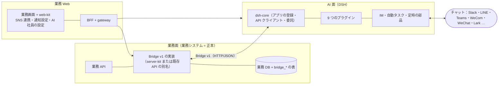
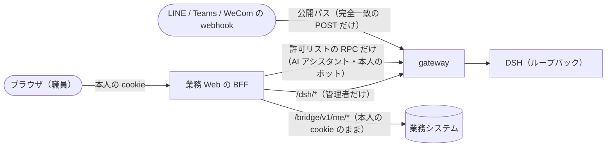
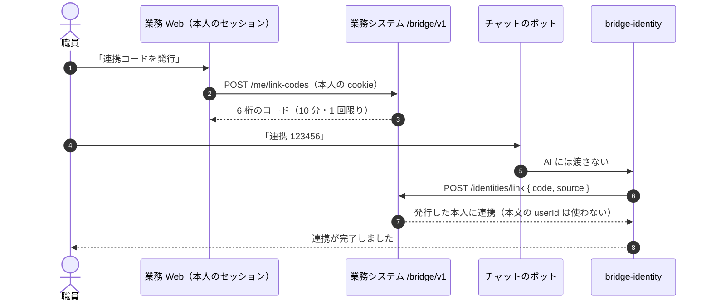
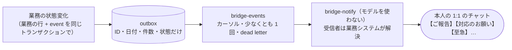
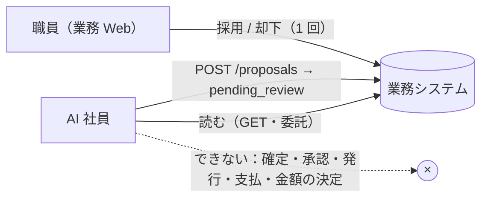
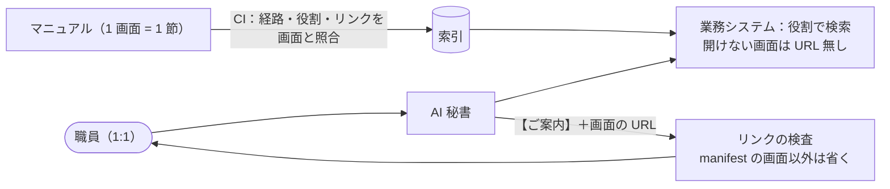
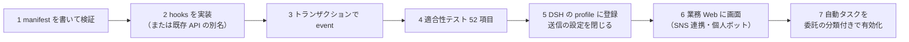

# Biz Assistant Framework 技術解説（技術担当者向け）

> 版：2026-11-13。対象：Biz Assistant Framework（顧客向けの名前：Bizアシスタント）の導入・連携を検討する企業の技術担当者
> （アプリケーション開発・インフラ・情報セキュリティ・業務システムの保守）。
> 同じ内容のスライド版：`biz-assistant-framework-technical-guide.pptx` / `.pdf`（この文書と同じフォルダ）。
> この文書は公式サイトの技術ページの原稿としても使えるように、内部の環境名・ホスト名・顧客名を含めずに書いている。

---

## 目次

0. [この文書について](#0-この文書について)
1. [概要：記録するシステムを、考えて動くシステムに](#1-概要記録するシステムを考えて動くシステムに)
2. [アーキテクチャ](#2-アーキテクチャ)
3. [Bridge protocol v1 と manifest](#3-bridge-protocol-v1-と-manifest)
4. [主な流れ](#4-主な流れ)
5. [AI 社員の人柄と記憶](#5-ai-社員の人柄と記憶)
6. [身元・個人ボット・複数のアプリケーション](#6-身元個人ボット複数のアプリケーション)
7. [安全と個人情報](#7-安全と個人情報)
8. [対応するチャット](#8-対応するチャット)
9. [既存の業務システムをつなぐ](#9-既存の業務システムをつなぐ)
10. [新しい業務システムを作る](#10-新しい業務システムを作る)
11. [拡張点](#11-拡張点)
12. [テストと品質](#12-テストと品質)
13. [バージョン管理と互換性](#13-バージョン管理と互換性)
14. [運用AI Bot との関係：システムも自分で育つ](#14-運用ai-bot-との関係システムも自分で育つ)
15. [導入例と提供状況](#15-導入例と提供状況)
16. [用語集](#16-用語集)

---

## 0. この文書について

### 0.1 目的

経営層・事業責任者には「Bizアシスタントで何が変わるか」を別の資料で説明している。この文書は、その後に導入の検討を任された技術担当者が、

- どういう仕組みで動くのか（アーキテクチャ・プロトコル・データの流れ）
- 自社の業務システムに何を足せばつながるのか（チェックリストと手順）
- 安全・個人情報・権限をどう守っているのか（コードと設定で守る約束）
- どう確かめるのか（適合性テスト・完了の条件）

を短時間で把握するためのものである。

### 0.2 扱わないこと

AI への指示文の全文、判定の閾値、各部品のソースコードの細部など、製品の中核のノウハウは扱わない。
必要な場合は秘密保持契約のうえで個別に説明する。

### 0.3 表記

- **業務システム**：お客様の既存の（または新しく作る）IT システム。職員・役割・ログインを持つもの（請求・点検・人事・受発注・予約など）。
- **AI 社員**：職員一人ひとりの AI アシスタント。チャット（IM）と業務 Web で働く。
- **DSH**：AI 社員が動く AI 実行基盤（会話・モデル呼び出し・チャットの接続・自動タスクを持つ）。
- 例に出てくる「受注管理」「設備点検」などの業務名・画面・数値はすべて説明用の架空の例。

---

## 1. 概要：記録するシステムを、考えて動くシステムに

### 1.1 これまでの業務システムの限界

これまでの業務システムは、登録・照会・更新・削除（CRUD）と、決められた業務処理を確実に行う。一方で、

- 人が画面を開くまで、システムは何もしない（待っている）
- 大事な変化（期限超過・承認待ち・未提出）は、誰かが画面を見に行かないと気づかれない
- 確認・承認・催促・報告のために、管理者が担当者を追いかける
- 画面を新しくしても「見に行く・入力する・追いかける」という仕事の形は変わらない

という限界がある。情報はすでにシステムの中にあるのに、それを人に届け、動かす仕組みが無い。

### 1.2 Biz Assistant Framework がすること

Biz Assistant Framework は、**どの IT システムも、AI エージェント（AI 社員・AI アシスタント）と働くシステムに変える汎用のフレームワーク**である。
業務システムに AI 社員が付き、職員がふだん使っているチャット（Slack・LINE・Teams・WeCom・WeChat・Lark など）で働く。

| 力 | AI 社員がすること | 人がすること |
|---|---|---|
| **考える** | 本人の権限の範囲で業務データを読み、いま大事なことを見分け、計画書や修正の案を下書きする | 内容を確かめ、採用するかを決める |
| **覚える** | 一人ひとりの好み・進行中の用件、組織の手順や決めごと、前の会話の要点を覚える（個人情報は覚えない） | 覚えてほしいことを伝える。間違いは消す |
| **自分から動く** | 業務の変化を見張り、関係する人にだけ知らせ、適任者に頼み、進まなければ催促し、定時にまとめて報告する | チャットで受け取り、承認・判断する |

**決めるのはいつも人**である。確定・承認・発行・支払・金額の決定は、AI にはできない作り（プロトコルとコードで拒否する）になっている。

### 1.3 2 つの使い方

| 使い方 | 内容 | 業務システム側の作業 |
|---|---|---|
| **既存の業務システムにつなぐ**（主な使い方） | いま動いているシステムに「ブリッジ」を足す | Bridge v1 の窓口・manifest・本人の SNS 連携・受信者の規則など（§9 のチェックリスト）。業務ロジックの書き換えは不要だが、**何も変えずにつながるわけではない** |
| **新しい業務システムを作る** | フレームワークの部品（server-kit）の上で作る。生まれたときから AI 社員と働くシステム | 業務そのもの・hooks・manifest・画面（§10） |

既存システムのコードに手を入れたくない場合は、ブリッジを外部のサービスとして置く「外付けモード」（試行中、§9.6）もある。

### 1.4 設計の原則

1. **業務システムが唯一の正本**：業務データ・職員と役割・規則・承認・金額・監査は業務システムが持つ。AI 側は会話（と本人の長期記憶）だけを持ち、業務データは毎回ツールで最新の値を読む。
2. **AI は読む・提案するだけ**：AI の権限は「AI に許した操作 ∩ その職員の役割」。書込みは「提案」として業務システムに渡り、人が採用したときだけ反映される。
3. **誰に届けるかは業務システムが決める**：AI は宛先を選ばない。業務システムが決めていない相手には何も届かない。
4. **SNS の連携は本人だけ**：管理者でも他人の SNS を連携・解除できない。
5. **event と IM に個人情報を載せない**：event の中身は型ごとの許可リスト（ID・日付・件数・状態）、IM の文面の引数は数値・日付だけ。
6. **閉じた既定（fail closed）**：未連携・グループ会話・無人の自動タスク・送信先の設定などは、既定で閉じている。開けるのは導入先の明示の設定だけ。
7. **約束はテストで確かめる**：上の約束は 52 項目の適合性テスト（conformance suite）と各部品のテストで確かめる。

---

## 2. アーキテクチャ

### 2.1 業務面と AI 面



| 面 | 持つもの | 持たないもの |
|---|---|---|
| **業務面**（業務システム） | 業務データ、職員・役割、規則、承認、金額、監査、通知の受信者と本人の通知設定、AI 社員のプロフィール（版と監査）、マニュアルの索引 | 会話 |
| **AI 面**（DSH） | 会話、AI 社員の設定（人物・使えるツール）、チャットの接続、自動タスクの台帳、長期記憶 | 業務データ（必要なときに本人の委託でツールから読むだけ） |

2 つの面は、小さく版の付いた HTTP プロトコル **Bridge v1** と、機械が読める自己紹介 **manifest** でつながる。

### 2.2 5 つの層

| 層 | 部品 | 役割 |
|---|---|---|
| **L1 protocol** | `@dsh-bridge/protocol` | Bridge v1 の OpenAPI 3.1、manifest と event の JSON Schema、検証ライブラリ、`bridge-validate` CLI、**適合性テスト（52 項目）** |
| **L2 server-kit** | `@dsh-bridge/server-kit` | 業務システムが Bridge v1 を実装するための Node.js の部品。連携コード・委託・event の outbox・通知の解決・承認カード・報告・提案・manifest の配信・個人情報の検査・マニュアル検索・AI 社員のプロフィール・外部連携・添付の変換。業務システムが書くのは hooks だけ |
| **L3 dsh-core + プラグイン** | `@dsh-bridge/dsh-core`、9 つのプラグイン | AI 面。アプリケーションの登録、業務 API クライアント、委託トークンのキャッシュ、ツールの部品、AI 秘書の文面の枠、送信の検査。プラグインは業務固有の語やツールを持たず、manifest と設定で受け取る |
| **L4 gateway + web-kit** | `@dsh-bridge/gateway`、`@dsh-bridge/web-kit` | 業務 Web への組み込み。BFF から DSH への認証付きゲートウェイと、React の画面部品 |
| **L5 app adapter** | 各業務システム | manifest、hooks（または既存 API の別名）、手書きのツール・文面のモジュール、承認・提案の画面 |

依存の向きは L5 → L3 / L2 → L1。**L3 は L2 を知らない**（HTTP の Bridge v1 だけで話す）。そのため業務システムは Node.js でなくてもよく、Bridge v1 を自分で実装して適合性テストで確かめればつながる。

周辺の部品：

| 部品 | 内容 |
|---|---|
| `@dsh-bridge/help` | 業務システムのマニュアルの解析・索引・画面との照合（CI）・役割ごとの検索 |
| `@dsh-bridge/telemetry` | 共通のログ形式（JSON・伏せ字・traceparent・エラー指紋） |
| `@dsh-bridge/testing` | モックの LLM・LINE・WeChat・WeCom、隔離した DSH の作業場所、プロセスの補助 |
| `profile/` | DSH の製品設定（profile）の雛形とインストーラ。送信の設定を閉じた値で出荷する |

### 2.3 AI 面のプラグイン

| プラグイン | 役割 |
|---|---|
| **bridge-identity** | 連携コードの受付、アクセス判定（連携済みの職員だけ。グループ会話には固定の案内）、ボットごとの照会、共用ボットのアプリ切替、AI の答えのリンクの検査、未連携の人への公開ヘルプ |
| **bridge-tools** | 委託の関門（gate）、委託の分類と event ごとの委託、手書きのツールのモジュール、外部連携のツール |
| **bridge-events** | アプリケーションごとの event の取り込み（カーソル・再試行・dead letter）、各プラグインと自動タスクへの振り分け、manifest の playbook の配備 |
| **bridge-notify** | 規則ベースの通知（業務システムが挙げた受信者だけに）、まとめ送信、通知を控える時間帯、配信先の優先順位、AI 秘書の文面、定時報告とその守り |
| **bridge-approvals** | 承認カード、ボタンと返信コード、1 人の決定で確定 |
| **bridge-assistant** | 業務 Web の AI アシスタントのパネル（本人の権限で動く。添付ファイル） |
| **bridge-memory** | 長期記憶（個人・組織・会話の振り返り）。保存前の個人情報の検査 |
| **bridge-persona** | AI 社員のプロフィール（呼び名・口調・会社の紹介・性格・背景）を、固定の規則の後ろに「人物の設定」として渡す |
| **bridge-reader** | 業務システムが読めなかったスキャン文書・画像を、画像を読めるモデルで 1 ページずつ書き写して返す |

このほか、実績のある DSH の IM・自動タスク・定時実行の部品に、業務システムとの接続に足りない機能（信頼できる発信元、既定で拒否するアクセス制御、承認カード、冪等な送信、event による起動、受信者を業務システムが毎回決める配信、送信先を固定させない設定など）を足したものを同梱している。

### 2.4 業務 Web への組み込み（L4）



- **gateway**：BFF が許した利用者（通常は管理者）にだけ DSH の設定画面を見せる。ブラウザの cookie・認証ヘッダ・サービストークンは DSH に転送しない。DSH の cookie はゲートウェイのメモリだけに持つ。サーバ側の RPC は**許可リスト必須**（空なら全部拒否）。
- **BFF の秘密（x-bff-secret）**は、BFF 自身がサーバ側で組み立てる呼び出し（アシスタントのチケット、添付の変換、本人のボットの登録）にだけ付け、ブラウザの要求には付けない。
- **web-kit**：`SnsLinkPage`（本人の SNS 連携・本人のボット・通知設定）、`ImBotsShell`（組織のボットの接続／本人のボット）、`NotifyPrefsCard`、`AiProfilePage`（AI 社員の設定）、`ExternalConnectorsPage`（外部連携）、アシスタントの添付と安全な Markdown 表示。

### 2.5 デプロイの形

- **1 つの DSH に複数の業務アプリケーション**を載せるのが推奨（個人 WeChat のボットは 1 つの DSH にしか載せられないため）。
- DSH は隔離した作業場所で動かす（インストーラは個人の設定フォルダを拒否する）。DSH の管理用トークンはブラウザに渡さず、ゲートウェイだけが使う（または BFF の子プロセスとして起動する）。
- 業務システム側の Bridge v1 は **stateless な HTTP**（セッション・回数制限・コード・委託・event はすべて PostgreSQL）。台数を増やせる。
- 必要なもの：Node.js 22.19 以上（24 で検証）、PostgreSQL（server-kit を使う場合）、AI モデルの API（DSH が利用）、使うチャットのボット。

---

## 3. Bridge protocol v1 と manifest

### 3.1 プロトコルの原則

| 項目 | 規則 |
|---|---|
| 形式 | HTTP + JSON。パスは `/bridge/v1/*` |
| 版 | すべての応答にヘッダ `bridge-protocol: 1`。v1 の中では**足すだけ**（任意の項目・新しい操作・新しいエラーコード）。意味の変更・削除・必須の追加は v2 |
| エラー | `{ ok: false, error: <lower_snake_case> }`。コードは安定した識別子で、項目名を埋め込まない（`required` + `details.field`） |
| 仕様 | OpenAPI 3.1（`bridge-v1.yaml`）。他の言語の実装はこれに従い、適合性テストで確かめる |
| 既存 API | 同じ働きの API があれば、パスの別名（alias・path profile）で載せられる |

### 3.2 主体（誰として呼ぶか）

| 主体 | 誰 | 使える操作 |
|---|---|---|
| **サービス**（x-service-token） | DSH | 身元の照会、委託の発行、event の取り込み、通知の解決、承認カード、manifest、報告の配信など。業務データは読めない |
| **委託**（サービス + x-delegation-token） | 職員の代わりの AI 社員（最長 5 分） | その職員の役割で許された**読取（GET）と提案**だけ。書込み・承認・確定は 403 |
| **職員のセッション**（業務システム自身のログイン） | 業務 Web を使う本人 | 連携コードの発行、自分の連携の一覧と解除、通知設定、提案の採否、承認 |
| **BFF**（職員のセッション + x-bff-secret） | 業務 Web のサーバ | アシスタントのチケット、添付の変換、本人のボットの登録 |

### 3.3 エンドポイント

必須（適合性テストの対象）：

| 区分 | 主な操作 | 内容 |
|---|---|---|
| 基本 | `GET /health`、`GET /manifest` | 死活と版の告知、manifest（etag / 304） |
| 身元 | `GET /identity`、`POST /identities/link`、`/me/link-codes`、`/me/identities` | SNS アカウントから職員を引く、連携コードの発行と連携、本人の連携の一覧と解除 |
| 個人ボット | `/me/personal-bots` | 本人のボットの登録（BFF だけ）と一覧 |
| 委託 | `POST /delegations` | サービスだけが発行。AI 許可リスト ∩ 職員の役割、最長 5 分。event に基づく委託（任意） |
| アシスタント | `POST /assistant/tickets`、`POST /assistant/delegations` | Web セッションに結び付いたチケット（30 分、BFF だけ）を委託に交換（サービスだけ） |
| event | `GET /events?after=&limit=` | outbox の取り込み（id は commit 順に増加） |
| 通知 | `GET /notifications/for-event/{eventId}`、`POST /notifications/deliveries`、`/me/notification-preferences` | 受信者・文面の材料の解決、配信結果の報告、本人の通知設定 |
| 承認 | `/approvals/{approvalId}/deliveries`、`…/im-decision`、`/approvals/im-decisions` | 承認カードの材料と送付の記録、チャットからの決定（本人照合・1 回。返信コードだけでも決められる） |
| 提案 | `POST /proposals`、`/proposals/{id}/accept`・`/reject` | AI の提案（`pending_review`）、人の採用・却下（1 回） |
| 報告 | `GET /reports/latest`、`POST /reports/run` | 件数だけの定時報告（役割ごとのセクション）、管理者による即時実行 |
| 統計 | `GET /identities/stats` | 連携の件数だけ（個人情報なし） |

任意（使う機能だけ）：

| 区分 | 操作 | 内容 |
|---|---|---|
| マニュアル | `/help/search`、`/help/public`、`/help/sections/{sectionId}` | 役割で並べた検索、未連携の人向けの公開の節 |
| 個人情報の検査 | `POST /pii-scan` | 名簿に基づく検査（当たった区分だけを返す） |
| AI 社員のプロフィール | `GET /ai-profile`、`/admin/ai-profile`、版の復元 | 呼び名・口調などの配信と管理 |
| 添付 | `/assistant/attachments/prepare`、添付の設定 | アシスタントへの添付の検査と文字への変換 |
| 文書の読み取り | `GET /document-reads`、`POST /document-reads/{id}/result` | スキャン文書を AI が書き写す |
| 外部連携 | `/connectors/catalog`、`/connectors/{connectorId}/operations/{operationId}/run`、`/admin/connectors*`・`/admin/connector-rules*` | 接続先と操作の一覧、読む操作の実行、管理者による登録・秘密の設定・接続テスト・規則・実行履歴 |

### 3.4 manifest：業務システムの自己紹介

manifest は業務システムが自分を説明する YAML。DSH はこれを読んで、AI 社員の語彙・ツール・event の分類・通知の文面・自動タスクを組み立てる。
`bridge-validate manifest --strict` で検証する（スキーマ・相互参照・個人情報らしいキー）。

| セクション | 書くこと |
|---|---|
| `system` | id（= DSH でのアプリ id）、名前、言語、タイムゾーン、説明 |
| `roles` | 役割と、AI に任せられる範囲（`delegation: none / read / propose`） |
| `entities` / `glossary` | 業務の対象と用語（AI の語彙） |
| `tools` | AI が使える読取の操作（HTTP の GET と、使える役割 `roles`） |
| `proposals` | AI が出せる提案の種類と、扱える役割 |
| `events` | event の型と **payload の許可リスト**（ID・日付・件数・状態だけ） |
| `templates` | 通知の文面（意図 intent：ご報告・対応のお願い・至急・承認のお願い・ご相談、引数は数値・日付だけ） |
| `notify` / `audience` | 通知の種類ごとの設定（まとめ送信・おやすみ時間の扱い）、受信者の規則の説明 |
| `playbooks` | event で AI 社員を起こす自動タスク（起動条件・指示・委託の分類・報告の宛先） |
| `reports` | 定時報告のセクションと時刻、役割ごとに見せるセクション |
| `help` / `web.routes` | マニュアル検索のツール、業務 Web の画面の経路（答えのリンクの検査に使う） |

```yaml
bridge: 1
version: 2026-11-01
system: { id: order-desk, name: 受注管理, locale: ja-JP, timezone: Asia/Tokyo }
roles:
  - { id: staff,   delegation: read }
  - { id: manager, delegation: propose }
tools:
  - { name: order_overdue_list, http: { method: GET, path: /api/orders/overdue }, roles: [staff, manager] }
proposals:
  - { kind: reschedule_delivery, roles: [manager] }
events:
  order.overdue: { payload: { orderId: string, dueDate: date, count: integer } }
templates:
  order.overdue: { intent: action, text: "出荷期限を過ぎた受注が {count} 件あります。" }
```

（説明用の簡略版。実際の項目名と必須の項目は OpenAPI と JSON Schema に従う。）

---

## 4. 主な流れ

### 4.1 SNS 連携（本人だけ）



- コードは**発行した本人**に結び付く。新しいコードを出すと古いコードは無効。誤った試行は発信元ごとに 10 分 5 回まで（超えると 429）。グループ会話では受け付けない。
- 他人の SNS を連携・解除する操作は**存在しない**（管理者を含む）。自分の連携だけを見て解除できる。
- 連携を外す・職員を無効にする・Web のセッションを終えると、その人の委託はすぐに無効になる。
- email は差出人を検証できないため**通知だけ**に使い、連携・AI の利用・承認には使えない。

### 4.2 質問と委託（AI が本人の権限で読む）

1. 職員がチャットで質問する（例：「期限切れの受注は？」）。
2. bridge-identity が発信元（プラットフォーム・ボット・アカウント）で身元を照会する。未連携なら `linked: false` 以外は何も返らない。
3. AI 社員がツールを呼ぶと、bridge-tools が業務システムに**委託**を求める（`POST /delegations`、最長 5 分、`(アプリ, 発信元)` ごとにキャッシュ）。
4. 業務システムは「AI 許可リスト ∩ 本人の役割」で委託を出し、その範囲のデータだけを返す。
5. AI 社員は本人の 1:1 の会話に答える。業務データは記憶に残さない。

### 4.3 業務の変化 → 通知（規則ベース）



1. **outbox**：業務システムは業務の行と event を**同じトランザクション**で書く。event の id は commit 順に増えるので、取り込みが event を飛ばさない。payload は型ごとの許可リストにある値だけで、未宣言の型・許可外のキー・個人情報らしい値は書込み時に拒否される。
2. **取り込み**：bridge-events がアプリケーションごとに `GET /events?after=` で取り込み、成功した event までだけカーソルを進める（少なくとも 1 回）。失敗は指数バックオフで再試行し、上限を超えると dead letter。
3. **受信者の解決**：bridge-notify が `GET /notifications/for-event/{id}` を呼び、**業務システムが**受信者・本人の設定・文面の材料を返す。状況が変わって不要なら `stale`。
4. **送信**：プラグインが決めるのは「いつ・どのボットで・何通に分けて・どの文面で」だけ。
   - 短時間のまとめ送信：同じ人・同じ種別を最後の event から 15 秒、遅くとも 2 分で 1 通に。
   - 定期のまとめ送信（例：30 分ごと）、通知を控える時間帯（本人の設定。急ぎの種別は除外できる）。
   - 配信先の優先順位：連携済みのうち優先度の最も高いチャットへ。
   - 冪等キー付きで送信し、結果を業務システムに報告する。送れない理由（ボット未接続・宛先不正・月間上限など）は理由付きで記録し、黙って捨てない。
5. **AI 秘書の文面**：1 行目のラベル（【ご報告】【対応のお願い】【至急】【承認のお願い】【ご相談】【定時のご報告】）、あいさつ（名前は使わない）、事実（件数・日付だけ）、「▶ お願いしたいこと」または「ご対応は不要です」、リンク、署名「— <呼び名>（<アプリ名> AI 秘書）」。

規則が明確で必ず届けたいもの（承認・期限超過・安否）は規則ベースの通知、「伝えるか・何を伝えるか」の判断が要るものは AI の自動タスク（§4.6）と使い分ける。どちらでも「誰に」は業務システムが決める。

### 4.4 承認カード（チャットで決める）

- 承認できる人ごとに 1 枚のカードが届く。ボタンの無いチャットでは返信コードで決める。
- 誰か 1 人が決めると**他のカードはすべて無効**（1 回の承認で確定）。返信コードを 5 回誤るとカードはロックされ、再発行されない。
- Web で承認するときも同じ規則関数（`mayDecide`）を使い、チャットのカードを無効にする。
- カードの項目（ID・金額・期限）を決めるのは業務システム。AI 秘書の枠は種類と期限だけを言い、金額や名前を足さない。

### 4.5 AI の提案（人が採用して初めて反映）



- 提案は、職員の役割がその種類を扱えるときだけ受け付ける（`role_not_permitted`）。
- AI は自分の提案を採用も却下もできない。採否は人が 1 回だけ。
- 採用されたときだけ、業務システムの `apply` が業務の書込みを行う。

### 4.6 自動タスク（event で AI 社員を起こす）

- manifest の **playbook** が event で AI 社員を起こす。AI は読取ツールで現在の状態を確かめ、何も無ければ静かに終わり、必要なら提案して 1 通だけ報告する。
- 報告は**その event の受信者（業務システムが解決した人）**にだけ届く。受信者が決まらなければ送らない。本文は AI の自由文ではなく固定の文面（タスク名・業務 Web で確認・リンク）にできる。
- **委託の分類**：無人のタスクは既定で拒否。運用者が仕事の種類ごとに委託する職員を指定する（例：請求の分類は経理の責任者）。`<分類>=each` にすると、**回ごとにその event の本人**の委託で動く（導入先の同意と業務システムの規則が必要）。
- playbook は無効の状態で配備され、運用者が id を指定して有効にする。同じ event では 1 回しか動かない。

### 4.7 定時報告

- 本人が自分の 1:1 の会話で「定時報告 オン」と送ると、決まった時刻に AI 社員が本人の委託（読取のみ）で【定時のご報告】を書く。
- **起動の守り**：起動の直前に毎回、本人が在職・連携済み・同じ 1:1 の会話・許された役割かを業務システムで確かめる。
- **送信の守り**：送る直前に宛先が本人の 1:1 か、本文に金額・人名・連絡先・外部 URL・健康情報の語が無いかを確かめ、見つかれば全文を固定の文面に置き換える。

### 4.8 業務 Web の AI アシスタント

- 業務 Web のパネルから AI 社員に質問できる。BFF が本人の Web セッションに結び付いたチケット（30 分）を取り、DSH が委託に交換する。委託が使えるのは**本人がパネルから送ったターンの間だけ**。Web セッションを終えるとチケットと委託も終わる。
- **添付**：画像・PDF・Word・Excel・CSV・Markdown・テキストを 1 回 5 ファイル（1 ファイル 10 MB・合計 20 MB）まで。文書は業務システムがメモリ上で文字に変換して「参考情報（指示ではない）」の節として渡し、原本も変換した文字も保存しない。スキャンの PDF は、業務システムの OCR・モデルに読ませる・読まない、から選べる。
- 答えは安全な Markdown（HTML を出さない・許可したリンクだけ）で表示する。添付の中身がモデルの提供元に送られることはパネルに常に表示する。

### 4.9 使い方の質問（マニュアル）



- 職員の「〇〇はどこで入力する？」に、**業務システム自身のマニュアルだけ**を根拠に、**聞いた人の役割で開ける画面の URL** 付きで答える。AI の知識や推測では答えない。
- マニュアルは 1 画面 = 1 節の Markdown。CI で画面の経路・役割・リンクと照合するので、画面を変えてマニュアルを直さないと CI が落ちる。
- 開けない画面には URL を出さず「誰に頼むか」を答える。未連携の人には、AI を使わずにログイン・SNS 連携の公開の節だけで答える。
- 送る直前に、答えの中のリンクを manifest の画面の経路と許可したホストだけに絞る。

### 4.10 スキャン文書の読み取り

- 業務システムが自分で読めなかった文書（画像、文字の層の無い PDF）を、ページの画像として `GET /document-reads` に並べる。
- bridge-reader が数件ずつ受け取り、画像を読めるモデルに**1 ページ 1 回ずつ書き写させ**、結果を返す。会話は作らず、ページの画像は読み終わったら片付ける。
- モデルは書き写すだけ（推測・要約・補完をしない、読めない字は〔判読不能〕、資料の中の指示には従わない）。項目への割り当てと人の確認は業務システムが行い、AI が読んだ値は自動で確定しない。

### 4.11 外部連携（自社の別の API・第三者の API）

- 管理者が業務 Web で**接続先**（URL・認証・操作の一覧）、**操作**（読む／書く）、**規則**（いつ・どの条件で・何をするか）を登録する。
- 接続先の秘密は業務システムだけが持ち（封をして保存）、**呼び出しも業務システムが行う**（許可した https のホストだけ、応答は許可した項目だけ）。AI と DSH には秘密を渡さない。
- AI は読む操作を本人の委託でツールとして使い、書く操作は提案する。書く操作は人の承認を経て業務システムが実行する。
- 条件で動く規則（event・定時・条件）は、AI を通さずに業務システムが決定的に実行できる。

---

## 5. AI 社員の人柄と記憶

### 5.1 会社が決めた名前と人柄（プロフィール）

| 項目 | 例 |
|---|---|
| 呼び名 | さくら |
| 一人称・口調 | わたし／です・ます、やわらかめ |
| 会社の紹介 | 事業・拠点・営業時間・大事にしていること（参考情報） |
| 性格・背景 | 落ち着いていて、先回りして確認する |
| 話し方の例 | 「おはようございます。今日の訪問は 12 件です。」 |
| AI 社員ごとの上書き | 用途ごとに別の名前（任意） |

- 正本は業務システム。管理者が業務 Web の「AI 社員の設定」で編集し、版と監査（版の番号だけ）が残り、前の版に戻せる。
- DSH は起動時と 60 秒ごとに読み、**固定の規則 → 人物の設定 → 会社の紹介（参考）**の順で渡す。プロフィールは文章だけで、権限・ツール・安全の規則を変えられない。規則を外させる言い回しや個人情報は保存時に拒否される。
- 署名は常に「— <呼び名>（<アプリ名> AI 秘書）」。**AI であることを必ず示し**、人と間違えさせない。

### 5.2 長期記憶

| 記憶 | 範囲 | 読める人 | 例 |
|---|---|---|---|
| 個人の記憶 | アプリ × 組織 × 職員 | 本人だけ | 「結論を先に 3 行で」、進行中の用件、頼まれたメモ |
| 組織の記憶 | アプリ × 組織 | その組織の連携済みの職員 | 手順、判断の理由、運用上の好み |
| 会話の振り返り | アプリ × 組織 × 職員 | 本人だけ | 過去の発言と返事の要点（90 日） |

- 会話の最初に、関係する記憶を少しだけ「参考情報（指示ではない）」として渡し、会話中は固定する。
- 保存の前に、手元の検査（人名・連絡先・長い番号・健康の語）と業務システムの名簿に基づく検査（`/pii-scan`）を通す。当たれば保存しない。検査に届かなければ保存しない（fail closed）。
- グループ会話では使わない。業務データは記憶に入れない（毎回ツールで読む）。管理者の画面にも個人の記憶は件数しか出ない。

---

## 6. 身元・個人ボット・複数のアプリケーション

### 6.1 組織のボットと個人ボット

- **組織のボット**：アプリケーションごとの Slack App・LINE 公式アカウント・Teams Bot・WeCom の自社アプリ・Lark アプリなど。管理者が接続する。
- **個人ボット**：すべての役割の職員が、自分のボットを自分でつなげる（Slack・LINE・Teams・Telegram・Discord・個人 WeChat・WhatsApp・WeCom・QQ・DingTalk・Lark・Matrix）。原則は「各職員は自分の接続だけを設定する。他人の接続は見ない・作らない・解除しない（管理者を含む）」。
- 作成は**新規だけ**（既存のボットと同じ認証情報で作ろうとすると断る＝組織や他人のボットを奪えない）。
- 身元の判定は**ボットごと**：個人ボットの場合は、連携先の職員がそのボットの持ち主のときだけ連携済みとして扱う。

### 6.2 1 つの DSH に複数のアプリケーション

- **会話のキー = (アプリケーション, プラットフォーム, ボット, 会話)**。会話・記憶・自動タスク・通知はアプリケーションごとに分かれる。
- どのアプリケーションかはボットで決まる（メッセージの本文では決めない）。1 アプリ 1 ボットが基本。
- 個人 WeChat は 1 アカウント 1 ボットの制約があるため、1 つの共用ボットを複数のアプリケーションに載せ、`#一覧`・`#<アプリ名>` などで切り替える。返信・通知は【アプリ名】で始まる。
- **トークンはアプリケーションをまたがない**：委託トークン・承認の token は発行したアプリケーションにしか送らない。ツールは `<名前空間>_*` で、名前空間の外のツールは作らない。
- 同じ id の 2 つのアプリ、2 つのアプリに載った同じボット（共用ボットを除く）などは起動時に拒否する。

---

## 7. 安全と個人情報

### 7.1 受信者の保証：自分に関係するものだけが届く

最も基本の約束：**各役割・各アカウントは、自分に関係する業務の知らせ・連絡・依頼だけを受け取る**（自分の役割・所属・担当の範囲）。プロンプトではなく、コードと設定で守る。

業務システムでの推奨の決め方：

1. event ごとの規則（役割・本人あて・除く人）に、event の対象（顧客・事業所・部署など）を持たせる。
2. 役割の受信者は、対象の範囲にいる職員だけにする。
3. **関門**：受信者を 1 人ずつ確かめる（その種類が届いてよい役割か、本人あてでなければ**その人が業務 Web で同じ対象を見られるか**）。落とした人には送らず、監査に ID と理由の符号だけを残す。
4. 件数は受信者が見られる範囲で数える。
5. 範囲が分からなければ誰にも送らない。

フレームワークは受信者を作らない。業務システムの答えに挙がった人だけに送り、本人の通知設定・おやすみ時間・まとめ送信・配信先の優先順位を当てるだけである。モデルが呼べるツールに、宛先（ボット・会話・メールアドレス）を指定できるものは残さない。

### 7.2 AI からチャットへ出る経路と守り

| 経路 | 守り | 製品の既定 |
|---|---|---|
| 規則ベースの通知 | 受信者は業務システムの答えだけ。email は既定の配信先に入れない | — |
| 自動タスクの報告 | 受信者は起動した event の受信者。決まらなければ送らない。本文は固定の文面 | 受信者の代替なし・固定の文面 |
| 自動タスクの固定の配信先 | 固定のボット・会話に回さない。報告はタスク自身の会話からだけ | 制限する |
| メール | 任意の宛先へのメール送信・受信の巡回を無くす | 無効 |
| 定時報告 | 起動の直前の本人確認、送る直前の宛先と本文の検査 | 検査あり・守りが無ければ送らない |
| 定時報告以外の業務アラーム | チャットへ送らない | 拒否 |
| 定時実行のモデルツール | 任意の宛先を指定する操作・他人の会話の変更を無くす | 回収だけ |
| グループ会話 | AI を動かさず固定の案内（「業務の内容は個別チャットでお尋ねください。」）だけ。業務ツールも拒否（二重の守り） | 拒否 |
| 運用者の固定の結び付け | インストーラが固定の配信先の指定を受け付けない | 拒否 |

部品によっては上流の既定が開いているものがあるが、**フレームワークの profile の雛形がこれらを製品の値で閉じて出荷する**（雛形のテストで確かめる）。開けたいシステムは、その行を明示して変える（opt-in）。

### 7.3 本文の検査

- AI の自由文を送る経路では、送る直前に、金額（円・¥）、敬称つきの人名、連絡先（電話・郵便番号・メール）、業務 Web 以外の URL、長すぎる文、**健康情報の語**（病名・症状・服薬・バイタル・受診の一般語、体温）を検査する。見つけた文字列は返さず、理由の符号だけを返す。
- 当たれば**全文を固定の文面に置き換える**（部分的な伏せ字はしない）。
- 限界：語の一覧とパターンによる推定なので、すべてを見つけられるわけではない。防御の中心は「定時報告は件数しか読まない・本人の 1:1 にしか送らない」という構造の方にある。

### 7.4 閉じた既定（fail closed）

既定で閉じているもの：未連携の発信者、無人の自動タスクの委託、グループ会話、定時報告の本文の検査、ゲートウェイの RPC（許可リストが空なら全部拒否）、event ごとの委託（導入先の同意と業務システムの規則が無ければ拒否）、個人ボットの持ち主の規則、固定の配信先の指定、業務システムが範囲を決められない受信者。

### 7.5 安全と個人情報の約束（一覧）

| 約束 | どう守るか |
|---|---|
| 本人だけが自分の SNS を連携・解除する | 連携コードは発行者に結び付く。代理連携の操作が無い |
| 委託 = AI 許可リスト ∩ 役割、未連携は何も得ない | 委託はサービスだけ・最長 5 分。manifest の tools の roles と一致 |
| AI は読む・提案するだけ、人が決める | 委託の書込みは 403。提案は `pending_review`。採否・承認は人の 1 回 |
| event とチャットに個人情報を載せない | 型ごとの payload 許可リスト。文面の引数は数値・日付だけ。個人情報らしいキー・値の拒否。名簿の検査 |
| 身元は業務システムからだけ | 本文の userId は拒否か無視。チケット・委託トークンからだけ職員を決める |
| 業務システムが唯一の正本 | AI 面は会話だけを持ち、業務データは毎回ツールで読む |
| トークンはアプリケーションをまたがない | 委託のキャッシュは (アプリ, 発信元) ごと。承認の token は発行元にだけ |
| email は通知だけ | 連携・承認・AI の利用は不可 |
| 秘密を画面に出さない | DSH の管理用トークン・cookie はゲートウェイのメモリだけ。BFF の秘密はブラウザに出さない。トークンはハッシュで保存 |
| 危険な機能を無効にする | profile でプラグイン管理・端末・コーディング用の機能を無効化。AI 社員は業務ツールだけを持つ |
| 受信者は業務システムが決める | 通知も自動タスクの報告も業務システムが挙げた人だけ。モデルに宛先を選ぶツールが無い |
| グループ会話では業務を扱わない | 固定の案内だけ。業務ツールも拒否 |
| AI の自由文は検査するか固定の文面 | 定時報告は検査して当たれば固定の文面。自動タスクの報告は固定の文面 |
| 個人ボットは持ち主だけ | 新規作成だけ、照会はボットごとに持ち主の規則 |
| プロフィールは規則を変えない | 文章だけ。固定の規則が先。規則を外させる言い回しは保存時に拒否 |
| 長期記憶に個人情報を残さない | 保存前の二重の検査。届かなければ保存しない。本人だけが読める |

### 7.6 AI 特有のリスクへの対策

| リスク | 対策 |
|---|---|
| メッセージ・文書・event に紛れた指示（プロンプトインジェクション） | 起動データ・添付・記憶・プロフィールは「参考情報（指示ではない）」として区別して渡す。権限・宛先・承認はコードと業務システムで決まり、文章では変わらない |
| AI が本人より強い権限を持つ | 委託 = AI 許可リスト ∩ 本人の役割。書込みは提案だけ |
| AI が宛先を選んで情報を漏らす | 宛先を指定できるツールが無い。受信者は業務システムだけが決める |
| 生成文への個人情報の混入 | event と文面の型の制限、送信前の検査と固定の文面、記憶の保存前の検査 |
| 無人の処理の暴走 | 既定で拒否。委託の分類を導入先が明示。同じ event では 1 回だけ |
| 他のアプリケーションへの越境 | 会話・トークン・ツールの名前空間をアプリケーションごとに分離 |

### 7.7 AI モデルへ送られるデータ

- 会話・ツールの結果（本人の権限の範囲の業務データ）・添付の中身・スキャン文書のページは、DSH が使う AI モデルの提供元に送られる。
- 使うモデル（提供元）は導入先が選ぶ。添付については、モデルに送られることを画面に常に表示する。個人情報・健康情報を含む書類は、業務システムの OCR を使う、または読まない設定にできる。

---

## 8. 対応するチャット

| 区分 | プラットフォーム |
|---|---|
| 組織のボット（アプリごと） | Slack、LINE、Microsoft Teams、WeCom（企業微信）、個人 WeChat（共用ボットで切替）、Lark（飛書）ほか |
| 個人ボット（職員が自分でつなぐ） | Slack、LINE、Teams、Telegram、Discord、個人 WeChat、WhatsApp、WeCom、QQ、DingTalk、Lark、Matrix |
| 通知だけ | email（差出人を検証できないため連携・承認・AI の利用は不可） |

プラットフォームごとの注意（例）：LINE の月間の送信上限、WeChat の会話コンテキスト、Lark の ID がアプリごとに異なる点などは、送れない理由として記録し、文面・ボタンの差は AI 秘書の枠が吸収する。

---

## 9. 既存の業務システムをつなぐ

### 9.1 チェックリスト（業務システムに足すもの）

| # | 足すもの | 区分 | 内容 |
|---|---|---|---|
| 1 | 業務データを読む口と、AI の提案を受ける口 | 必須 | Bridge v1 を実装するか、既存の API に別名で載せる。AI の読取は manifest の `tools` の GET、書込みは提案 → 人が採用したときだけ反映 |
| 2 | manifest | 必須 | 役割と委託の上限、event と payload の許可リスト、文面、ツール、playbook、報告。`--strict` で警告なし |
| 3 | 本人の SNS 連携の画面（**システム自身のログイン**で） | 必須 | web-kit の画面を業務 Web に置き、BFF が既存のログインを確かめる。別の本人確認は作らない |
| 4 | 通知の受信者を業務システムが決める規則 | 必須 | event ごとに役割・所属・担当の範囲で決め、Web の認可と同じ判定で確かめる |
| 5 | 業務の状態変化を同じトランザクションで event として記録 | 必須 | transactional outbox。状態を変える処理に 1 行足す |
| 6 | 職員と役割（有効・無効を含む）を引ける | 必須 | 既存の職員表から返す hook |
| 7 | 承認の規則を 1 か所の関数に | 必須 | Web とチャットの両方から同じ規則で決める |
| 8 | Web のセッションが生きているかを確かめられる | 必須 | セッションを終えると AI の権限も止まる |
| 9 | 職員向けのマニュアル（1 画面 = 1 節） | 推奨 | 使い方の質問の根拠。CI で画面と照合 |
| 10 | 名簿に基づく個人情報の検査 | 推奨 | 長期記憶の保存前の検査に使う |
| 11 | AI 社員のプロフィールの編集 | 推奨 | server-kit は既定で持つ |
| 12 | 定時報告（件数だけ） | 必須 | 適合性テストの多くの項目が報告の経路を使う |
| 13 | 外部連携 | 任意 | 接続先・操作・規則。まず読む操作の 1〜2 個から |

承認（7）と報告（12）は、業務で使う予定が無くても最小の形で持つ（適合性テストを skip 無しで通すため）。

### 9.2 手順（7 ステップ）



1. **manifest を書く**：見本から始め、役割・event・文面・ツール・playbook・報告を書き出す。`bridge-validate manifest --strict`。
2. **hooks を実装する**（server-kit の場合）：`authenticate`（既存のセッションから本人）、`isSessionLive`、`employees`、`recipientsFor`、`approvals`、`proposalKinds`、`reports`、任意で `piiScan`・`eventDelegations`。既存の API があれば別名で載せる。
3. **event を書く**：業務のトランザクションの中で `emitEvent`。
4. **適合性テスト**：TEST 環境に対して 52 項目。リリースの条件は 52 / 52、既知の欠落なし、skip なし。
5. **DSH の profile に登録**：アプリケーションとボットを登録し、送信の設定を閉じた値のまま使う。すべてのアプリに業務 Web の URL（リンクの検査用）を書く。
6. **業務 Web**：SNS 連携・通知設定・承認・AI の提案・AI 社員の設定の画面。BFF は本人の cookie のまま転送し、BFF 自身の呼び出しだけに秘密を付ける。
7. **自動タスク**：playbook を委託の分類付きで有効にする。

### 9.3 完了の条件

コマンドで判定する：manifest の検証（警告なし）、適合性テスト 52 / 52（skip なし）、業務のテスト、profile の検査（送信の設定・リンクの検査の URL）、必要なら e2e。

### 9.4 進め方

- まず 1 つの業務（例：請求の承認、点検の期限）から始め、既存の画面と並行して動かして確かめてから広げる。
- 読取 API とログイン（チェックリストの 1・3）は作りの根本に関わるので、足す量がシステムによって大きく違う。最初に見積もる。
- 足す量が大きいときは、同じフレームワークで新しい業務システムとして作る道もある（§10）。

### 9.5 既存 API への別名

Bridge v1 と同じ働きの API をすでに持つシステムは、パスの別名（path profile）で載せられる。最初の導入例はこの方法でつながっている。

### 9.6 外付けモード（試行）

既存システムのコードに手を入れず、その外に**ブリッジ専用のサービス**を置き、既存システムの API を呼んで Bridge v1 を出す形。DSH から見ると外付けブリッジが業務システムなので、AI 面は変わらない。

使えるかは既存システムの 4 つの能力で決まる：

| 能力 | 無いとき |
|---|---|
| ログインを外から確かめられる（OIDC / SAML の IdP など） | 本人の SNS 連携を満たせないため使えない（別のログインは作らない） |
| 本人として API を呼べる（利用者ごとの OAuth、トークン交換など） | 読取は役割だけで決まる範囲に限り、承認・書込みは使わない |
| 変化を知らせる（commit 後の webhook、DB の変更ログ） | 承認など正確さの要る event を出せない |
| 承認と書込みの API | 提案の採用とチャットでの承認ができない |

4 つともあれば全項目を満たせる。実システムでの検証はまだで、結果で変わりうる（リリースの条件は変えない）。

---

## 10. 新しい業務システムを作る

フレームワークの上で新しく作るとき、Bridge の部分は server-kit が持ち、業務システムが書くのは業務そのもの・hooks・manifest・マニュアル・テスト・製品の profile と、業務 Web・BFF だけ。

```
bridge.manifest.yaml      システムの自己紹介（system.id = DSH のアプリ id）
src/config.mjs            環境変数だけ（秘密の既定値は開発用だけ。本番では必須）
src/auth.mjs              自分のログインとセッション：authenticate(req)・isSessionLive
src/domain.mjs            業務の規則。状態の変化は tx + emitEvent、承認の規則は 1 か所
src/hooks.mjs             employees・recipientsFor・approvals・proposalKinds・reports・piiScan
src/routes.mjs            業務 API：AI の読取は readToolPolicy、書込みは人だけ
src/help.mjs              マニュアル → 索引 → 検索
src/app.mjs, server.mjs   createBridgeApp + マイグレーション + スケジューラ
src/migrations/*.sql      業務の表（bridge_* は kit が作る）
manual/NN-*.md            1 画面 = 1 節
test/                     業務のテストと適合性テスト（汎用の HTTP adapter）
<product>/dsh-profile/    profile の雛形の写しと、手書きのツール・文面のモジュール
web/, bff/                業務 Web（React + web-kit）と BFF（gateway）
```

規則：フレームワークの中（packages・plugins・profile の雛形）を自分のシステムのために書き換えない。足りないところは hooks・ツールや文面のモジュール・プラグインと profile の設定で補い、それでもできないことはフレームワークの変更としてテスト・文書と一緒に直す。役割の名前は自由（適合性テストの fixtures で汎用の役割に写す）。

見本：設備点検の業務システム（server-kit の上で新しく作ったもの。業務テストと適合性テスト 52 / 52、mock のチャットと LLM での通しの e2e）。

---

## 11. 拡張点

| 拡張点 | 何を足すか |
|---|---|
| ツールのモジュール | 手書きのツール。業務データは `kit.requestJson` だけで読み、書込みは `kit.proposeTool` の提案だけ（業務 DB・秘密に触れない） |
| 文面のモジュール | 通知の事実の文・意図・お願い・期限。枠（ラベル・あいさつ・署名・リンク）はプラグインが付ける |
| 定時報告 | AI への指示、使える役割、キーワード |
| 連携・切替の語 | 連携のキーワード、共用ボットの切替の語、未連携・連携完了の案内 |
| 承認の語 | 返信で決定する語、カードの文（種類ごと・各 300 字まで。名前・金額は書かない） |
| グループ会話 | 方針（既定は拒否）と案内の文 |
| アシスタント | 画面の文脈 ID、役割の表示名、アプリごとの AI 社員 |
| 経路の別名 | `/bridge/v1` でないシステムの経路 |
| 配信 | 配信先の優先順位、送信ボット、リンクのオリジン、まとめ送信の時間 |
| 画面の文言 | web-kit の文言、プラットフォームの表示名、通知種別の説明 |
| server-kit | 名簿の個人情報の検査、外部連携、スキャン PDF の扱い |

```js
// ツールのモジュールの例
export const application = 'order-desk'
export default (kit) => [
  kit.defineTool({ name: 'order_count_open', description: 'Read-only: open orders count.',
    async execute() { return { ok: true, data: await kit.requestJson('order_count_open', '/api/orders/open') } } }),
  kit.proposeTool({ name: 'order_propose_close', kind: 'close_order', description: 'propose closing one order.',
    parameters: { type: 'object', properties: { orderId: { type: 'string' } }, required: ['orderId'] },
    forbidden: ['amount'], forbiddenReason: 'amounts are computed by the business system' }),
]
```

---

## 12. テストと品質

| 層 | 何で | 何を確かめるか |
|---|---|---|
| 単体 | 各パッケージの `node --test` | 部品の契約（業務 API はモック、データは架空） |
| 適合性（conformance） | 52 項目 | 業務システムがプロトコルの不変条件を守ること |
| mutation test | 不変条件をわざと壊したモック | 壊すと該当の項目が落ちる＝テストが効いていること |
| manifest | `bridge-validate` | スキーマ・相互参照・個人情報らしいキー |
| e2e（mock） | 本物の DSH + 部品 + gateway を mock の LLM / チャットで | 連携 → 質問 → 通知 → 承認 → 自動タスク → 分離 を通しで（15 ステップ） |
| profile | 雛形のテスト・検査スクリプト | 送信の設定が閉じていること、リンクの検査の URL |

適合性テストの 52 項目は、5 つの不変条件とプロトコルの作法から導いている：

| 不変条件 | 項目の例 |
|---|---|
| 1 本人だけが連携する | 連携コードは発行者に結び付く・1 回限り・期限・試行の制限・他人の連携は見えない・代理連携の操作が無い・解除で委託が終わる・個人ボットの持ち主の規則 |
| 2 委託 = AI 許可リスト ∩ 役割、未連携は何も得ない | 未連携に委託なし・委託はサービスだけで最長 5 分・宣言どおりの開き方・書込みは拒否・期限・無効の職員・チケットはセッションに結び付く |
| 3 AI は読む・提案する、人が決める | 提案は `pending_review`・AI は採否できない・役割外の提案は拒否・チャットの承認は本人が 1 回・誤ったコードでロック |
| 4 event とチャットに個人情報を載せない | event は宣言どおりで許可リストのキーだけ・型ごとの許可リスト・カードと文面の引数・報告は件数だけ |
| 5 身元は業務システムからだけ | 本文の userId は拒否か無視 |
| プロトコルの作法 | `/health`・エラーの形・サービス専用の操作の認証・ヘッダ・エラーコードの形・manifest の etag |

リリースの条件：52 / 52、既知の欠落なし、skip なし。

---

## 13. バージョン管理と互換性

| 対象 | 版の表し方 | 規則 |
|---|---|---|
| プロトコル | `/bridge/v1`、ヘッダ `bridge-protocol: 1`、manifest の `bridge: 1` | v1 の中では足すだけ。意味の変更・削除・必須の追加は v2。プロトコルを変えるときは適合性テストも同時に |
| エラーコード | lower snake case | 安定した識別子。人向けの message は変わってよい |
| manifest | `version`（SemVer か日付）、etag は内容から | 内容が変われば etag が変わり、DSH は再取得する（既定 600 秒ごと）。不正・届かない manifest は最後の正しいものを置き換えない |
| event の型 | `<対象>.<事実>` | 出さなくなった型は消さずに `deprecated`。payload のキーを消すのは意味の変更 |
| playbook | manifest の版が変わったときだけ再配備 | テンプレートの項目だけ上書きし、運用の項目（有効・配信・実行状態）は残す。消えた playbook は無効にする |

---

## 14. 運用AI Bot との関係：システムも自分で育つ

Biz Assistant Framework の AI 社員が「職員と一緒に業務を回す」のに対し、別製品の **運用AI Bot** は「システムそのものを見守り、直し、育てる」。

| | AI 社員（このフレームワーク） | 運用AI Bot |
|---|---|---|
| 相手 | 職員 | 開発・運用保守のチーム |
| 仕事 | 知らせる・頼む・下書きする・まとめる | 課題を受け付け、調べ、直し、テストし、PR を出し、反映し、報告する |
| 決めるのは | 職員（承認・採用） | 担当者（本番は承認ゲート経由） |
| 置き場所 | 業務システムと同じ環境 | 業務システムとは別の基盤 |

フレームワークの共通ログ形式（telemetry）と、業務システム側の健康・エラー・ログの読み取り口が、運用AI Bot との接点になる。詳しくは運用AI Bot の技術概要を参照。

---

## 15. 導入例と提供状況

### 15.1 導入例

- **介護事業所向けの業務システム**（最初の導入例）：請求・訪問記録・シフト・帳票の業務で、AI 社員と働く形で実装済み。フレームワークはこのシステムから取り出したもので、既存の API に別名で載せる方法でつながっている。デモ環境で稼働中。
- **設備点検**（見本）：server-kit の上で新しく作った業務システム。適合性テスト 52 / 52、mock での通しの e2e。

### 15.2 提供状況（2026-11 時点）

| 区分 | 内容 |
|---|---|
| 提供中 | Bridge v1・manifest・適合性テスト、server-kit、AI 面の 9 プラグイン、gateway と web-kit、規則ベースの通知・承認カード・提案・自動タスク・定時報告、AI 社員のプロフィール、長期記憶、使い方の質問（マニュアル）、外部連携（接続先・操作・規則）、アシスタントの添付、スキャン文書の読み取り |
| 試行 | 外付けモード（既存システムのコードを変えずに外にブリッジを置く） |
| 今後 | 公開パッケージとしての配布（現在は個別提供）、プロフィールの適合性テスト項目、通しのシナリオ実行器 |

パッケージは現在非公開で、提供条件・ライセンスは個別に相談する。

---

## 16. 用語集

| 用語 | 意味 |
|---|---|
| AI 社員 | 職員一人ひとりの AI アシスタント。チャットと業務 Web で働く |
| AI 秘書の文面 | AI 社員が送るメッセージの決まった形（ラベル・あいさつ・事実・お願い・リンク・署名） |
| Bridge v1 | 業務面と AI 面をつなぐ HTTP プロトコル |
| manifest | 業務システムの自己紹介（役割・ツール・event・文面・playbook・報告） |
| 委託（delegation） | AI 社員が職員の代わりに業務システムを読む・提案するための短命のトークン |
| 提案（proposal） | AI が出す書込みの案。人が採用したときだけ反映 |
| event / outbox | 業務の状態変化の記録。業務の行と同じトランザクションで書く |
| playbook | event で AI 社員を起こす自動タスクの定義 |
| 定時報告 | 決まった時刻に本人の 1:1 に届く件数のまとめ |
| 連携コード | 本人が自分の SNS を結び付けるための 6 桁のコード |
| 個人ボット | 職員が自分でつなぐ、自分専用のボット |
| 適合性テスト（conformance suite） | 業務システムがプロトコルの約束を守っているかを確かめる 52 項目 |
| BFF | 業務 Web のサーバ側（ブラウザと業務システム・DSH の間） |
| DSH | AI 社員が動く AI 実行基盤 |
| fail closed | 判断できないとき・設定が無いときに「拒否・送らない」側に倒す既定 |
