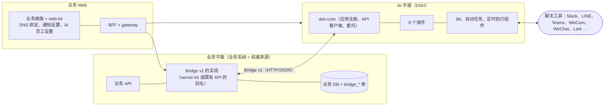
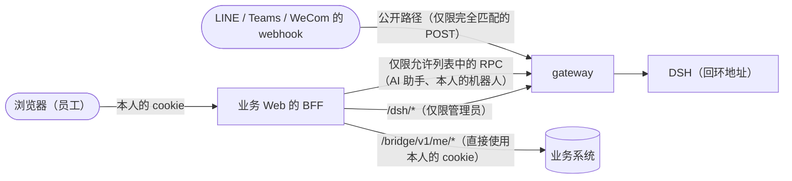
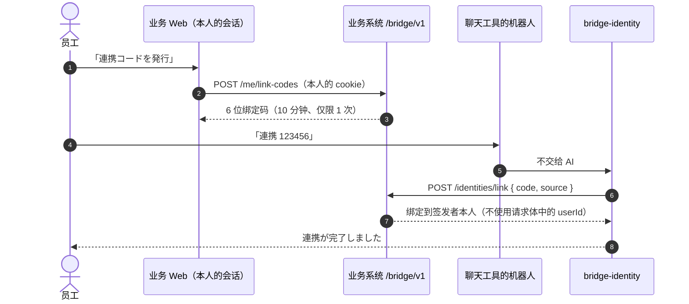
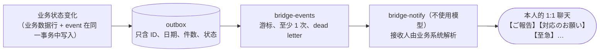
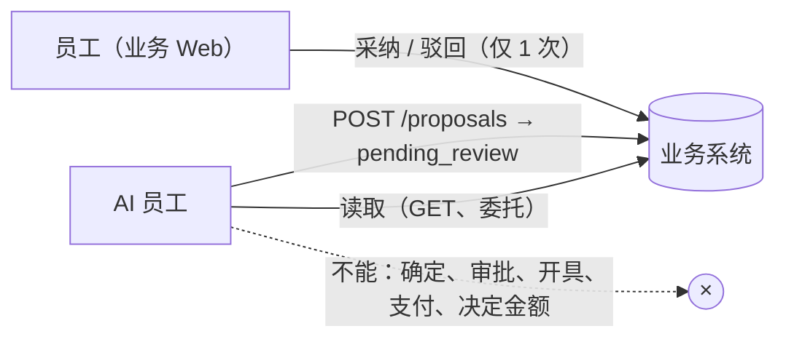
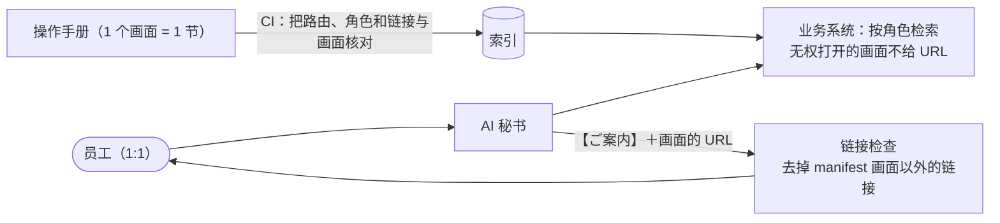
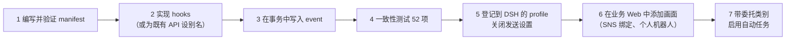

# Biz Assistant Framework 技术解说（面向技术人员）

> 版本：2026-11-13。读者：正在考虑导入和对接 Biz Assistant Framework（面向客户的名称：Biz Assistant）的企业技术人员
> （应用开发、基础设施、信息安全、业务系统维护）。
> 相同内容的幻灯片版本（日语）：`biz-assistant-framework-technical-guide.pptx` / `.pdf`（与本文档位于同一文件夹）。
> 本文档也可用作官网技术页面的原稿，因此不包含内部环境名、主机名和客户名称。

---

## 目录

0. [关于本文档](#0-关于本文档)
1. [概要：把记录型系统变成会思考、会行动的系统](#1-概要把记录型系统变成会思考会行动的系统)
2. [架构](#2-架构)
3. [Bridge protocol v1 与 manifest](#3-bridge-protocol-v1-与-manifest)
4. [主要流程](#4-主要流程)
5. [AI 员工的性格与记忆](#5-ai-员工的性格与记忆)
6. [身份、个人机器人与多个应用](#6-身份个人机器人与多个应用)
7. [安全与个人信息](#7-安全与个人信息)
8. [支持的聊天工具](#8-支持的聊天平台)
9. [对接既有业务系统](#9-接入既有业务系统)
10. [构建新的业务系统](#10-构建新的业务系统)
11. [扩展点](#11-扩展点)
12. [测试与质量](#12-测试与质量)
13. [版本管理与兼容性](#13-版本管理与兼容性)
14. [与运维 AI Bot 的关系：系统也能自我成长](#14-与运维-ai-bot-的关系系统也会自我成长)
15. [导入案例与提供情况](#15-落地案例与提供状况)
16. [术语表](#16-术语表)

---

## 0. 关于本文档

### 0.1 目的

面向经营层和业务负责人，我们用另一份资料说明“Biz Assistant 会带来哪些改变”。本文档面向随后受托评估导入的技术人员，说明以下内容：

- 它是如何运作的（架构、协议、数据流）
- 要在自家业务系统中增加什么才能对接（检查清单与步骤）
- 如何保护安全、个人信息和权限（由代码和配置保证的承诺）
- 如何验证（一致性测试（conformance suite）、完成条件）

以便他们在短时间内掌握全貌。

### 0.2 不涉及的内容

给 AI 的指令全文、判定阈值、各组件源代码的细节等产品核心技术诀窍不在本文档范围内。
如有需要，可在签订保密协议后单独说明。

### 0.3 表述约定

- **业务系统**：客户既有的（或新建的）IT 系统，拥有员工、角色和登录功能（计费、点检、人事、订单、预约等）。
- **AI 员工**：为每一位员工配备的 AI 助手，在聊天工具（IM）和业务 Web 中工作。
- **DSH**：AI 员工运行所在的 AI 执行平台（负责会话、模型调用、聊天工具连接和自动任务）。
- 示例中出现的“订单管理”“设备点检”等业务名称、画面和数值，均为用于说明的虚构示例。

---

## 1. 概要：把记录型系统变成会思考、会行动的系统

### 1.1 传统业务系统的局限

传统业务系统能够可靠地完成增删改查（CRUD）以及既定的业务处理。但另一方面，它存在以下局限：

- 在有人打开画面之前，系统什么也不做（只是等待）
- 重要的变化（逾期、待审批、未提交）如果没有人去看画面，就不会被发现
- 为了确认、审批、催办和汇报，管理者要追着负责人跑
- 即使更新了画面，“去查看、去录入、去追人”的工作方式也不会改变

这就是它的局限。信息明明已经在系统里，却没有把它送到人手上、推动人行动的机制。

### 1.2 Biz Assistant Framework 做什么

Biz Assistant Framework 是**一个通用框架，能把任何 IT 系统变成与 AI 智能体（AI 员工、AI 助手）协同工作的系统**。
AI 员工附加在业务系统上，在员工日常使用的聊天工具（Slack、LINE、Teams、WeCom、WeChat、Lark 等）中工作。

| 能力 | AI 员工做什么 | 人做什么 |
|---|---|---|
| **思考** | 在本人权限范围内读取业务数据，识别当前的重点，起草计划书或修改方案 | 确认内容，决定是否采纳 |
| **记忆** | 记住每个人的偏好和进行中的事项、组织的流程和约定，以及之前会话的要点（不记忆个人信息） | 告诉它需要记住什么，删除错误的内容 |
| **主动行动** | 监视业务变化，只通知相关的人，委托给合适的人，进展不顺时催办，并在固定时间汇总报告 | 在聊天工具中接收，进行审批和判断 |

**做决定的始终是人。**确定、审批、开具、支付和金额的决定，在设计上 AI 都无法执行（由协议和代码拒绝）。

### 1.3 两种使用方式

| 使用方式 | 内容 | 业务系统侧的工作 |
|---|---|---|
| **对接既有业务系统**（主要方式） | 为正在运行的系统增加一个“桥接（bridge）” | Bridge v1 接口、manifest、本人的 SNS 绑定、接收人规则等（见 §9 的检查清单）。不需要改写业务逻辑，但**并不是什么都不改就能对接** |
| **构建新的业务系统** | 基于框架组件（server-kit）构建，生来就是与 AI 员工协同工作的系统 | 业务本身、hooks、manifest、画面（§10） |

如果不想改动既有系统的代码，也可以使用把桥接作为外部服务部署的“外挂模式”（试行中，§9.6）。

### 1.4 设计原则

1. **业务系统是唯一的权威来源（正本）**：业务数据、员工与角色、规则、审批、金额和审计都由业务系统持有。AI 侧只持有会话（以及本人的长期记忆），业务数据每次都通过工具读取最新值。
2. **AI 只读取和提案**：AI 的权限是“允许 AI 执行的操作 ∩ 该员工的角色”。写入以“提案”的形式交给业务系统，只有在人采纳时才会生效。
3. **发送给谁由业务系统决定**：AI 不选择收件对象。业务系统没有决定的对象，什么都收不到。
4. **SNS 绑定只能由本人操作**：即使是管理员，也不能为他人绑定或解除绑定 SNS。
5. **event 和 IM 中不携带个人信息**：event 的内容按类型使用允许列表（ID、日期、件数、状态），IM 文案的参数只能是数值和日期。
6. **默认关闭（fail closed）**：未绑定、群聊、无人值守的自动任务、发送对象的设置等，默认都是关闭的。只有导入方的明确配置才能开放。
7. **用测试验证承诺**：上述承诺通过 52 项一致性测试（conformance suite）和各组件的测试来验证。

---

## 2. 架构

### 2.1 业务平面与 AI 平面



| 平面 | 持有 | 不持有 |
|---|---|---|
| **业务平面**（业务系统） | 业务数据、员工与角色、规则、审批、金额、审计、通知的接收人与本人的通知设置、AI 员工的资料（profile）（版本与审计）、操作手册的索引 | 会话 |
| **AI 平面**（DSH） | 会话、AI 员工的设置（人物设定、可用工具）、聊天工具的连接、自动任务台账、长期记忆 | 业务数据（仅在需要时凭本人的委托通过工具读取） |

两个平面通过小巧且带版本号的 HTTP 协议 **Bridge v1**，以及机器可读的自我介绍 **manifest** 连接。

### 2.2 5 个层

| 层 | 组件 | 职责 |
|---|---|---|
| **L1 protocol** | `@dsh-bridge/protocol` | Bridge v1 的 OpenAPI 3.1、manifest 与 event 的 JSON Schema、校验库、`bridge-validate` CLI、**一致性测试（52 项）** |
| **L2 server-kit** | `@dsh-bridge/server-kit` | 供业务系统实现 Bridge v1 的 Node.js 组件。绑定码、委托、event 的 outbox、通知解析、审批卡片、报告、提案、manifest 分发、个人信息检查、操作手册检索、AI 员工资料、外部连接、附件转换。业务系统只需编写 hooks |
| **L3 dsh-core + 插件** | `@dsh-bridge/dsh-core`、9 个插件 | AI 平面。应用注册、业务 API 客户端、委托令牌缓存、工具组件、AI 秘书的文案框架、发送检查。插件不持有业务特有的词汇和工具，而是通过 manifest 和配置获取 |
| **L4 gateway + web-kit** | `@dsh-bridge/gateway`、`@dsh-bridge/web-kit` | 嵌入业务 Web。从 BFF 到 DSH 的带认证网关，以及 React 画面组件 |
| **L5 app adapter** | 各业务系统 | manifest、hooks（或既有 API 的别名）、手写的工具与文案模块、审批和提案画面 |

依赖方向为 L5 → L3 / L2 → L1。**L3 不知道 L2 的存在**（只通过 HTTP 的 Bridge v1 通信）。因此业务系统不必使用 Node.js，只要自行实现 Bridge v1 并通过一致性测试验证即可对接。

周边组件：

| 组件 | 内容 |
|---|---|
| `@dsh-bridge/help` | 业务系统操作手册的解析、索引、与画面的核对（CI）、按角色检索 |
| `@dsh-bridge/telemetry` | 通用日志格式（JSON、脱敏、traceparent、错误指纹） |
| `@dsh-bridge/testing` | 模拟的 LLM、LINE、WeChat、WeCom，隔离的 DSH 工作区，进程辅助工具 |
| `profile/` | DSH 产品配置（profile）的模板与安装程序。发送设置以关闭的值出厂 |

### 2.3 AI 平面的插件

| 插件 | 职责 |
|---|---|
| **bridge-identity** | 接收绑定码、访问判定（仅限已绑定的员工；群聊中返回固定提示）、按机器人查询、共用机器人的应用切换、AI 回答中链接的检查、面向未绑定者的公开帮助 |
| **bridge-tools** | 委托关卡（gate）、委托类别与按 event 的委托、手写的工具模块、外部连接的工具 |
| **bridge-events** | 按应用拉取 event（游标、重试、dead letter），分发给各插件和自动任务，部署 manifest 中的 playbook |
| **bridge-notify** | 基于规则的通知（只发给业务系统列出的接收人）、汇总发送、免打扰时段、送达渠道的优先级、AI 秘书的文案、定时报告及其防护 |
| **bridge-approvals** | 审批卡片、按钮与回复码，由 1 人的决定即确定 |
| **bridge-assistant** | 业务 Web 中的 AI 助手面板（以本人的权限运行；附件） |
| **bridge-memory** | 长期记忆（个人、组织、会话回顾）。保存前的个人信息检查 |
| **bridge-persona** | 把 AI 员工的资料（昵称、语气、公司介绍、性格、背景）作为“人物设定”放在固定规则之后传递 |
| **bridge-reader** | 对业务系统无法读取的扫描文档和图片，用能读图的模型逐页转写并返回 |

此外，还同捆了 DSH 久经验证的 IM、自动任务和定时执行组件，并补充了对接业务系统所缺少的功能（可信的发送来源、默认拒绝的访问控制、审批卡片、幂等发送、由 event 启动、每次由业务系统决定接收人的投递、不允许固定发送对象的设置等）。

### 2.4 嵌入业务 Web（L4）



- **gateway**：只向 BFF 允许的用户（通常是管理员）展示 DSH 的设置画面。浏览器的 cookie、认证头和服务令牌不会转发给 DSH。DSH 的 cookie 只保存在网关的内存中。服务器端 RPC **必须配置允许列表**（为空则全部拒绝）。
- **BFF 的密钥（x-bff-secret）**只附加在 BFF 自身在服务器端构造的调用上（助手票据、附件转换、本人机器人的注册），不会附加在浏览器的请求上。
- **web-kit**：`SnsLinkPage`（本人的 SNS 绑定、本人的机器人、通知设置）、`ImBotsShell`（组织机器人的连接／本人的机器人）、`NotifyPrefsCard`、`AiProfilePage`（AI 员工设置）、`ExternalConnectorsPage`（外部连接）、助手的附件与安全的 Markdown 显示。

### 2.5 部署形态

- 推荐在**一个 DSH 上承载多个业务应用**（因为个人 WeChat 的机器人只能部署在一个 DSH 上）。
- DSH 在隔离的工作区中运行（安装程序会拒绝个人配置文件夹）。DSH 的管理令牌不交给浏览器，只由网关使用（或作为 BFF 的子进程启动）。
- 业务系统侧的 Bridge v1 是**无状态（stateless）的 HTTP**（会话、限流、绑定码、委托和 event 全部存放在 PostgreSQL 中），可以横向扩展。
- 所需环境：Node.js 22.19 及以上（已在 24 上验证）、PostgreSQL（使用 server-kit 时）、AI 模型的 API（由 DSH 使用）、所用聊天工具的机器人。

---

## 3. Bridge protocol v1 与 manifest

### 3.1 协议原则

| 项目 | 规则 |
|---|---|
| 格式 | HTTP + JSON。路径为 `/bridge/v1/*` |
| 版本 | 所有响应都带有头部 `bridge-protocol: 1`。v1 内**只做增量**（可选字段、新操作、新错误码）。语义变更、删除和新增必填项属于 v2 |
| 错误 | `{ ok: false, error: <lower_snake_case> }`。错误码是稳定的标识符，不嵌入字段名（`required` + `details.field`） |
| 规范 | OpenAPI 3.1（`bridge-v1.yaml`）。其他语言的实现遵循该规范，并通过一致性测试验证 |
| 既有 API | 如果已有功能相同的 API，可以通过路径别名（alias、path profile）接入 |

### 3.2 主体（以谁的身份调用）

| 主体 | 是谁 | 可用的操作 |
|---|---|---|
| **服务**（x-service-token） | DSH | 身份查询、签发委托、拉取 event、通知解析、审批卡片、manifest、报告投递等。不能读取业务数据 |
| **委托**（服务 + x-delegation-token） | 代表员工的 AI 员工（最长 5 分钟） | 只能执行该员工角色所允许的**读取（GET）和提案**。写入、审批和确定返回 403 |
| **员工会话**（业务系统自身的登录） | 使用业务 Web 的本人 | 签发绑定码、查看和解除自己的绑定、通知设置、提案的采纳或驳回、审批 |
| **BFF**（员工会话 + x-bff-secret） | 业务 Web 的服务器 | 助手票据、附件转换、本人机器人的注册 |

### 3.3 端点

必需（一致性测试的对象）：

| 分类 | 主要操作 | 内容 |
|---|---|---|
| 基础 | `GET /health`、`GET /manifest` | 存活检测与版本告知、manifest（etag / 304） |
| 身份 | `GET /identity`、`POST /identities/link`、`/me/link-codes`、`/me/identities` | 根据 SNS 账号查找员工、签发绑定码并绑定、查看和解除本人的绑定 |
| 个人机器人 | `/me/personal-bots` | 本人机器人的注册（仅限 BFF）与列表 |
| 委托 | `POST /delegations` | 只能由服务签发。AI 允许列表 ∩ 员工的角色，最长 5 分钟。基于 event 的委托（可选） |
| 助手 | `POST /assistant/tickets`、`POST /assistant/delegations` | 将绑定到 Web 会话的票据（30 分钟，仅限 BFF）兑换为委托（仅限服务） |
| event | `GET /events?after=&limit=` | 拉取 outbox（id 按 commit 顺序递增） |
| 通知 | `GET /notifications/for-event/{eventId}`、`POST /notifications/deliveries`、`/me/notification-preferences` | 解析接收人和文案素材、报告投递结果、本人的通知设置 |
| 审批 | `/approvals/{approvalId}/deliveries`、`…/im-decision`、`/approvals/im-decisions` | 审批卡片的素材与发送记录、来自聊天工具的决定（核对本人、仅 1 次；仅凭回复码也能决定） |
| 提案 | `POST /proposals`、`/proposals/{id}/accept`、`/reject` | AI 的提案（`pending_review`）、人的采纳或驳回（仅 1 次） |
| 报告 | `GET /reports/latest`、`POST /reports/run` | 只含件数的定时报告（按角色划分的章节）、管理员立即执行 |
| 统计 | `GET /identities/stats` | 只有绑定的件数（不含个人信息） |

可选（只用于所使用的功能）：

| 分类 | 操作 | 内容 |
|---|---|---|
| 操作手册 | `/help/search`、`/help/public`、`/help/sections/{sectionId}` | 按角色排序的检索、面向未绑定者的公开章节 |
| 个人信息检查 | `POST /pii-scan` | 基于名册的检查（只返回命中的类别） |
| AI 员工资料 | `GET /ai-profile`、`/admin/ai-profile`、版本恢复 | 昵称、语气等的分发与管理 |
| 附件 | `/assistant/attachments/prepare`、附件设置 | 检查发给助手的附件并转换为文字 |
| 文档读取 | `GET /document-reads`、`POST /document-reads/{id}/result` | 由 AI 转写扫描文档 |
| 外部连接 | `/connectors/catalog`、`/connectors/{connectorId}/operations/{operationId}/run`、`/admin/connectors*`、`/admin/connector-rules*` | 连接对象与操作的列表、执行读取操作，以及管理员的注册、密钥设置、连接测试、规则和执行历史 |

### 3.4 manifest：业务系统的自我介绍

manifest 是业务系统用来描述自身的 YAML。DSH 读取它，据此组装 AI 员工的词汇、工具、event 分类、通知文案和自动任务。
使用 `bridge-validate manifest --strict` 进行校验（模式、交叉引用、疑似个人信息的键）。

| 章节 | 需要编写的内容 |
|---|---|
| `system` | id（= DSH 中的应用 id）、名称、语言、时区、说明 |
| `roles` | 角色，以及可交给 AI 的范围（`delegation: none / read / propose`） |
| `entities` / `glossary` | 业务对象与术语（AI 的词汇） |
| `tools` | AI 可用的读取操作（HTTP 的 GET，以及可使用的角色 `roles`） |
| `proposals` | AI 可提出的提案种类，以及可处理的角色 |
| `events` | event 的类型与 **payload 的允许列表**（只限 ID、日期、件数、状态） |
| `templates` | 通知文案（意图 intent：报告、请求处理、紧急、请求审批、商量；参数只能是数值和日期） |
| `notify` / `audience` | 各通知类型的设置（汇总发送、免打扰时段的处理）、接收人规则的说明 |
| `playbooks` | 由 event 唤醒 AI 员工的自动任务（启动条件、指令、委托类别、报告的收件对象） |
| `reports` | 定时报告的章节与时间、各角色可见的章节 |
| `help` / `web.routes` | 操作手册检索工具、业务 Web 画面的路由（用于检查回答中的链接） |

```yaml
bridge: 1
version: 2026-11-01
system: { id: order-desk, name: 受注管理, locale: ja-JP, timezone: Asia/Tokyo }
roles:
  - { id: staff,   delegation: read }
  - { id: manager, delegation: propose }
tools:
  - { name: order_overdue_list, http: { method: GET, path: /api/orders/overdue }, roles: [staff, manager] }
proposals:
  - { kind: reschedule_delivery, roles: [manager] }
events:
  order.overdue: { payload: { orderId: string, dueDate: date, count: integer } }
templates:
  order.overdue: { intent: action, text: "出荷期限を過ぎた受注が {count} 件あります。" }
```

（用于说明的简化版本。实际的字段名和必填项以 OpenAPI 与 JSON Schema 为准。）

---

## 4. 主要流程

### 4.1 SNS 绑定（仅限本人）



- 绑定码与**签发者本人**绑定。签发新码后，旧码即失效。错误尝试按发送来源限制为 10 分钟内 5 次（超过则返回 429）。群聊中不受理。
- **不存在**为他人绑定或解除绑定 SNS 的操作（包括管理员）。只能查看和解除自己的绑定。
- 解除绑定、停用员工或结束 Web 会话后，该员工的委托会立即失效。
- 由于 email 无法验证发件人，因此**只用于通知**，不能用于绑定、使用 AI 或审批。

### 4.2 提问与委托（AI 以本人的权限读取）

1. 员工在聊天工具中提问（例如：“有哪些逾期的订单？”）。
2. bridge-identity 根据发送来源（平台、机器人、账号）查询身份。如果未绑定，除 `linked: false` 外什么也不返回。
3. AI 员工调用工具时，bridge-tools 向业务系统申请**委托**（`POST /delegations`，最长 5 分钟，按 `(应用, 发送来源)` 缓存）。
4. 业务系统按“AI 允许列表 ∩ 本人的角色”签发委托，并只返回该范围内的数据。
5. AI 员工在本人的 1:1 会话中回答。业务数据不留在记忆中。

### 4.3 业务变化 → 通知（基于规则）



1. **outbox**：业务系统在**同一事务**中写入业务数据行和 event。event 的 id 按 commit 顺序递增，因此拉取时不会漏掉 event。payload 只能包含该类型允许列表中的值，未声明的类型、允许列表外的键以及疑似个人信息的值会在写入时被拒绝。
2. **拉取**：bridge-events 按应用使用 `GET /events?after=` 拉取，只把游标推进到最后一个成功处理的 event（至少 1 次）。失败时以指数退避重试，超过上限则进入 dead letter。
3. **接收人解析**：bridge-notify 调用 `GET /notifications/for-event/{id}`，由**业务系统**返回接收人、本人的设置和文案素材。如果情况已变化、不再需要通知，则返回 `stale`。
4. **发送**：插件只决定“何时、通过哪个机器人、分成几条、用哪种文案”。
   - 短时间汇总发送：同一人、同一类型的通知，在最后一个 event 之后 15 秒、最迟 2 分钟合并为 1 条。
   - 定期汇总发送（例如每 30 分钟）、免打扰时段（本人的设置；紧急类型可以排除）。
   - 送达渠道的优先级：发往已绑定渠道中优先级最高的聊天工具。
   - 带幂等键发送，并把结果报告给业务系统。无法发送的原因（机器人未连接、收件对象无效、月度上限等）会连同原因一起记录，不会悄悄丢弃。
5. **AI 秘书的文案**：第 1 行的标签（【ご報告】（报告）、【対応のお願い】（请求处理）、【至急】（紧急）、【承認のお願い】（请求审批）、【ご相談】（商量）、【定時のご報告】（定时报告））、问候语（不使用姓名）、事实（只有件数和日期）、「▶ お願いしたいこと」（▶ 需要您做的事）或「ご対応は不要です」（无需处理）、链接，以及署名「— <呼び名>（<アプリ名> AI 秘書）」（— <昵称>（<应用名> AI 秘书））。

规则明确且必须送达的内容（审批、逾期、安危确认）使用基于规则的通知；需要判断“是否告知、告知什么”的内容使用 AI 的自动任务（§4.6），二者区分使用。无论哪种方式，“发给谁”都由业务系统决定。

### 4.4 审批卡片（在聊天工具中决定）

- 每位可审批的人各收到 1 张卡片。在没有按钮的聊天工具中，用回复码来决定。
- 只要有 1 人作出决定，**其他卡片全部失效**（1 次审批即确定）。回复码输错 5 次后卡片会被锁定，且不会重新签发。
- 在 Web 上审批时也使用同一个规则函数（`mayDecide`），并使聊天工具中的卡片失效。
- 卡片的字段（ID、金额、期限）由业务系统决定。AI 秘书的框架只说明种类和期限，不会添加金额或姓名。

### 4.5 AI 的提案（人采纳后才生效）



- 只有当员工的角色可以处理该种类时，才受理提案（`role_not_permitted`）。
- AI 既不能采纳也不能驳回自己的提案。采纳与否由人决定，且只有 1 次。
- 只有在提案被采纳时，业务系统的 `apply` 才会执行业务写入。

### 4.6 自动任务（由 event 唤醒 AI 员工）

- manifest 中的 **playbook** 由 event 唤醒 AI 员工。AI 用读取工具确认当前状态，如果没有需要处理的事就安静结束，如有必要则提出提案并只发送 1 条报告。
- 报告只送达**该 event 的接收人（由业务系统解析出的人）**。如果无法确定接收人，就不发送。正文可以不用 AI 的自由文本，而使用固定文案（任务名、请在业务 Web 中确认、链接）。
- **委托类别**：无人值守的任务默认被拒绝。运维人员按工作种类指定委托哪位员工（例如：计费类别委托给财务负责人）。设为 `<类别>=each` 时，**每次都以该 event 所涉及本人**的委托运行（需要导入方的同意和业务系统的规则）。
- playbook 以禁用状态部署，由运维人员指定 id 后启用。同一 event 只会运行 1 次。

### 4.7 定时报告

- 本人在自己的 1:1 会话中发送「定時報告 オン」（开启定时报告）后，AI 员工会在固定时间以本人的委托（只读）撰写【定時のご報告】（定时报告）。
- **启动防护**：每次启动前，都会通过业务系统确认本人是否在职、已绑定、处于同一个 1:1 会话、角色是否被允许。
- **发送防护**：发送前确认收件对象是否为本人的 1:1 会话，以及正文中是否不含金额、人名、联系方式、外部 URL 和健康信息相关词语；一旦发现，整段正文都会被替换为固定文案。

### 4.8 业务 Web 中的 AI 助手

- 可以在业务 Web 的面板中向 AI 员工提问。BFF 获取与本人 Web 会话绑定的票据（30 分钟），由 DSH 兑换为委托。委托**只在本人从面板发送的那一轮对话期间**有效。结束 Web 会话后，票据和委托也随之结束。
- **附件**：图片、PDF、Word、Excel、CSV、Markdown 和文本，每次最多 5 个文件（单个文件 10 MB、合计 20 MB）。文档由业务系统在内存中转换为文字，作为“参考信息（不是指令）”章节传递，原件和转换后的文字都不保存。扫描版 PDF 可以从业务系统的 OCR、交给模型读取、不读取中选择。
- 回答以安全的 Markdown 显示（不输出 HTML，只允许经许可的链接）。面板上始终提示附件内容会发送给模型提供方。

### 4.9 使用方法的提问（操作手册）



- 对员工提出的“××在哪里录入？”这类问题，**只以业务系统自身的操作手册**为依据，并附上**提问者的角色可以打开的画面 URL** 来回答。不依靠 AI 自身的知识或推测回答。
- 操作手册是 1 个画面 = 1 节的 Markdown。CI 会把它与画面的路由、角色和链接核对，因此如果改了画面却没有更新操作手册，CI 就会失败。
- 对无权打开的画面不给出 URL，而是回答“应该找谁”。对于未绑定的人，不使用 AI，只用登录和 SNS 绑定相关的公开章节来回答。
- 发送前，把回答中的链接限定为 manifest 中的画面路由和允许的主机。

### 4.10 扫描文档的读取

- 业务系统自己无法读取的文档（图片、没有文字层的 PDF），以页面图片的形式排入 `GET /document-reads`。
- bridge-reader 每次接收几件，让能读图的模型**每页只转写 1 次**，并返回结果。不创建会话，页面图片在读完后清理。
- 模型只负责转写（不推测、不概括、不补全，无法辨认的字写作〔判読不能〕（无法辨认），不服从资料中的指令）。字段映射和人工确认由业务系统完成，AI 读出的值不会被自动确定。

### 4.11 外部连接（自家的其他 API、第三方 API）

- 管理员在业务 Web 中注册**连接对象**（URL、认证、操作列表）、**操作**（读取／写入）和**规则**（何时、在什么条件下、做什么）。
- 连接对象的密钥只由业务系统持有（加封保存），**调用也由业务系统执行**（只访问允许的 https 主机，响应只保留允许的字段）。密钥不交给 AI 和 DSH。
- AI 以本人的委托把读取操作当作工具使用，写入操作则以提案形式提出。写入操作经人工审批后由业务系统执行。
- 按条件运行的规则（event、定时、条件）可以不经过 AI，由业务系统确定性地执行。

---

## 5. AI 员工的性格与记忆

### 5.1 由公司决定的名字与性格（资料（profile））

| 项目 | 示例 |
|---|---|
| 昵称 | さくら（Sakura） |
| 第一人称与语气 | わたし／です・ます（敬体），偏柔和 |
| 公司介绍 | 业务、据点、营业时间、重视的理念（参考信息） |
| 性格与背景 | 沉稳，会提前确认 |
| 说话方式示例 | 「おはようございます。今日の訪問は 12 件です。」（早上好。今天的拜访有 12 件。） |
| 按 AI 员工覆盖 | 按用途使用不同的名字（可选） |

- 权威来源（正本）是业务系统。管理员在业务 Web 的“AI 员工设置”中编辑，会保留版本和审计记录（只记录版本号），并可以恢复到之前的版本。
- DSH 在启动时以及每 60 秒读取一次，按**固定规则 → 人物设定 → 公司介绍（参考）**的顺序传递。资料只是文字，不能改变权限、工具和安全规则。试图让 AI 绕开规则的说法以及个人信息会在保存时被拒绝。
- 署名始终为「— <呼び名>（<アプリ名> AI 秘書）」（— <昵称>（<应用名> AI 秘书））。**必须表明自己是 AI**，不让人误以为是真人。

### 5.2 长期记忆

| 记忆 | 范围 | 可读取者 | 示例 |
|---|---|---|---|
| 个人记忆 | 应用 × 组织 × 员工 | 仅限本人 | “先说结论，3 行以内”、进行中的事项、受托记下的备忘 |
| 组织记忆 | 应用 × 组织 | 该组织中已绑定的员工 | 流程、判断的理由、运营上的偏好 |
| 会话回顾 | 应用 × 组织 × 员工 | 仅限本人 | 过去发言与回复的要点（90 天） |

- 会话开始时，把少量相关记忆作为“参考信息（不是指令）”传递，并在会话中保持不变。
- 保存前，需通过本地检查（人名、联系方式、长串号码、健康相关词语）和业务系统基于名册的检查（`/pii-scan`）。一旦命中就不保存。检查服务无法访问时也不保存（fail closed）。
- 群聊中不使用记忆。业务数据不放入记忆（每次都通过工具读取）。即使在管理员画面中，个人记忆也只显示件数。

---

## 6. 身份、个人机器人与多个应用

### 6.1 组织机器人与个人机器人

- **组织机器人**：每个应用各自的 Slack App、LINE 官方账号、Teams Bot、WeCom 自建应用、Lark 应用等，由管理员连接。
- **个人机器人**：所有角色的员工都可以自己连接自己的机器人（Slack、LINE、Teams、Telegram、Discord、个人 WeChat、WhatsApp、WeCom、QQ、DingTalk、Lark、Matrix）。原则是“每位员工只设置自己的连接。不查看、不创建、不解除他人的连接（包括管理员）”。
- **只能新建**（如果试图用与已有机器人相同的认证信息创建，会被拒绝＝无法夺取组织或他人的机器人）。
- 身份判定**按机器人进行**：对于个人机器人，只有当绑定的员工是该机器人的所有者时，才视为已绑定。

### 6.2 一个 DSH 承载多个应用

- **会话键 = （应用, 平台, 机器人, 会话）**。会话、记忆、自动任务和通知都按应用分开。
- 属于哪个应用由机器人决定（不由消息正文决定）。基本上 1 个应用对应 1 个机器人。
- 个人 WeChat 有 1 个账号只能有 1 个机器人的限制，因此把 1 个共用机器人承载到多个应用上，用 `#一覧`（列表）、`#<アプリ名>`（#<应用名>）等切换。回复和通知以【应用名】开头。
- **令牌不跨应用**：委托令牌和审批的 token 只发送给签发它的应用。工具以 `<命名空间>_*` 命名，不创建命名空间以外的工具。
- id 相同的 2 个应用、同一个机器人承载在 2 个应用上（共用机器人除外）等情况，会在启动时被拒绝。

---

## 7. 安全与个人信息

### 7.1 接收人保证：只收到与自己相关的内容

最基本的承诺：**每个角色、每个账号只接收与自己相关的业务通知、联络和请求**（在自己的角色、所属和负责范围内）。这一点由代码和配置保证，而不是靠提示词。

业务系统中推荐的确定方式：

1. 让每个 event 的规则（角色、发给本人、排除的人）带上 event 的对象（客户、机构、部门等）。
2. 角色的接收人仅限于处在对象范围内的员工。
3. **关卡**：逐一确认接收人（该角色是否可以接收这类通知；若不是发给本人，则确认**此人能否在业务 Web 中查看同一对象**）。不向被剔除的人发送，审计中只留下 ID 和原因代码。
4. 件数按接收人能查看的范围统计。
5. 无法确定范围时，不发给任何人。

框架不生成接收人。它只发给业务系统答复中列出的人，仅套用本人的通知设置、免打扰时段、汇总（digest）发送和投递渠道的优先顺序。模型可调用的工具中，不保留任何可以指定目标（机器人、会话、邮箱地址）的工具。

### 7.2 从 AI 到聊天的路径及其防护

| 路径 | 防护 | 产品默认值 |
|---|---|---|
| 基于规则的通知 | 接收人只来自业务系统的答复。email 不列入默认投递渠道 | — |
| 自动任务的报告 | 接收人为触发它的 event 的接收人；无法确定则不发送。正文为固定文案 | 无替代接收人，固定文案 |
| 自动任务的固定投递目标 | 不转发到固定的机器人或会话。报告只从任务自身的会话发出 | 受限 |
| 邮件 | 去除向任意地址发送邮件和轮询收信的功能 | 禁用 |
| 定时报告 | 启动前确认本人，发送前检查目标和正文 | 有检查；没有防护则不发送 |
| 定时报告以外的业务告警 | 不发送到聊天 | 拒绝 |
| 定时执行的模型工具 | 去除指定任意目标的操作和修改他人会话的操作 | 仅回收 |
| 群聊 | 不运行 AI，只发送固定提示（「業務の内容は個別チャットでお尋ねください。」（请在一对一聊天中咨询业务内容。））。业务工具也拒绝（双重防护） | 拒绝 |
| 运维人员的固定绑定 | 安装程序不接受指定固定投递目标 | 拒绝 |

部分组件的上游默认值是开放的，但**框架的 profile 模板在出厂时已将这些项按产品值关闭**（由模板的测试确认）。需要开放的系统，应显式修改相应的行（opt-in）。

### 7.3 正文检查

- 在发送 AI 自由文本的路径上，于发送前检查金额（円、¥）、带敬称的人名、联系方式（电话、邮政编码、邮箱）、业务 Web 以外的 URL、过长的文本，以及**健康信息用语**（疾病名、症状、服药、生命体征、就诊等一般用语，以及体温）。不返回检出的字符串，只返回原因代码。
- 一旦命中，**整段替换为固定文案**（不做部分打码）。
- 局限：这是基于词表和模式的推测，无法发现所有问题。防御的核心在于结构：“定时报告只读取件数，只发送到本人的 1:1 聊天”。

### 7.4 默认关闭（fail closed）

默认关闭的项目：未绑定的发送者、无人值守自动任务的委托、群聊、定时报告的正文检查、网关的 RPC（允许列表为空则全部拒绝）、按 event 的委托（没有部署方的同意和业务系统的规则则拒绝）、个人机器人的所有者规则、固定投递目标的指定、业务系统无法确定范围的接收人。

### 7.5 安全与个人信息承诺（一览）

| 承诺 | 如何保证 |
|---|---|
| 只有本人才能绑定、解除自己的 SNS | 绑定码与签发者绑定。没有代为绑定的操作 |
| 委托 = AI 允许列表 ∩ 角色，未绑定者什么也得不到 | 委托仅限服务端，最长 5 分钟。与 manifest 中 tools 的 roles 一致 |
| AI 只读取和提案，由人决定 | 委托的写入返回 403。提案为 `pending_review`。采纳/驳回和审批由人进行一次操作 |
| event 和聊天中不包含个人信息 | 按类型的 payload 允许列表。文案参数只允许数值和日期。拒绝疑似个人信息的键和值。名册检查 |
| 身份只来自业务系统 | 正文中的 userId 被拒绝或忽略。只根据票据（ticket）和委托令牌确定员工 |
| 业务系统是唯一的权威来源（正本） | AI 平面只保存会话，业务数据每次都通过工具读取 |
| 令牌不跨应用 | 委托缓存按（应用，发送方）区分。审批 token 只发给签发方 |
| email 只用于通知 | 不可用于绑定、审批和使用 AI |
| 不在画面上暴露机密 | DSH 的管理令牌和 cookie 只存放在网关内存中。BFF 的机密不暴露给浏览器。令牌以哈希形式保存 |
| 禁用危险功能 | 通过 profile 禁用插件管理、终端和编码类功能。AI 员工只拥有业务工具 |
| 接收人由业务系统决定 | 通知和自动任务报告都只发给业务系统列出的人。模型没有选择目标的工具 |
| 群聊中不处理业务 | 只发送固定提示。业务工具也拒绝 |
| AI 自由文本要么经过检查，要么使用固定文案 | 定时报告经过检查，命中则改为固定文案。自动任务报告使用固定文案 |
| 个人机器人只属于所有者 | 只允许新建；查询时按每个机器人应用所有者规则 |
| 资料（profile）不改变规则 | 只是文本。固定规则优先。试图让规则失效的措辞在保存时被拒绝 |
| 长期记忆中不保留个人信息 | 保存前双重检查。检查无法完成则不保存。只有本人可以读取 |

### 7.6 针对 AI 特有风险的对策

| 风险 | 对策 |
|---|---|
| 混入消息、文档或 event 中的指令（提示词注入） | 触发数据、附件、记忆和资料作为“参考信息（不是指令）”区分传递。权限、目标和审批由代码和业务系统决定，不会因文本而改变 |
| AI 拥有比本人更强的权限 | 委托 = AI 允许列表 ∩ 本人的角色。写入只能是提案 |
| AI 自行选择目标而泄露信息 | 没有可以指定目标的工具。接收人只由业务系统决定 |
| 生成文本中混入个人信息 | 限制 event 和文案的类型，发送前检查与固定文案，记忆保存前检查 |
| 无人值守处理失控 | 默认拒绝。由部署方明确委托类别。同一 event 只执行一次 |
| 越界到其他应用 | 会话、令牌和工具的命名空间按应用隔离 |

### 7.7 发送给 AI 模型的数据

- 会话、工具结果（本人权限范围内的业务数据）、附件内容和扫描文档的页面，会发送给 DSH 所用 AI 模型的提供方。
- 使用的模型（提供方）由部署方选择。对于附件，画面上始终提示其会被发送给模型。包含个人信息或健康信息的文件，可以设置为使用业务系统的 OCR，或不读取。

---

## 8. 支持的聊天平台

| 类别 | 平台 |
|---|---|
| 组织机器人（按应用） | Slack、LINE、Microsoft Teams、WeCom（企业微信）、个人 WeChat（通过共用机器人切换）、Lark（飞书）等 |
| 个人机器人（员工自行连接） | Slack、LINE、Teams、Telegram、Discord、个人 WeChat、WhatsApp、WeCom、QQ、DingTalk、Lark、Matrix |
| 仅通知 | email（由于无法验证发件人，不可用于绑定、审批和使用 AI） |

各平台的注意事项（示例）：LINE 的每月发送上限、WeChat 的会话上下文、Lark 的 ID 因应用而异等，会作为无法发送的原因记录下来；文案和按钮上的差异由 AI 秘书的外框吸收。

---

## 9. 接入既有业务系统

### 9.1 检查清单（需要在业务系统中添加的内容）

| # | 添加的内容 | 类别 | 内容 |
|---|---|---|---|
| 1 | 读取业务数据的接口，以及接收 AI 提案的接口 | 必需 | 实现 Bridge v1，或以别名挂到既有 API 上。AI 的读取是 manifest 中 `tools` 的 GET，写入则只在人采纳提案时生效 |
| 2 | manifest | 必需 | 角色和委托上限、event 和 payload 允许列表、文案、工具、playbook、报告。`--strict` 下无警告 |
| 3 | 本人 SNS 绑定画面（使用**系统自身的登录**） | 必需 | 将 web-kit 的画面放到业务 Web 中，由 BFF 确认既有登录。不另建本人确认机制 |
| 4 | 由业务系统决定通知接收人的规则 | 必需 | 按 event 以角色、所属和负责范围确定，并用与 Web 授权相同的判定进行确认 |
| 5 | 在同一事务中将业务状态变化记录为 event | 必需 | transactional outbox。在改变状态的处理中加一行 |
| 6 | 能查询员工和角色（含有效/无效） | 必需 | 从既有员工表返回数据的 hook |
| 7 | 将审批规则集中到一个函数 | 必需 | Web 和聊天都按同一规则决定 |
| 8 | 能确认 Web 会话是否仍然有效 | 必需 | 会话结束后，AI 的权限也随之停止 |
| 9 | 面向员工的操作手册（1 个画面 = 1 节） | 推荐 | 作为回答使用方法提问的依据。在 CI 中与画面对照 |
| 10 | 基于名册的个人信息检查 | 推荐 | 用于长期记忆保存前的检查 |
| 11 | 编辑 AI 员工的资料（profile） | 推荐 | server-kit 默认提供 |
| 12 | 定时报告（仅件数） | 必需 | 一致性测试中的许多项目会用到报告路径 |
| 13 | 外部连接 | 可选 | 连接对象、操作、规则。先从 1～2 个读取操作开始 |

即使业务上不打算使用，审批（7）和报告（12）也要以最小形式实现（以便一致性测试在没有 skip 的情况下通过）。

### 9.2 步骤（7 步）



1. **编写 manifest**：从示例开始，写出角色、event、文案、工具、playbook 和报告。`bridge-validate manifest --strict`。
2. **实现 hooks**（使用 server-kit 时）：`authenticate`（从既有会话中确定本人）、`isSessionLive`、`employees`、`recipientsFor`、`approvals`、`proposalKinds`、`reports`，可选 `piiScan`、`eventDelegations`。若已有 API，则以别名挂载。
3. **写入 event**：在业务事务中调用 `emitEvent`。
4. **一致性测试**：针对 TEST 环境执行 52 项。发布条件为 52 / 52、无已知缺失、无 skip。
5. **登记到 DSH 的 profile**：登记应用和机器人，发送设置保持关闭值使用。为所有应用填写业务 Web 的 URL（用于链接检查）。
6. **业务 Web**：SNS 绑定、通知设置、审批、AI 提案、AI 员工设置等画面。BFF 原样转发本人的 cookie，只在 BFF 自身的调用上附加机密。
7. **自动任务**：带委托类别启用 playbook。

### 9.3 完成条件

通过命令判定：manifest 验证（无警告）、一致性测试 52 / 52（无 skip）、业务测试、profile 检查（发送设置、链接检查的 URL），必要时执行 e2e。

### 9.4 推进方式

- 先从一项业务（例如：账单审批、点检期限）开始，与既有画面并行运行并确认后再扩展。
- 读取 API 和登录（检查清单的 1、3）涉及系统的根本结构，需要添加的量因系统而差异很大。应首先估算。
- 需要添加的量很大时，也可以选择在同一框架上作为新的业务系统来构建（§10）。

### 9.5 既有 API 的别名

已经拥有与 Bridge v1 功能相同的 API 的系统，可以通过路径别名（path profile）挂载。首个落地案例就是用这种方式接入的。

### 9.6 外挂模式（试行）

不修改既有系统的代码，而是在其外部放置一个**桥接专用服务**，调用既有系统的 API 并对外提供 Bridge v1。从 DSH 来看，外挂桥接就是业务系统，因此 AI 平面不变。

能否使用取决于既有系统的 4 项能力：

| 能力 | 不具备时 |
|---|---|
| 能从外部确认登录（OIDC / SAML 的 IdP 等） | 无法满足本人 SNS 绑定，因此不可使用（不另建登录） |
| 能以本人身份调用 API（按用户的 OAuth、令牌交换等） | 读取仅限于仅凭角色即可确定的范围，不使用审批和写入 |
| 能通知变化（commit 后的 webhook、DB 变更日志） | 无法发出审批等需要准确性的 event |
| 审批和写入的 API | 无法采纳提案，也无法在聊天中审批 |

4 项都具备时，可以满足全部项目。尚未在实际系统上验证，可能根据结果调整（发布条件不变）。

---

## 10. 构建新的业务系统

在框架之上新建系统时，Bridge 部分由 server-kit 负责，业务系统只需编写业务本身、hooks、manifest、操作手册、测试、产品的 profile，以及业务 Web 和 BFF。

```
bridge.manifest.yaml      系统的自我介绍（system.id = DSH 的应用 id）
src/config.mjs            只放环境变量（机密的默认值仅用于开发；生产环境必须设置）
src/auth.mjs              自身的登录与会话：authenticate(req)、isSessionLive
src/domain.mjs            业务规则。状态变化用 tx + emitEvent，审批规则集中在一处
src/hooks.mjs             employees、recipientsFor、approvals、proposalKinds、reports、piiScan
src/routes.mjs            业务 API：AI 的读取用 readToolPolicy，写入仅限人
src/help.mjs              操作手册 → 索引 → 检索
src/app.mjs, server.mjs   createBridgeApp + 迁移 + 调度器
src/migrations/*.sql      业务表（bridge_* 由 kit 创建）
manual/NN-*.md            1 个画面 = 1 节
test/                     业务测试和一致性测试（通用 HTTP adapter）
<product>/dsh-profile/    profile 模板的副本，以及手写的工具和文案模块
web/, bff/                业务 Web（React + web-kit）和 BFF（gateway）
```

规则：不要为了自己的系统而改写框架内部（packages、plugins、profile 模板）。不足之处用 hooks、工具或文案模块、插件和 profile 设置来补充；仍然无法实现的，作为框架的变更，连同测试和文档一起修改。角色名称可以自由命名（在一致性测试的 fixtures 中映射到通用角色）。

示例：设备点检业务系统（在 server-kit 之上新建。业务测试和一致性测试 52 / 52，使用 mock 聊天和 LLM 的端到端 e2e）。

---

## 11. 扩展点

| 扩展点 | 添加什么 |
|---|---|
| 工具模块 | 手写的工具。业务数据只通过 `kit.requestJson` 读取，写入只能是 `kit.proposeTool` 的提案（不接触业务 DB 和机密） |
| 文案模块 | 通知中的事实句、意图、请求和期限。外框（标签、问候、署名、链接）由插件添加 |
| 定时报告 | 给 AI 的指示、可用的角色、关键词 |
| 绑定和切换用语 | 绑定关键词、共用机器人的切换用语、未绑定和绑定完成时的提示 |
| 审批用语 | 通过回复作出决定的用语、卡片文本（按类型，各 300 字以内。不写姓名和金额） |
| 群聊 | 方针（默认拒绝）和提示文本 |
| 助手 | 画面上下文 ID、角色显示名、各应用的 AI 员工 |
| 路径别名 | 不使用 `/bridge/v1` 的系统的路径 |
| 投递 | 投递渠道优先顺序、发送机器人、链接的源（origin）、汇总发送时间 |
| 画面文字 | web-kit 的文字、平台显示名、通知类型的说明 |
| server-kit | 基于名册的个人信息检查、外部连接、扫描 PDF 的处理 |

```js
// 工具模块示例
export const application = 'order-desk'
export default (kit) => [
  kit.defineTool({ name: 'order_count_open', description: 'Read-only: open orders count.',
    async execute() { return { ok: true, data: await kit.requestJson('order_count_open', '/api/orders/open') } } }),
  kit.proposeTool({ name: 'order_propose_close', kind: 'close_order', description: 'propose closing one order.',
    parameters: { type: 'object', properties: { orderId: { type: 'string' } }, required: ['orderId'] },
    forbidden: ['amount'], forbiddenReason: 'amounts are computed by the business system' }),
]
```

---

## 12. 测试与质量

| 层 | 用什么 | 确认什么 |
|---|---|---|
| 单元 | 各包的 `node --test` | 组件契约（业务 API 使用模拟，数据为虚构） |
| 一致性（conformance） | 52 项 | 业务系统遵守协议的不变条件 |
| mutation test | 故意破坏不变条件的模拟 | 一旦破坏，对应项目就会失败 = 测试确实有效 |
| manifest | `bridge-validate` | 模式（schema）、交叉引用、疑似个人信息的键 |
| e2e（mock） | 真实的 DSH + 组件 + gateway，配合 mock 的 LLM / 聊天 | 绑定 → 提问 → 通知 → 审批 → 自动任务 → 隔离，全流程贯通（15 步） |
| profile | 模板测试和检查脚本 | 发送设置为关闭、链接检查的 URL |

一致性测试的 52 项由 5 条不变条件和协议规范推导而来：

| 不变条件 | 项目示例 |
|---|---|
| 1 只有本人才能绑定 | 绑定码与签发者绑定、一次性、有期限、尝试次数限制、看不到他人的绑定、没有代为绑定的操作、解除后委托终止、个人机器人的所有者规则 |
| 2 委托 = AI 允许列表 ∩ 角色，未绑定者什么也得不到 | 未绑定者无委托、委托仅限服务端且最长 5 分钟、按声明开放、拒绝写入、期限、无效员工、票据与会话绑定 |
| 3 AI 读取和提案，由人决定 | 提案为 `pending_review`、AI 无法采纳/驳回、拒绝角色外的提案、聊天审批由本人进行一次、错误代码时锁定 |
| 4 event 和聊天中不包含个人信息 | event 按声明且只含允许列表中的键、按类型的允许列表、卡片和文案的参数、报告只含件数 |
| 5 身份只来自业务系统 | 正文中的 userId 被拒绝或忽略 |
| 协议规范 | `/health`、错误格式、服务专用操作的认证、请求头、错误代码格式、manifest 的 etag |

发布条件：52 / 52、无已知缺失、无 skip。

---

## 13. 版本管理与兼容性

| 对象 | 版本的表示方式 | 规则 |
|---|---|---|
| 协议 | `/bridge/v1`、请求头 `bridge-protocol: 1`、manifest 中的 `bridge: 1` | v1 内只做新增。含义变更、删除和新增必填项属于 v2。变更协议时同时变更一致性测试 |
| 错误代码 | lower snake case | 稳定的标识符。面向人的 message 可以变化 |
| manifest | `version`（SemVer 或日期），etag 由内容生成 | 内容变化则 etag 变化，DSH 重新获取（默认每 600 秒）。无效或无法获取的 manifest 不会替换最后一个正确的 manifest |
| event 类型 | `<对象>.<事实>` | 不再发出的类型不删除，而是标记为 `deprecated`。删除 payload 的键属于含义变更 |
| playbook | 仅在 manifest 版本变化时重新部署 | 只覆盖模板项目，保留运维项目（启用、投递、执行状态）。已消失的 playbook 将被禁用 |

---

## 14. 与运维 AI Bot 的关系：系统也会自我成长

Biz Assistant Framework 的 AI 员工“与员工一起推动业务”，而另一款产品**运维 AI Bot**则“守护、修复并培育系统本身”。

| | AI 员工（本框架） | 运维 AI Bot |
|---|---|---|
| 服务对象 | 员工 | 开发和运维保障团队 |
| 工作 | 通知、请求、起草、汇总 | 受理问题、调查、修复、测试、提交 PR、发布、报告 |
| 决定者 | 员工（审批、采纳） | 负责人（生产环境需经审批关卡） |
| 运行位置 | 与业务系统相同的环境 | 独立于业务系统的平台 |

框架的通用日志格式（telemetry）以及业务系统侧读取健康状态、错误和日志的接口，是与运维 AI Bot 的接点。详情请参阅运维 AI Bot 的技术概要。

---

## 15. 落地案例与提供状况

### 15.1 落地案例

- **面向护理机构的业务系统**（首个落地案例）：在账单、访问记录、排班和报表等业务中，以与 AI 员工协同工作的方式实现。框架就是从该系统中提取出来的，该系统通过为既有 API 设置别名的方式接入。在演示环境中运行。
- **设备点检**（示例）：在 server-kit 之上新建的业务系统。一致性测试 52 / 52，使用 mock 的端到端 e2e。

### 15.2 提供状况（截至 2026-11）

| 类别 | 内容 |
|---|---|
| 已提供 | Bridge v1、manifest、一致性测试、server-kit、AI 平面的 9 个插件、gateway 和 web-kit、基于规则的通知、审批卡片、提案、自动任务、定时报告、AI 员工资料（profile）、长期记忆、使用方法的提问（操作手册）、外部连接（连接对象、操作、规则）、助手的附件、扫描文档的读取 |
| 试行 | 外挂模式（不修改既有系统的代码，在外部放置桥接） |
| 今后 | 作为公开包发布（目前为单独提供）、资料（profile）的一致性测试项目、全流程场景执行器 |

目前这些包未公开，提供条件和许可证需单独协商。

---

## 16. 术语表

| 术语 | 含义 |
|---|---|
| AI 员工（AI 社員） | 每位员工专属的 AI 助手。在聊天和业务 Web 中工作 |
| AI 秘书文案（AI 秘書の文面） | AI 员工所发送消息的固定格式（标签、问候、事实、请求、链接、署名） |
| Bridge v1 | 连接业务平面与 AI 平面的 HTTP 协议 |
| manifest | 业务系统的自我介绍（角色、工具、event、文案、playbook、报告） |
| 委托（委託） | AI 员工代替员工读取业务系统、提交提案所用的短期令牌 |
| 提案（提案） | AI 提出的写入方案。只在人采纳时生效 |
| event / outbox | 业务状态变化的记录。与业务数据行在同一事务中写入 |
| playbook | 由 event 唤起 AI 员工的自动任务定义 |
| 定时报告（定時報告） | 在固定时刻发送到本人 1:1 聊天的件数汇总 |
| 绑定码（連携コード） | 本人绑定自己的 SNS 所用的 6 位代码 |
| 个人机器人（個人ボット） | 员工自行连接、仅供自己使用的机器人 |
| 一致性测试（適合性テスト / conformance suite） | 确认业务系统是否遵守协议约定的 52 项测试 |
| BFF | 业务 Web 的服务器端（位于浏览器与业务系统、DSH 之间） |
| DSH | AI 员工运行所在的 AI 执行平台 |
| fail closed | 无法判断或没有配置时，倒向“拒绝、不发送”一侧的默认行为 |
