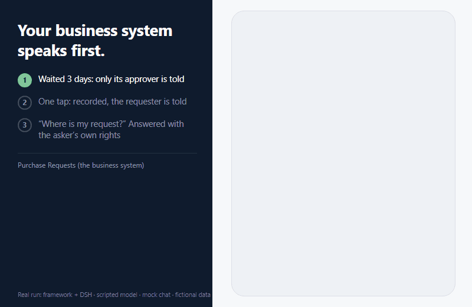

# purchase-requests — your business system speaks first



(日本語: [`speaks-first-ja.gif`](../../docs/images/speaks-first-ja.gif) · 中文: [`speaks-first-zh.gif`](../../docs/images/speaks-first-zh.gif) · MP4: `docs/images/speaks-first-<lang>.mp4`)

Nobody has to open a dashboard to find what is stuck. When a purchase request has waited 3 days, **the business system
itself** tells the approver it names — and only that approver — in their own chat, with **[Approve] [Reject]**. One tap is
recorded in the business system and the requester is told. Asked "Where is my request?", the AI answers **with the asker's own
rights**: the requester sees their request, another staff member is told it cannot be seen.

Like [`leave-requests`](../leave-requests), this is **one source file (`src/app.mjs`) and one manifest** on
[`@dsh-bridge/server-kit`](../../packages/server-kit), with **no database** (the kit's memory store), and it passes the Bridge v1
conformance suite: **52 / 52 checks, 0 skipped, 0 known gaps**.

| | |
|---|---|
| domain | staff request purchases (item, quantity, amount in yen); their approver decides on the web or with the card in their own chat |
| roles | `admin`, `manager` (label "Approver"), `staff` (staff see their own requests only) |
| who decides | the approver named for the requester (or every manager when none is named), or an administrator — **never the requester** (web and card use the same rule; tested) |
| domain events | `purchase.unanswered` — pending for 3 days (once per request), to the named approver(s) only; the approval opens in chat in the same transaction (`approval.requested`). `purchase.decided` — to the requester only (`purchase.approved` / `purchase.rejected` template) |
| approval subject | `purchase_request` with Approve / Reject (one decision closes every card) |
| AI read tools | `purchase_list_requests`, `purchase_get_request` (one request by number: another employee's is *not found* for staff), `purchase_list_unanswered` (approvers) |
| AI proposals | `purchase_quantity` (any role; staff for their own requests), `purchase_cancel` (approvers only) — a person accepts or rejects |
| languages | one instance, one language: `locale` `en` / `ja` / `zh` (`src/messages.mjs`) — the served manifest (`system.locale` en-US / ja-JP / zh-CN), the card wording and the replies. The chat frame around them (labels such as `[For your approval]` / 【承認のお願い】 / 【请审批】, the greeting, the reply-code hint, the signature) is the framework's, in the language of the served manifest: no template module, no translation |
| storage | memory: nothing to install, **nothing survives a restart** |
| data | fictional only |

## Run it

```sh
pnpm install                                                  # at the framework root
pnpm --filter @dsh-bridge/example-purchase-requests start     # http://127.0.0.1:19760 (PURCHASE_LOCALE=ja|zh for the other languages)
pnpm --filter @dsh-bridge/example-purchase-requests test      # the business rules, the three languages, the conformance suite (52 / 52)
```

It starts with five fictional employees (`admin`, `approver1`, `approver2`, `staff1` → approver1, `staff2` → approver2; password
`purchase-dev`, or `PURCHASE_SEED_PASSWORD`) and one request of `staff1` that has already waited 3 days:

```sh
curl -c jar -H 'content-type: application/json' -d '{"loginId":"approver1","password":"purchase-dev"}' http://127.0.0.1:19760/api/auth/login
curl -b jar -H 'content-type: application/json' -d '{}' http://127.0.0.1:19760/api/admin/unanswered-scan   # purchase.unanswered + approval.requested
curl -H 'x-service-token: purchase-dev-service-token-000000000' 'http://127.0.0.1:19760/bridge/v1/events?after=0'
```

## The demo: the three moments on the real framework path

`demo/run.mjs` runs this system with the framework profile (`profile/template` made into a product profile) and the framework
plugins on a **real DeepSeek Harness**, with the scripted model and the mock LINE of [`@dsh-bridge/testing`](../../packages/testing)
— the same harness as `pnpm demo`. Nothing is faked by hand: the people send LINE webhooks, DSH answers through the mock LINE API,
and every step is checked (PASS / FAIL):

1. a request has waited 3 days → `scanUnanswered` → bridge-events → bridge-notify and bridge-approvals → the named approver gets
   the notice and the card; the other approver, the requester and the other staff member get nothing;
2. the approver taps Approve (a LINE postback) → the business API records the decision (approved, by that approver, channel `im`)
   → the card is updated → `purchase.decided` → the requester is told;
3. the requester asks "Where is my request?" → the AI calls `purchase_list_requests` with **the requester's own delegation**;
   another staff member asks about the same request → `purchase_get_request` answers 404 for them → the AI says it cannot see it.

```sh
node examples/purchase-requests/demo/run.mjs --lang all --reuse-home   # 3 runs (en, ja, zh), about a minute each
node examples/purchase-requests/demo/build-view.mjs                   # demo-view/<lang>.html from demo-view/transcript.<lang>.json
PLAYWRIGHT_CORE=<an installed playwright-core> FFMPEG=<ffmpeg> node examples/purchase-requests/demo/record.mjs   # docs/images/speaks-first-*.gif / .mp4
```

`run.mjs` needs the DSH CLI (`DSH_BIN`, or the pinned local copy that `pnpm demo` installs into `.dsh-cli/`), an isolated home
(`.dsh-home-purchase-demo`, never `~/.dsh`) and free ports (`PURCHASE_DEMO_PORTS`, default `app=19761,dsh=3261,llm=3262,line=3263,gateway=3264`).
It writes the transcript of each run to `demo-view/transcript.<lang>.json` (what people did and what they received, without ids,
tokens, hosts or reply codes). `build-view.mjs` lays it out as a messenger page and paces it to about 15 seconds; an approval
card is shortened to its title, fields, first line and buttons. Nothing is translated: every label, greeting, button, signature
and answer is shown as it was sent (the framework frames each message in the language of the instance's manifest).
`record.mjs` renders the page frame by frame with Playwright and encodes it with ffmpeg (nothing is downloaded).

## What is in `src/app.mjs`

The same shape as leave-requests — data and login, the hooks, the web API, business change + event in one transaction — plus:

- **`approversOf` / `mayDecide`**: the approver named for the requester (`approverId`, set by the administrator), else every
  manager; an administrator may decide too; the requester never. The card (`hooks.approvals.approvers` / `mayDecide`) and the web
  (`POST /api/approvals/:id/decision`) use the same rule.
- **`scanUnanswered`**: the moment the system speaks first — `purchase.unanswered` and `approval.requested` in one transaction,
  once per request (a real system runs it from its scheduler).
- **`recipientsFor`**: `purchase.unanswered` → the named approver(s); `purchase.decided` → the requester, with the approved or
  rejected template. Parameters are numbers only (`requestNumber`, `daysWaiting`), never names.
- **`GET /api/purchase-requests/:requestNo`**: staff read their own requests; another employee's request is `404` (its existence
  is not disclosed) — which is what the AI tells the other staff member in the demo.

To use it as the start of your own system, copy the folder the way [leave-requests](../leave-requests#use-it-as-the-start-of-your-own-system)
describes (`demo/` uses the framework's test harness and stays in this repository).
